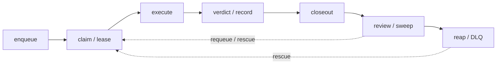

# Lifecycle × Concern Grid (NAF-style subjects × aspects)

- **Date:** 2026-10-23 (clock-first: `date` run before filename composition)
- **Status:** LIVE v1 — every cell cites its owning package and the gate/test
  or named mechanism that pins it. An unciteable cell is marked `— GAP` and
  harvested into `TODO_LIST.md` the same day; silence is never an option
  (an empty cell you forgot is the grid's whole point).
- **Provenance:** NAF v4.1's grid = subjects of concern (rows) × aspects of
  concern (columns), tailored to stakeholder concerns (their v4.1 tailoring
  rule). Here the subject axis is tq's lifecycle; the aspect axis is the five
  concerns a durable agent-pool operator actually gets burned by.
- **Vocabulary:** [DOMAIN_LANGUAGE.md](../DOMAIN_LANGUAGE.md) terms are used
  verbatim (Claim, Lease, Parked vs refused, Verdict channel, Checkpoint,
  Autopsy, Mint, Fold lock, …). Package docs carry the per-package
  Consumer/Concern/Non-goals viewpoint; this grid is the cross-package view.

## Lifecycle strip

## Grid

| Lifecycle ↓ / Concern →                  | Correctness                                                                                                                                                                                                                                                            | Observability                                                                                                                                                                             | Recovery                                                                                                                                                                                                                                                                       | Security                                                                                                                                                                                                          | Cost                                                                                                                                                                                         |
| ---------------------------------------- | ---------------------------------------------------------------------------------------------------------------------------------------------------------------------------------------------------------------------------------------------------------------------- | ----------------------------------------------------------------------------------------------------------------------------------------------------------------------------------------- | ------------------------------------------------------------------------------------------------------------------------------------------------------------------------------------------------------------------------------------------------------------------------------ | ----------------------------------------------------------------------------------------------------------------------------------------------------------------------------------------------------------------- | -------------------------------------------------------------------------------------------------------------------------------------------------------------------------------------------- |
| **Enqueue** (harvest/API → dedup → fact) | `DedupKey` idempotent: re-enqueue returns the stored task; COMPLETED keys refused (`queue.ErrTaskDone`, internal/queue/queue.go:54); semantics pinned by the companion conform suites (internal/queue/companion/conform)                                               | `task.enqueued` fact with THIN snapshot `{project,type}` — `Caps.EnqueuedSnapshot=false` pinned at internal/queue/companion/conform/suite.go:120; replay via `tq facts` and the dashboard | Fact lands in the SAME transaction as state (facts-first, ADR-0001); a refused enqueue never entered the queue (DOMAIN_LANGUAGE: Parked vs refused)                                                                                                                            | `tq api` enqueue is token-mandatory + lockout-guarded (ADR-0008, SECURITY.md); error reports carry no header/cookie/body fields to populate (DOMAIN_LANGUAGE: Error report)                                       | Batched harvest `--batch-items`: one task per N adjacent items (`batch:` + sorted-key hash); Cap counts `task.enqueued` facts since local midnight (DOMAIN_LANGUAGE: Cap)                    |
| **Claim / lease**                        | Atomic claim; due = pending + `not_before` passed + deps completed (one NOT EXISTS, DOMAIN_LANGUAGE: Deps); lease TTL + expiry reclaim = at-least-once in one mechanism; exclusivity pinned by conform suites                                                          | `task.claimed` facts; retry trails via `tq show`; parked pool via `tq tasks --parked`                                                                                                     | Expired lease ⇒ reclaim; claim-wake `queue.Waker` (ADR-0020) re-claims in ms and resets the idle ladder (cap `IdlePollMax` 2s, internal/worker)                                                                                                                                | Opt-in per-project exclusivity across ALL processes (DOMAIN_LANGUAGE: Exclusivity); claim checks run CHEAP-FIRST budget → preflight → executor, so gated pools never spawn a refused process                      | Claim-time budget gate parks WITHOUT burn (class `budget`, outside the env-streak breaker); claim order = stored priority + aging (3d/pt, cap 10; ADR-0015 — stored value never mutates)     |
| **Execute**                              | Registry dispatch (`ErrUnknownType`); payload decoding via the shared seams, never hand-rolled (`decodePayload`, `recordRunOutcome`; STRICT via `check-mirror-clones.sh`); completion requires the verify gate exit 0 (DOMAIN_LANGUAGE: Verify gate)                   | Output tails excerpted AND redacted; `task.requeued` carries `RequeueEvidence` (DOMAIN_LANGUAGE: Retry trail)                                                                             | 429 → `executor.DetectRateLimit` (internal/executor/ratelimit.go:142) parks without burn + per-repo gate fast-refuses siblings; env requeues carry `requeue_class` — 3 consecutive burn + escalate (env-streak, never uncap); ETXTBSY exec sites ride `execWithTransientRetry` | Secrets redaction default ON on every output tail (internal/executor/redact.go; one shared table `TestSecretHitsAndRedactionCompileIdenticalTable`); agent model+effort ONLY in the repo `.crushrc` managed block | `payloadTimeout` bounds each run; task contexts survive pool shutdown, bounded only by `--task-timeout` (Store invariants); budget-cmd veto per tick (DOMAIN_LANGUAGE: Budget)               |
| **Verdict / record**                     | Verdict channel `$TQ_RESULT_FILE` (file > legacy stdout, last-wins); review/status/dlqfix findings are commit-anchored (verbatim `anchor` or REJECTED); derived outcome = ONE `Task-Queue-ID` footer as LAST trailer — misplacement is hook-rejected                   | Usage (cost/tokens/messages) via go-crush-data; shipped files via `git diff-tree`; result detail rendered from the `task.completed` fact (`tq show`, DOMAIN_LANGUAGE: Result detail)      | Closeout 429 arms `closeoutPending` resume (internal/executor/agent.go) instead of losing the report                                                                                                                                                                           | `tq audit --journal` reports SECRET EVIDENCE rows — redaction has its own audit path                                                                                                                              | Usage derived for ALL paid turns; no stdout self-report exists at all (2026-09-14 ruling, DOMAIN_LANGUAGE: Derived outcome)                                                                  |
| **Closeout**                             | `--task-closeout` resumes the EXACT session for its a)-g) report (`docs/status/tasks/<ts>_task-<id>.md`); reports indexed on creation (`check-status-index.sh`)                                                                                                        | `session.opened`/`session.closed` are observations, never task state (DOMAIN_LANGUAGE: Session bridge); the indexed reports are the paper trail                                           | Close scans `Crush-Session:` trailers and mints ONE review + ONE status task; closeoutPending resume covers the 429 case                                                                                                                                                       | — GAP: no dedicated audit that closeout/report prose stays inside the redaction posture (tails are redacted; report bodies are agent-authored) — harvested to TODO_LIST                                           | Session close mints a bounded task pair; no per-fact spend beyond the two mints                                                                                                              |
| **Review / sweep**                       | Verdict-gated sweepers (`--review-autofix`, `--status-every`, `--dlq-fix` autopsies — ONE per dead agent task, autopsies never autopsied); gate-artifact death WITH shipped-proof auto-dismisses (`executor.IsGateArtifactDeath`, internal/executor/verifygate.go:292) | `tq watermarks show` reports per-consumer lag; autopsy and sweep decisions are facts in the journal                                                                                       | Watermark checkpoint lands AFTER the batch's last accepted fact; a failed checkpoint gates forwarding (DOMAIN_LANGUAGE: Checkpoint); autopsy `fixed` verdict → rescue                                                                                                          | Incident reports mint ONE fix task riding the pool's autonomy gates (`incident.task-minted`, dedup `err:<fp>:<seq>`; DOMAIN_LANGUAGE: Mint)                                                                       | Sweepers share ONE durable watermark cursor (internal/watermark); the score cache re-derives priority without re-paying the AI (DOMAIN_LANGUAGE: Score cache)                                |
| **Reap / DLQ**                           | Exhausted attempts or permanent error → DLQ (DOMAIN_LANGUAGE: DLQ); dismiss = Dead→Cancelled with a recorded reason; dedup keys keep completed work from zombie re-dispatch                                                                                            | `tq dlq` + error class on the facts; pool detectors (worker-death, frozen-sweepers, budget-all-day) raise `alert.triggered` to PapDashboard, completions resolve                          | `tq dlq --rescue` re-queues with a fresh attempt budget; a regression re-mints at regression priority (DOMAIN_LANGUAGE: Regression)                                                                                                                                            | Autopsies read the failure evidence through the same redacted-tail path as every other reader                                                                                                                     | Poisoned-repo DLQ backoff is part of Pacing (DOMAIN_LANGUAGE); `Bridge.NotifyDeadPool` is the direct dead-pool path, best-effort delivery (internal/bridge/papdashboard/papdashboard.go:769) |

## Gaps harvested (2026-10-23)

- **closeout × security**: report/closeout bodies are agent-authored prose;
  only output TAILS pass redaction. No check pins that a)-g) reports can't
  leak secrets via quoted prompt/verify text. → TODO_LIST row.
- **reap/DLQ × cost**: the poisoned-repo backoff exists in Pacing but has no
  surfaced observability (pool-health shows skip streaks; the backoff state
  itself is implicit). → TODO_LIST row (observability-shaped, cheap).

Everything else above cites code or a named gate; cells with only prose
backing (AGENTS.md conventions) say so by naming the convention instead of a
test — treat those as cite-the-test-next-time candidates during any future
grid pass, not as silent gaps.

## Maintenance rule

New lifecycle stage or new concern ⇒ add the row/column the day you add the
feature, with citations, or mark `— GAP` + harvest. The grid is tailored
(v4.1 rule): these five concerns are the ones this operator pool pays for;
do not grow columns speculatively.
