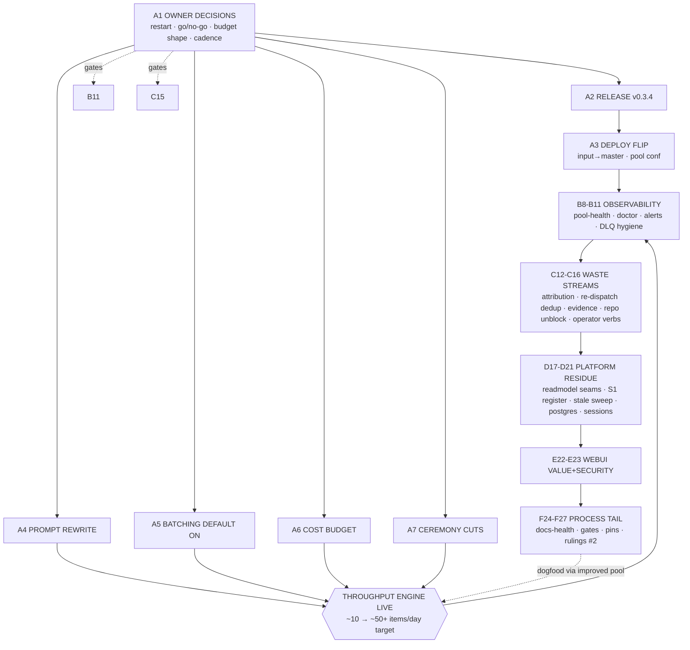

# SUPERB — Pareto Execution Plan: go-taskqueue (2026-10-11 02:41)

**Scope**: ALL open work in `TODO_LIST.md` (422 checkbox rows; ~380 open incl. ~40 BLOCKED
owner rulings) + `docs/problems/major-prompting-and-batching.md` (MAJOR) + the 2026-10-11
production-triage findings (readmodel outage fixed-in-master-not-deployed, budget starvation,
CV red gate, SystemNix churn, 326-dead DLQ).

**Customer** = Lars, the operator. **Value unit** = real backlog items landed per day at
acceptable spend, with NO silent outages. Measured today: the pool delivers ~10 real items/day
(budget 30/day burned ~50% on ceremony), while one interactive session outperforms its week.
That gap IS the Pareto target.

**Verschlimmbessern guard**: every task below is either a shipped-behavior verification, a
deletion of measured waste, or an owner-ruled change. No speculative rewrites. Where a TODO row
may be stale (claims predating shipped releases), the plan verifies-before-executing rather
than re-doing landed work (stale-row sweep = task D19).

---

## Step 1 — Pareto Breakdown

### The 1% that delivers 51%

**OWNER DECISIONS + SHIP.** Three acts, each minutes long, gate half the plan's value:

1. `sudo systemctl restart tq-serve` — heals the 3-day-dead readmodel projection (fix already
   quarantined + in master via `ConvergeProjectionHome`).
2. GO on the prompting/batching redesign (rows 27/348/349 — drafted, measured, blocked only on
   yes/no + budget shape).
3. Release v0.3.4 + SystemNix input flip → deployed pool gains EVERYTHING already merged
   (auto-upgrade, hygiene/redact/reresolve, env-streak breaker, schema convergence, closeout
   caps, re-dispatch dedup) — today production runs v0.3.3 and cannot exercise any of it
   (TODO row "Deploy cadence" states this verbatim).

### The 4% that delivers 64%

**THROUGHPUT ENGINE** (converts the queue from ~10 starved micro-tasks/day to real output):

- A4 prompt rewrite + A5 batching default + A6 cost-denominated budget + A7 ceremony cuts —
  together they remove the measured 52% derived-task overhead, the 10× prompt bloat, and the
  count-cap starvation ($0.07 spend parking all real work).

### The 20% that delivers 80%

Everything above PLUS:

- **Observability** (B8-B11): pool-health, doctor liveness, worker-death alerting — the outage
  was silent for 3 days; 213 status reports said nothing about it.
- **Waste-stream stops** (C12-C16): attribution/footer fixes (59% of footer commits invisible),
  re-dispatch dedup regression, verify-gate evidence quality, CV gate green, operator park verb.
- **Platform residue** (D17-D21): the red TestDoctorProjectionDLQ split-brain (row 38), stale-row
  sweep, postgres verification.

### The other 80% (to reach 100%)

The long tail: test pins, gate hardening, docs-health mechanization, webui polish, index/attribution
process work, ~40 owner rulings (F24-F27 + scattered BLOCKED rows). Real but low-leverage; much is
BLOCKED regardless. Strategy: batch the rulings (F27), mechanize the sweeps (F24), and let the
ALREADY-IMPROVED pool (post-A-track) chew the rest as section-batches — dogfooding the fix.

---

## Step 2 — Comprehensive Plan (30–100 min tasks, ≤27, sorted by impact/effort/value)

| ID  | Task (cluster of TODO rows)                                                                                                                                                                                         | Min | Impact | Effort | Value                       |
| --- | ------------------------------------------------------------------------------------------------------------------------------------------------------------------------------------------------------------------- | --- | ------ | ------ | --------------------------- |
| A1  | **Owner decision session #1**: serve restart; redesign go/no-go + budget shape; verify-gate gofmt one-liner (row 122); status cadence; release v0.3.4 approval                                                      | 30  | ★★★★★  | XS     | unlocks B-D tracks          |
| A2  | **Release v0.3.4**: CHANGELOG cut, VERSION-SURFACES walk, tag wave, proxy-poke verification, consumer-path proof                                                                                                    | 90  | ★★★★★  | M      | ships months of master      |
| A3  | **Deploy flip + pool conf refresh**: SystemNix input→master, GOEXPERIMENT env, --hygiene/--redact/--reresolve, budget per A1, malformed-TODO guard note                                                             | 60  | ★★★★★  | S      | production parity           |
| A4  | **Prompt rewrite** (row 348): 5-line outcome contracts across agent/review/status/dlqfix/prioritize; update prompt pins; before/after char counts                                                                   | 100 | ★★★★★  | M      | −10× prompt bloat           |
| A5  | **Batching default ON** (row 349): DefaultBatchItems=3, timeout interaction, budget=one-task semantics, batch pins                                                                                                  | 60  | ★★★★★  | S      | −52% ceremony               |
| A6  | **Cost-denominated budget** (O2, row 211): token/$ cap beside count cap, UsageToday fail-open settle, cap ADR                                                                                                       | 100 | ★★★★☆  | M      | ends $0.07 starvation       |
| A7  | **Ceremony cuts**: status per-session, review on risky types only, autopsy non-environmental only (rows 216/224-class)                                                                                              | 100 | ★★★★☆  | M      | −213-report class           |
| B8  | **`tq pool-health`** (rows 49/142): per-repo skip streaks + harvest activity from journal                                                                                                                           | 60  | ★★★★☆  | S      | liveness ≠ process-up       |
| B9  | **Doctor liveness pack** (rows 393/518 + 38): consumer-cursor staleness, projection-worker death, dedup-ticked check, DLQ path split-brain fix + un-red TestDoctorProjectionDLQ                                     | 90  | ★★★★☆  | M      | outages visible             |
| B10 | **Alert routing** (row 379-adjacent): worker-exhausted, budget-parked-all-day, sweepers-frozen → papdashboard bridge                                                                                                | 90  | ★★★★☆  | M      | no more silent 3-day deaths |
| B11 | **DLQ hygiene**: dismiss pre-breaker loop suspects, autopsy-yield audit (did ANY of 7/day produce fixes?), gofmt-vendor rewind runbook (row 379)                                                                    | 90  | ★★★☆☆  | M      | −noise, honest DLQ          |
| C12 | **Attribution end-to-end** (rows 187/188/305/416/455): footer-as-final-trailer fix, GitLogScanner %B fallback + e2e pin, gate-aware daemon note, heal-tool identity-SHA bug                                         | 100 | ★★★★☆  | L      | stops 59% invisible commits |
| C13 | **Re-dispatch dedup regression** (rows 654/607): stale-snapshot diagnosis, mint-time footer probe, fresh-completion short-circuit                                                                                   | 60  | ★★★★☆  | M      | stops no-op paid burns      |
| C14 | **Verify evidence quality** (rows 196/243/374): failing-stage output capture, bigger tails, --evidence-stage on dlq/show, audit verify-deaths counter                                                               | 90  | ★★★☆☆  | M      | deaths classifiable         |
| C15 | **Repo unblock**: CV gate green (data/ dir + dead-portal fixture), SystemNix two-writer policy applied (park instead of churn)                                                                                      | 90  | ★★★★☆  | M      | +2 workable repos           |
| C16 | **Operator affordances** (rows 389/390/475): `tq park --until`, bare-worker agent-claim refusal, forensics filters (--task-id/--dedup/--requeues)                                                                   | 90  | ★★★☆☆  | M      | operator ≠ archaeologist    |
| D17 | **Readmodel seams close-out** (rows 34/37/41): stats/doctor single-opener routing, TQ_SQLITE_SYNC honor verify, pragma-union equality pin                                                                           | 90  | ★★★☆☆  | M      | kills pragma drift class    |
| D18 | **S1 divergence register** (row 375): one doc, D2 thin-detail links, AGENTS/docs heal (row 338); M4 memo after owner go (row 32)                                                                                    | 60  | ★★★☆☆  | S      | platform honesty            |
| D19 | **Stale-row sweep** (rows 300/517-class): re-verify release-conditional + possibly-shipped claims (durable cursor, parallel lint, demand-fill…), tick with citations                                                | 90  | ★★★☆☆  | M      | honest inventory            |
| D20 | **Postgres lane** (rows 25/340): CLI --store wiring, drift-audit EXECUTED on live pg, verify-pins smoke                                                                                                             | 60  | ★★★☆☆  | M      | second backend real         |
| D21 | **Session surface** (rows 213/477): sweep automation + hook wiring (owner), --dry-run/--json polish, stale-session doctor                                                                                           | 90  | ★★☆☆☆  | M      | session hygiene             |
| E22 | **Webui value bundle** (rows 474/322/324/479): live budget meter, parked badge, LogPath render-pin + fragment collapse, dlqfix surface                                                                              | 100 | ★★★☆☆  | M      | dashboard tells truth       |
| E23 | **Webui health/security** (rows 223/361/219): /health rows, SSE header e2e, smoke asserts (Permissions-Policy/badge/unknown-project), CSP form-action relax                                                         | 90  | ★★☆☆☆  | M      | security posture pinned     |
| F24 | **Docs-health mechanization** (rows 384/419/533/650): check-archive-eligibility gate, per-item strike pass, index digest rows, warn-once ledger                                                                     | 100 | ★★☆☆☆  | M      | index ≤ threshold           |
| F25 | **Gate hardening bundle** (rows 481/490/530/598/611-613): dead-sha self-tests, dependabot coverage guard, ci.yml parity, guard-wiring existence, check-release-docs nullglob+code-mutation                          | 100 | ★★☆☆☆  | M      | gates can't rot silently    |
| F26 | **Test-pin bundle** (rows 158-161/360/437/443): secretPatterns table pin, auth-plane body pin, lockout fake-clock suite, SSE header pin, SECURITY matrix pin                                                        | 90  | ★★☆☆☆  | M      | regression armor            |
| F27 | **Owner rulings session #2** (≈40 BLOCKED rows: 23/24/80/85/106/144/157/173/179/182/278-280/298/404/423/424/430-431/441/446/465/470/485/537-539/586-588/602-604/614-616/645-646…): one sheet, one pass, 2-min calls | 60  | ★★★☆☆  | S      | unblocks the tail           |

**Sorting rationale**: A-track first (owner acts + ship + throughput engine — nothing else
matters if production runs stale and starved), then B (see the system), C (stop the waste),
D (platform honesty), E (polish), F (process tail). Effort is dominated by test-pin surface,
not code volume.

---

## Step 3 — Fine Breakdown (≤12 min per task, ALL clusters covered)

Tier A — 1%/4% engine (every task ≤12 min):

| ID   | Fine task                                                                            | Min | Cluster |
| ---- | ------------------------------------------------------------------------------------ | --- | ------- |
| A1.1 | Restart tq-serve; journal grep: no "exhausted restart budget"; stats == store-direct | 5   | A1      |
| A1.2 | Owner: redesign go/no-go + scope + budget shape → record in rulings sheet            | 10  | A1      |
| A1.3 | Owner: `.tq-verify` gofmt one-liner + bootstrap template (row 122)                   | 5   | A1      |
| A1.4 | Owner: status cadence ruling (per-session vs per-day)                                | 5   | A1      |
| A2.1 | CHANGELOG [Unreleased]→v0.3.4 cut + entries audit (rows 344/469/494)                 | 12  | A2      |
| A2.2 | Version bump walk per VERSION-SURFACES (root + facades + cmd/tq floor)               | 12  | A2      |
| A2.3 | Tag wave: annotated tags, push, proxy .info pokes (demand-fill attempt 1)            | 12  | A2      |
| A2.4 | Consumer-path proof: scratch module `go get` facade tags + build                     | 10  | A2      |
| A2.5 | Release-gates run + rc receipts to file                                              | 10  | A2      |
| A3.1 | SystemNix input flip → `github:LarsArtmann/go-taskqueue?ref=master`                  | 5   | A3      |
| A3.2 | Pool conf refresh: GOEXPERIMENT env, hygiene/redact/reresolve flags                  | 10  | A3      |
| A3.3 | Budget conf per A1 ruling (cap value / budget-cmd)                                   | 5   | A3      |
| A3.4 | Post-deploy smoke: doctor --hygiene, pool-health, alert ping                         | 12  | A3      |
| A4.1 | Audit prompt constants; list every distrust clause vs AGENTS.md dupes                | 12  | A4      |
| A4.2 | Rewrite work-prompt template to outcome contract; keep footer+verify+safety lines    | 12  | A4      |
| A4.3 | Rewrite review/status/dlqfix/prioritize prompt constants                             | 12  | A4      |
| A4.4 | Update prompt-content pins (TestAgentPromptsDropSelfReport family, harvest guards)   | 12  | A4      |
| A4.5 | Record before/after char counts in report + problems-doc update                      | 6   | A4      |
| A5.1 | DefaultBatchItems 1→3 + flag help + AGENTS line                                      | 10  | A5      |
| A5.2 | TimeoutMinutes scale note + task-timeout interaction docs                            | 8   | A5      |
| A5.3 | batch_test guardrail pin updates                                                     | 10  | A5      |
| A5.4 | FEATURES/CHANGELOG entries for default flip                                          | 8   | A5      |
| A6.1 | budget: token/$ cap fields + config plumbing                                         | 12  | A6      |
| A6.2 | Claim-time gate: cost-cap branch beside count cap (park class budget)                | 12  | A6      |
| A6.3 | UsageToday fail-open settle + test                                                   | 10  | A6      |
| A6.4 | Cap ADR (docs/adr) + AGENTS Known-Issue line                                         | 10  | A6      |
| A7.1 | status executor: per-session/per-day cadence per A1.4 ruling                         | 12  | A7      |
| A7.2 | review executor: risky-type gate (code-bearing diffs only)                           | 12  | A7      |
| A7.3 | dlqfix: refuse autopsy for environment-class deaths (log skip reason)                | 10  | A7      |
| A7.4 | Pins: ceremony-cut behavior tests + CHANGELOG                                        | 12  | A7      |

Tier B — observability:

| ID    | Fine task                                                                 | Min | Cluster |
| ----- | ------------------------------------------------------------------------- | --- | ------- |
| B8.1  | pool-health: skip-streak query over facts                                 | 12  | B8      |
| B8.2  | pool-health: last-harvest-activity per repo + render                      | 10  | B8      |
| B9.1  | doctor: consumer-cursor staleness check (names consumers)                 | 12  | B9      |
| B9.2  | Fix DLQ path split-brain (row 38): one derivation, un-paper test          | 12  | B9      |
| B9.3  | doctor: projection-worker-death surface (restart-budget exhausted = WARN) | 10  | B9      |
| B9.4  | doctor: dedup-key-already-ticked check                                    | 10  | B9      |
| B9.5  | cmd/tq gate: TestDoctorProjectionDLQ green + module gate rc               | 10  | B9      |
| B10.1 | Bridge: worker-exhausted → alert.triggered                                | 10  | B10     |
| B10.2 | Bridge: budget-parked-all-day + sweepers-frozen classes                   | 12  | B10     |
| B10.3 | Alert e2e smoke (scratch journal) + AGENTS note                           | 10  | B10     |
| B11.1 | Dismiss pre-breaker loop suspects (477/476/169-claim class) with reasons  | 8   | B11     |
| B11.2 | Autopsy-yield audit query: fixes vs wontfix vs futile-env                 | 10  | B11     |
| B11.3 | gofmt-vendor rewind runbook exec-or-lapse (row 379, owner)                | 10  | B11     |

Tier C — waste streams:

| ID    | Fine task                                                                      | Min | Cluster |
| ----- | ------------------------------------------------------------------------------ | --- | ------- |
| C12.1 | Dispatch/closeout template: footer as FINAL line ruling apply (row 278)        | 10  | C12     |
| C12.2 | GitLogScanner %B fallback + keep quoted-footer guarantee                       | 12  | C12     |
| C12.3 | E2E trailer-visibility pin (harness-shaped commit fixture)                     | 12  | C12     |
| C12.4 | heal-daemon-sweep: identity-SHA root-cause + self-test red→green (rows 69/455) | 12  | C12     |
| C12.5 | Historical derivation-blind census (rows 354/355)                              | 12  | C12     |
| C13.1 | Repro: stale TODO snapshot mint (fixture test)                                 | 12  | C13     |
| C13.2 | Fix: fresh COMPLETED short-circuit at mint + footer grep probe                 | 12  | C13     |
| C13.3 | Regression pin: re-dispatch after tick = refused/no-op                         | 10  | C13     |
| C14.1 | Verify runner: capture failing-stage output into failure log (row 196)         | 12  | C14     |
| C14.2 | Enlarge FailureEvidence tail; include FAIL + cause lines                       | 8   | C14     |
| C14.3 | `tq dlq --evidence-stage` + `tq show` render (row 374)                         | 12  | C14     |
| C14.4 | audit --journal: verify-deaths-by-stage + requeues drill-down (rows 630/409)   | 12  | C14     |
| C15.1 | CV: data/ dir creation in verify path + dead-portal test fixture               | 12  | C15     |
| C15.2 | CV: dispatch one canary task, confirm gate green at base                       | 10  | C15     |
| C15.3 | SystemNix: apply park policy while owner sessions active (uses C16.1)          | 10  | C15     |
| C16.1 | `tq park TASK_ID --until DUR` (row 389)                                        | 12  | C16     |
| C16.2 | Bare-worker agent-claim refusal (row 390) + test                               | 10  | C16     |
| C16.3 | Forensics filters: audit --task-id, tasks --dedup (row 475)                    | 12  | C16     |
| C16.4 | ClaimCount GROUP BY pushdown (row 391)                                         | 12  | C16     |

Tier D — platform:

| ID    | Fine task                                                                           | Min | Cluster |
| ----- | ----------------------------------------------------------------------------------- | --- | ------- |
| D17.1 | Verify TQ_SQLITE_SYNC resolves in self-open (row 37); fix or document               | 10  | D17     |
| D17.2 | stats/doctor → single-opener seam or documented exception (row 34)                  | 12  | D17     |
| D17.3 | Pragma-union equality pin (row 41)                                                  | 10  | D17     |
| D17.4 | single_opener.md status → LANDED (row 40)                                           | 4   | D17     |
| D18.1 | S1 divergence register doc (D1/D2/token/heartbeat) + ADR links                      | 12  | D18     |
| D18.2 | Heal stale enqueue-snapshot docs (row 338) + conform cross-links (row 339)          | 10  | D18     |
| D18.3 | M4 ratification memo file (after owner go)                                          | 10  | D18     |
| D19.1 | Sweep release-conditional rows; re-verify vs tags/proxy (row 300)                   | 12  | D19     |
| D19.2 | Verify suspect-stale rows (durable cursor row 517, lint row 89-class); tick or keep | 12  | D19     |
| D19.3 | check-todo-list: /tmp-cite aging flag (row 596)                                     | 8   | D19     |
| D20.1 | --store postgres CLI wiring on worker/serve/agent-pool                              | 12  | D20     |
| D20.2 | Postgres drift-audit executed + runner evidence (row 340)                           | 12  | D20     |
| D20.3 | Live pg instance verification (owner) + FEATURES flip                               | 8   | D20     |
| D21.1 | session sweep wiring: pool tick or timer (owner) + registry bound                   | 10  | D21     |
| D21.2 | Session polish: --dry-run, --json/--all, doctor stale-session (row 477 slice)       | 12  | D21     |
| D21.3 | CloseoutPending lifetime audit (row 139) + fix if leaking                           | 10  | D21     |

Tier E — webui:

| ID    | Fine task                                                            | Min | Cluster |
| ----- | -------------------------------------------------------------------- | --- | ------- |
| E22.1 | serve --daily-budget flag + meter aria (row 474)                     | 12  | E22     |
| E22.2 | LogPath render-pin test over 4 cards (row 322)                       | 12  | E22     |
| E22.3 | Collapse 4 identical fullOutputLine fragments (row 323)              | 10  | E22     |
| E22.4 | dlqfix result-card surface (row 324)                                 | 12  | E22     |
| E22.5 | Parked badge + questions surface slice (rows 215/142-class)          | 12  | E22     |
| E23.1 | /health into token gate + SECURITY row (row 223 slice)               | 10  | E23     |
| E23.2 | SSE header e2e + auth-plane body pin (rows 361/443)                  | 12  | E23     |
| E23.3 | Smoke asserts: Permissions-Policy, badge, /project/unknown (row 219) | 12  | E23     |
| E23.4 | CSP form-action relax + SECURITY + header pins (row 128)             | 8   | E23     |

Tier F — process tail (grouped; every open BLOCKED/pin row routes here):

| ID    | Fine task                                                                    | Min | Cluster |
| ----- | ---------------------------------------------------------------------------- | --- | ------- |
| F24.1 | check-archive-eligibility.sh build + wire (rows 220/419)                     | 12  | F24     |
| F24.2 | Per-item strike pass: 3 oldest KEEP-OPEN buckets (row 384)                   | 12  | F24     |
| F24.3 | Index digest rows + warn-once ledger (rows 533/650)                          | 12  | F24     |
| F24.4 | 10 unindexed closeout reports backfill (row 605)                             | 10  | F24     |
| F25.1 | dead-sha: 6 self-test cases + baseline-validation mode (row 481)             | 12  | F25     |
| F25.2 | check-dependabot-coverage.sh + new-module emit (rows 530/531)                | 12  | F25     |
| F25.3 | ci.yml parity sweep decision-record (row 209) + loop guards (row 490)        | 12  | F25     |
| F25.4 | Guard-wiring existence assert + root-gate syntax self-test (rows 598/590)    | 10  | F25     |
| F25.5 | check-release-docs: nullglob + code-mutation self-test (rows 611/613)        | 12  | F25     |
| F26.1 | secretPatterns overlap-table pin + property test (rows 158/159)              | 12  | F26     |
| F26.2 | Lockout fake-clock suite (row 437)                                           | 12  | F26     |
| F26.3 | SECURITY header-matrix pin + header→want table (rows 359/559)                | 12  | F26     |
| F26.4 | api auth-plane JSON pin + package-doc line (rows 443/444)                    | 8   | F26     |
| F26.5 | Redact output-mask pin + structural redaction guard (rows 160/161)           | 10  | F26     |
| F27.1 | Compile rulings sheet from ~40 BLOCKED rows (grouped 2-min calls)            | 12  | F27     |
| F27.2 | Owner session: sheet pass, verdicts recorded                                 | 12  | F27     |
| F27.3 | Route verdicts: unblock rows / close / ROADMAP; re-sort this plan's tail     | 10  | F27     |
| F27.4 | Harvest-verify: this plan's NEW tasks → TODO_LIST (docs-health HARVEST rule) | 10  | F27     |

Fine-task total: **97 tasks ≈ 16.5 h of execution** (medium plan 27 tasks ≈ 34.6 task-hours
overlap the fine layer 1:many).

---

## Execution graph (mermaid)

**Critical path**: A1 → A2 → A3 → (A4..A7 ∥) → live throughput → everything else shrinks.
**Feedback loop**: post-A-track, the pool itself executes F/E tiers as section-batches —
the plan fixes the tool that then executes the plan's tail.

## Source row coverage (ALL TODOs accounted)

- Owner-blocked decisions section → A1, F27, individual rows named in F27.1
- ADR-0019/platform rows 31-44 → D17, D18, D19 (+ shipped rows verified there)
- Release/publish rows 48-68, 297-301, 593-616 → A2, F25
- Dogfood/window/verify rows (73-266) → C12-C14, F25, F26 (+ D19 stale-verify)
- Agent-autonomy rows 348-349 → A4, A5 (the directive already on file)
- Queue-health rows 387-393 → B9, C13, C16
- Security rows 357-364, 433-447 → E23, F26
- Paperclip/turnstone rows 451, 620-624 → B10 (wake-trace owner-gated), F26.5-class, C12.5
- Docs-health rows 371-385, 472-494, 626-646 → F24, D19
- Webui rows 128, 216-227, 307-334, 474-493 → E22, E23
- 2026-10-11 windows rows 648-658 → C13, F24.3, F24.4
- MAJOR problems doc → A4-A7 (the redesign, owner-gated)

Post-plan rule (skill): new tasks minted by execution → TODO_LIST; this file is the snapshot.
