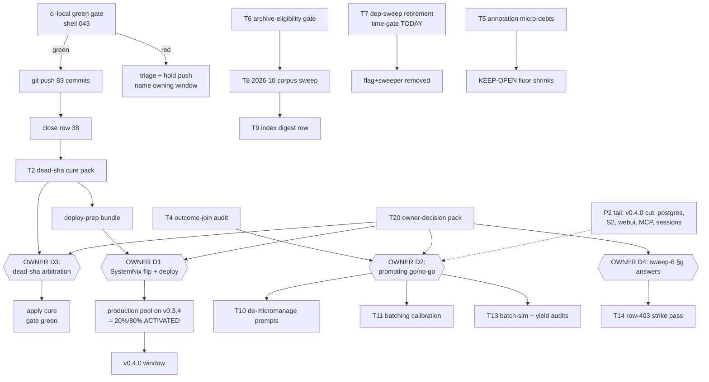

# SUPERB PARETO ACTIVATION PLAN — 2026-10-13 12:10

> Answer to the owner directive (2026-10-13): Pareto-decompose the FULL
> open-work universe (439 open TODO rows, 107 BLOCKED; sweep-6 §f residue;
> the executed-but-followed-up prompting/batching major problem; 83
> unpushed master commits; a production pool 3 releases stale; a red
> dead-sha gate), produce a two-level execution plan (30–100 min tasks →
> ≤12 min micro-tasks), and gate a push on a green ci-local.
>
> **Verschlimmbesserung guard:** this plan is a planning doc ONLY. It does
> not rewrite TODO_LIST.md (machine-consumed — mass checkbox edits would
> mint pool tasks), does not renumber rows, and does not touch living docs
> outside its explicit tasks. Every task cites its row; execution windows
> own the TODO edits.

## Where the value actually is (the Pareto ladder)

**Customer** = the owner as pool operator (agent-hours, spend control,
failure avoidance) + external facade consumers.

### The 20% that deliver 80%
1. **ACTIVATE production.** The deployed pool (SystemNix, v0.3.0-era
   binary) lacks everything shipped since: batch-default-3 (the executed
   remedy to the MAJOR prompting problem), owner-session-park, the
   claim-time done-preflight (kills no-op re-dispatch burn), B10 liveness
   alerts, token-budget projection, `tq park`, `tq pool-health`. Six weeks
   of shipped work with zero production value until ONE owner action
   (input flip + `nix run .#deploy`).
2. **UN-RED + PUSH master.** 83 commits ahead of origin; origin's last CI
   run validated a damaged pre-heal tree (row 38). The dead-sha gate
   (289 dangling citations) keeps the pre-push gate red for EVERY window
   (rows 691/714). Fix both and every future window stops paying the tax.
3. **DEMAND-SIDE of the agent loop.** The prompting redesign shipped; its
   auditable remainder (outcome-join, batch-simulation replay, classifier
   spot-check, section/day-level goal batching, rows 367/368 autonomy
   cuts) reduces paid tokens and ceremony on EVERY future dispatch.
4. **QUEUE INTEGRITY.** The pool executes what TODO_LIST says —
   mechanical archive bar (rows 239/438), row-403 strike-bar decision,
   the 2026-10 corpus sweep, index digest (293 > 100 rows).

### The 4% that deliver 64%
- The **dead-sha cure pack** (row 691's own recipe: baseline addendum +
  fork-record pair table + failure-summary header) — agent-executable now.
- The **deploy-prep bundle** (row 162) — turn the owner's flip into one
  command + checklist.
- The **push + green gate** (this session, owner-ordered).
- The **outcome-join audit** (one script, journal × prompt-class).

### The 1% that deliver 51%
- `git push` (this session) — 83 commits reach CI/consumers; closes row 38.
- The owner's SystemNix flip on evo-x2 — activates item 1 above.
- One owner go/no-go covering the prompting follow-ups + autonomy rows
  (unblocks rows 367/368/40-tail/45/46/714).

### The other 20% (to 100%)
v0.4.0 cut (the [Unreleased] section is fat), postgres CLI wiring
(owner-gated), S2/M4 platform arcs, webui P2 polish, MCP/channels
research, session-close polish, the KEEP-OPEN micro-floor, ROADMAP raw
ideas. None gates the ladder above; all are needed for completeness.

## Table A — comprehensive task plan (30–100 min each, ALL TODO areas covered)

Sorted by importance → impact → effort → customer value. P0 = now,
P1 = next, P2 = the other 20%, D = owner decision node (agents prepare,
never execute). Row refs = TODO_LIST.md rows / report items.

| # | Pri | Task (30–100 min) | Covers (rows/sources) | Impact | Effort | Value |
|---|-----|-------------------|------------------------|--------|--------|-------|
| T1 | P0 | Push wave: confirm ci-local green (running, shell 043), push 83 commits, watch the origin CI run, close row 38 with DONE note | row 38; O1 push policy | Critical (all work reaches users/CI) | 60–100 | 10 |
| T2 | P0 | Dead-sha cure pack: build the decision pack per row 691 (emit-baseline addendum into a scratch doc, fork-record old→new pair table from healed heirs, gate failure-summary header); apply on the row-714 ruling | rows 691/714; sweep-6 §f2 | Critical (pre-push gate red for everyone) | 90 | 10 |
| T3 | P0 | Deploy-prep bundle: per-flag smoke list (hygiene/reresolve/redact/owner-session-park/batch-3), SystemNix module diff summary, one-command flip checklist → hand to owner | rows 162/164/21/109 | Critical (activates 6 weeks of work) | 60 | 10 |
| T4 | P0 | Outcome-join audit: script joining pool task outcomes × prompt class (pre/post v0.3.4 templates) over tq.db + crush.db; one-page verdict | 02-23 §f8; problems doc follow-ups | High (validates the redesign with data) | 90 | 8 |
| T5 | P0 | Annotation micro-debts: strike 12-23 §f10 (#3857/#3982 pointer); 04-11 closeout's 2 new rows verify-fold if landed | sweep-6 §f1; 04-11 §f | Medium (closes KEEP-OPEN files' last straws) | 30 | 6 |
| T6 | P0 | `check-archive-eligibility.sh` mechanical archive bar + ci-local wiring (rows 239/438 — 7th manual sweep was this week) | rows 239/438 | High (converges future sweeps) | 90 | 8 |
| T7 | P0 | Dep-sweep retirement check: Dependabot week-1 gate is TODAY (earliest 2026-10-13) — verify coverage, then retire flag+sweeper+docs per row 39 | row 39 (O15 time gate) | Medium-High (kills a sweeper + flag surface) | 45 | 7 |
| T8 | P1 | 2026-10 corpus docs-health sweep (9-bucket fan-out, ~150 files, archive + harvest per sweep-6 pattern) | row 155/552; sweep-5 §f1 | High (index 293→~<150; backlog truth) | 100 | 8 |
| T9 | P1 | Index digest row `\| digest 2026-10 \| …` + live-count note (first-ever digest per README format) | row 552 | Medium (scannability) | 45 | 6 |
| T10 | P1 | De-micromanage prompt stack execution (audit all prompt constants → outcome contracts; update pins; record char counts) | row 367; problems doc | High (every dispatch pays the tax) | 100 | 9 |
| T11 | P1 | Batching default calibration: measure batch-of-3 vs singles from derived usage (02-23 method), then raise/hold with evidence; spell task-timeout interaction | row 368; O7 | High (ceremony → work ratio) | 100 | 9 |
| T12 | P1 | Classifier spot-check (20 sampled "freeform" messages hand-verified; correct the 9% owner-share claim) | 02-23 §f9 | Medium (measurement honesty) | 30 | 5 |
| T13 | P1 | Batch-simulation replay + status/review yield audits (the remaining problems-doc follow-ups) | 02-23 §f10-11 | Medium-High | 100 | 7 |
| T14 | P1 | Row-403 completion (owner-gated shape): bulk resolved-item strike pass over the 91 KEEP-OPEN files via the sweep-6 driver pattern (persisted) | row 403; sweep-6 §g1 | Medium (annotation-only value) | 100×3 | 5 |
| T15 | P1 | Warning-fatigue remedy: check-status-index suppressed-classes ledger + --brief mode | row 671 | Medium (signal vs noise in every gate run) | 60 | 6 |
| T16 | P1 | `scripts/run-gate.sh` rc-capture wrapper + scoped-rerun protocol | row 654 | Medium (battery discipline) | 45 | 6 |
| T17 | P1 | Sweep-6 harvest row execution batch 1: gosec self-test micro set + sibling-gate summary pins | sweep-6 harvest rows 1-2 | Medium | 100 | 6 |
| T18 | P1 | Sweep-6 harvest row execution batch 2: session-close smoke micros + swap-guard verification debt | sweep-6 harvest rows 3-4 | Medium-High (unverified shipped code) | 100×2 | 7 |
| T19 | P1 | v0.4.0 cut-planning walk: VERSION-SURFACES bump order, pre-cut sub-tags, [Unreleased] triage | row 363 | Medium (release hygiene) | 60 | 6 |
| T20 | P1 | Owner-decision pack: ONE ranked doc of every BLOCKED ruling (rows 40/45/46/56/131/132/199/230/231/232/239-gate-flips/460s/484/489/556/589-600 tail/643/663/666/695-714…) with one-line stakes each | all 107 BLOCKED rows | High (unblocks P1/P2 en masse) | 60 | 8 |
| T21 | P2 | Postgres CLI store wiring (`--store postgres://…`) post-ruling | rows 36/57 tail | Medium (consumer demand-gated) | 100×2 | 5 |
| T22 | P2 | ADR-0019 S2 journal unification on upstream facts.Fact | row 44 | Medium | 100×3 | 5 |
| T23 | P2 | Webui P2 batch (a11y audit, SSE tick measurement, cancel/rescue feedback, sticky-header, dark-mode QA) | rows 246/493 | Medium | 100×3 | 5 |
| T24 | P2 | Non-md 2026-0* artifact classify-or-archive pass (13 files) | sweep-6 §c2 | Low-Medium | 45 | 4 |
| T25 | P2 | MCP/Claude-Channels research → tq channel-meta schema draft | row 397; 23-37 | Medium (strategic) | 100×2 | 5 |
| T26 | P2 | Session-close polish bundle (dry-run/--json/stale-doctor/postgres arm…) | row 496 | Medium | 100×2 | 5 |
| T27 | P2 | Doctor backlog triage (05-38 tail keep/drop) + crush checks tail | sweep-6 harvest row 6; rows 655/656 | Medium | 100 | 5 |
| T28 | P2 | KEEP-OPEN retire passes (per-file as items close; driver-assisted) | 91 files; row 403 | Low-Medium (long game) | ongoing | 4 |
| T29 | P2 | ROADMAP raw-ideas intake review (payload-file, env-file, Discord bridge → TODO or park) | ROADMAP §Raw ideas | Low | 30 | 3 |
| D1 | D | **Owner: SystemNix input flip + `nix run .#deploy` on evo-x2** (uses T3's checklist) | rows 21/109/117/164 | THE 1%→51% action | owner | 10 |
| D2 | D | **Owner: prompting follow-ups go/no-go** (T10/T11/T13 scope + budget shape under batches) | row 40; §g answers | Unblocks 4 tasks | owner | 9 |
| D3 | D | **Owner: dead-sha arbitration** (fork-records vs baseline addendum vs both; living-docs scope) | row 714 | Unblocks T2 apply-half | owner | 9 |
| D4 | D | **Owner: sweep-6 §g answers** (KEEP-OPEN strike bar; micro-routing appetite; interactive attribution shape) | sweep-6 §g | Unblocks T14 + future sweeps | owner | 7 |

## Table B — micro-task breakdown (≤12 min each)

Sorted same as Table A (task prefix = parent). Every P0/P1 task is fully
decomposed; P2 items decompose on pickup (their shape depends on rulings).

| # | Micro-task (≤12 min) | Parent | Est |
|---|----------------------|--------|-----|
| M1 | Read ci-local log tail; classify rc (green / transient-retry / real red) | T1 | 5 |
| M2 | If transient: one 45s retry per wrapper; if real red: name the failing gate + owning window, hold push | T1 | 10 |
| M3 | `git push origin master`; capture rc | T1 | 2 |
| M4 | Watch the origin run (`scripts/check-ci.sh`) to verdict; record run id | T1 | 12 |
| M5 | Tick row 38 DONE w/ run id; delete per done-ruling; note in CHANGELOG if operator-visible | T1 | 8 |
| M6 | Run `check-dead-sha-refs.sh` to a file; count new-vs-baselined | T2 | 8 |
| M7 | `--emit-baseline` into a SCRATCH doc (never touch curated baseline) | T2 | 10 |
| M8 | For 10 worst-cited SHAs: `git log --all` heir lookup → old→new fork-record rows | T2 | 12 |
| M9 | Generate the remaining fork-record pairs via the map from M8's pattern (scripted) | T2 | 12 |
| M10 | Add the gate failure-summary header (N new + oldest date + baseline staleness) to check-dead-sha-refs output | T2 | 12 |
| M11 | Assemble the arbitration table (fork-records vs addendum vs both) for D3 | T2 | 10 |
| M12 | List deployed-vs-shipped flag deltas from CHANGELOG v0.3.1..v0.3.4 | T3 | 10 |
| M13 | Per-flag smoke mapping (which scripts/smoke proves which flag) | T3 | 10 |
| M14 | SystemNix module diff summary (house module vs current poolSettings) | T3 | 12 |
| M15 | Write the one-command flip checklist (owner-facing, 10 lines) | T3 | 10 |
| M16 | Post-checklist to D1's owner channel + TODO row 21 note | T3 | 5 |
| M17 | Extract task outcomes by prompt template-hash window from tq.db (read-only) | T4 | 12 |
| M18 | Classify completions pre/post v0.3.4 template flip; compute fail/dead/park rates | T4 | 12 |
| M19 | Join usage (tokens/cost) per class; write the one-page verdict | T4 | 12 |
| M20 | Strike 12-23 §f10 with the #3857/#3982 close-out pointer | T5 | 6 |
| M21 | Verify 04-11 closeout's 2 new rows (WorktreeInUse injection, terminal-status audit) vs tree; fold | T5 | 10 |
| M22 | check-archive-eligibility.sh skeleton: candidate scan (docs/status maxdepth 1) + bare-item counter | T6 | 12 |
| M23 | Verdict grammar (struck/routed-arrow/bare) + refuse-git-mv exit path | T6 | 12 |
| M24 | `--self-test` fixture (struck file passes, bare-item file refuses) | T6 | 12 |
| M25 | ci-local wiring next to check-status-index; gate green run | T6 | 10 |
| M26 | Dependabot week-1 evidence: merged PR count since 2026-10-06 config | T7 | 8 |
| M27 | If gate passed: remove --dep-sweep flag+sweeper+depsweep rows; CHANGELOG Removed entry | T7 | 12 |
| M28 | Sweep doc-refs + FEATURES mentions of dep-sweep post-removal | T7 | 10 |
| M29 | Sweep-6 driver resurrection from this report's method (spec gen + shape rules) → scripts/ or skill asset | T8/T14 | 12 |
| M30 | Bucket the 2026-10 corpus by date; launch fan-outs (9 agents) | T8 | 12 |
| M31 | Orchestrator verify + strikes + archives per sweep-6 pattern | T8 | 12×n |
| M32 | Mint harvest section; index/counter/citation mechanics | T8 | 12 |
| M33 | Write the digest row `| digest 2026-10 | … |` per README format | T9 | 8 |
| M34 | Grep prompt constants inventory (agent/review/status/dlqfix/prioritize templates) | T10 | 10 |
| M35 | Per-template distrust-marker audit (the problems-doc method, mechanical) | T10 | 12 |
| M36 | Rewrite worst template to ≤5-line outcome contract; run prompt pins | T10 | 12 |
| M37 | Next template (repeat M36 per template) | T10 | 12×n |
| M38 | Record before/after char counts in the window report | T10 | 6 |
| M39 | Pull derived usage for batch-of-3 vs single tasks since default flip | T11 | 10 |
| M40 | Compute per-item cost/token deltas; write measurement table | T11 | 12 |
| M41 | Draft the raise-or-hold recommendation + task-timeout interaction note | T11 | 10 |
| M42 | Sample 20 "freeform" messages; hand-classify; correct the 9% claim | T12 | 12 |
| M43 | Batch-simulation replay harness skeleton (journal replay over section goals) | T13 | 12 |
| M44 | Status-yield audit: reports/day pre/post --status-min-interval | T13 | 10 |
| M45 | Review-yield audit: request_changes rate × task type (risky-only gating evidence) | T13 | 12 |
| M46 | Suppressed-classes ledger design (known classes + tracking-row pointers) | T15 | 12 |
| M47 | --brief mode + warn-once wiring in check-status-index; self-test extension | T15 | 12 |
| M48 | run-gate.sh: rc-to-file wrapper core + usage header | T16 | 10 |
| M49 | Scoped-rerun protocol doc paragraph + wire one caller as proof | T16 | 10 |
| M50 | gosec micro set batch 1 (whitespace guard + partial-enumerator stub + tests) | T17 | 12×3 |
| M51 | gosec micro set batch 2 (literal↔template pin, rc=127 context, Files:0 stub, cd $tmp) | T17 | 12×3 |
| M52 | Sibling-gate summary pins (4 gates × self-test/grep pin) | T17 | 12×4 |
| M53 | Session-close smoke: ping leg + allow-dirty leg | T18 | 12×2 |
| M54 | Wrapper E2E: Yolo/omit-Model payload assert + zero-attributed case | T18 | 12×2 |
| M55 | applyFragment JS-unit harness skeleton (listener-drop + grace window fixtures) | T18 | 12 |
| M56 | data-state-key coverage assert + focus-after-swap livecheck | T18 | 12×2 |
| M57 | docs/webui-live-contract.md skeleton (ids/keys/grace) | T18 | 10 |
| M58 | [Unreleased] triage: operator-visible vs internal; draft v0.4.0 section header list | T19 | 12 |
| M59 | VERSION-SURFACES bump-order walk; sub-tag list draft | T19 | 12 |
| M60 | Owner-decision pack: extract all 107 BLOCKED rows to the doc skeleton | T20 | 12 |
| M61 | Rank by stakes; one-line decision ask + default recommendation each | T20 | 12×n |
| M62 | Postgres wiring: flag plumbing + config.Deployment DSN branch (post-D-ruling) | T21 | 12×n |
| M63 | S2 slice 1: facts.Fact alias + constants table (post-ruling) | T22 | 12×n |
| M64 | Webui P2: pick highest item (a11y audit script) and slice | T23 | 12×n |
| M65 | Artifact pass: classify 13 non-md files (referenced? decided?) | T24 | 12 |
| M66 | Channels spec reading notes → schema draft bullet list | T25 | 12×n |
| M67 | Session-close bundle: first slice (sweep --dry-run) | T26 | 12×n |
| M68 | Doctor backlog: keep/drop verdict table from 05-38 §f | T27 | 12 |
| M69 | ROADMAP raw-ideas: payload-file/env-file/Discord → TODO-or-park verdicts | T29 | 10 |
| M70 | Commit each finished task window separately (edit→commit ordering!) | all | 2×n |

## Execution graph

## Sequence (first 3 windows)

1. **Now (this session):** M1–M5 (push wave) → M6–M11 (cure pack build;
   apply waits on D3) → M12–M16 (deploy prep) → M20–M21 (micro-debts).
2. **Next window:** T4 outcome-join (M17–M19) + T6 (M22–M25) + T7
   (M26–M28).
3. **Then:** T8 corpus sweep (driver resurrected via M29) + T10/T11 as
   D2 lands.

## Non-goals (verschlimmbesserung guard)

- No TODO_LIST mass-edit from this plan (harvest would mint tasks for
  every checkbox; rows close only in executing windows).
- No living-doc rewrites beyond each task's named surface.
- No new conventions without an owner ruling (the sweep-6 §g questions
  stand).
- The 91 KEEP-OPEN files keep their bare open items until D4 rules.
