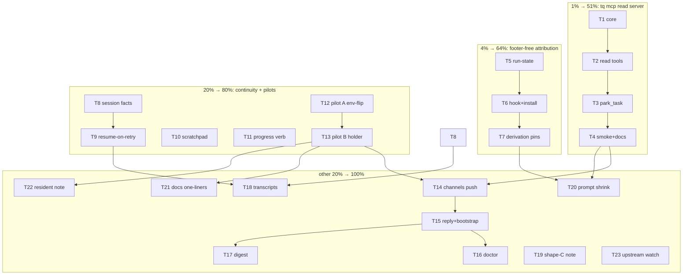

# SUPERB — Queue↔Crush Communication Overhaul (pareto execution plan)

**Minted**: 2026-10-16 04:25 CEST (clock-first via `date`) · interactive owner session
**Scope**: the ENTIRE communication-overhaul program derived from this session — the re-minted `tq mcp` rows, the seven improvement ideas from the "communication is SHIT" review, and the client/server pilot ladder. The rest of TODO_LIST.md is OUT of scope (owned by the 10-05 and 10-13 SUPERB plans).
**Sources** (all this session, all verified):
- `docs/planning/2026-10-16_01-11_TQ-MCP-CHANNELS-DESIGN-INPUT.md` — channels wire contract (read from shipped crush v0.98.x source) + `tq mcp` phase 1/2 design
- `docs/research/2026-10-16_03-52_crush-client-server-mode-review.md` — client/server code review, verdict green-light, pilot ladder A/B/C
- TODO_LIST.md `## Agent-autonomy overhaul` — re-minted phase-1 + phase-2 build rows
- `docs/problems/major-prompting-and-batching.md` — the measured pain baseline

**Step-0 verification (done)**: no `tq mcp` command, no `task.note`/`task.progress` facts, no per-attempt session-id fact, no attribution hook exist at HEAD (greps cited in session). TODO rows 420/422/431 (census/heal of footer-less commits) are DETECTION/REMEDY rows; T5–T7 below are PREVENTION — complementary, and they become wind-down candidates once the hook ships.

**Guiding verdict (this session)**: crush v0.98.1 has shipped everything the 09-14/09-29 assessments called unverified — client/server architecture (race-hardened, e2e-tested), channels wire contract, headless permission/question API, detached 202 runs. The blockers that parked this program are gone. The remaining owner gates: pilot green-light (given via this plan's execution), shape-C fold-or-park (T19), pool crush-version pinning policy (T16 adjacent).

---

## 1. Pareto breakdown

### The 1% that deliver 51%
**`tq mcp` phase 1 — the stdio read server.** Every agent run and every owner session pays the shell-`tq` tax (argv quoting, ambient `TQ_DB`, stdout scraping) multiple times per turn. One small server with 4 read tools + park parity deletes the highest-frequency failure surface in the system and is the substrate every later phase (one-wire, channels, owner tools) extends. Nothing else in the program has this daily multiplier.

### The 4% that deliver 64% (1% +)
**Footer-free attribution (hook + run-state file).** The largest recurring FAILURE industry in the repo: heal scripts, amend maneuvers, attribution audits, three open census rows — all because attribution depends on prompt discipline. Moving it to infrastructure (queue-managed `prepare-commit-msg` hook reading `.git/tq-active-task`) deletes the whole class, shrinks every work prompt, and makes rows 420/422/431 wind-down candidates.

### The 20% that deliver 80% (4% +)
1. **Attempt continuity** — persist the crush session id per attempt fact; retries resume (`crush -s`) instead of cold-restarting. Every retry, 429-wait, and question-answer today re-pays full context re-derivation.
2. **Task scratchpad (`task.note`)** — cross-attempt memory injected into the next attempt's prompt; kills re-discovery of environment truths.
3. **`tq progress`** — structured mid-run signals; the queue learns WHAT an agent is doing, not just that it lives.
4. **Pilot ladder A→B** — env-flip measurement, then the persistent-workspace holder with the channels never-dropped verification (the review's §6 ladder).

### The other 20% to reach 100%
Channels phase 2 proper (push dispatch + `channel_reply`→verdict + bootstrap/doctor), owner digest, transcript linkage on facts, shape-C (API orchestration) design decision, resident-agent evaluation, prompt-stack shrink to match the new wires, AGENTS.md/doc pins, upstream watch.

---

## 2. Comprehensive plan — medium granularity (30–100 min each)

Sorted by importance → impact → effort → customer-value (customer = owner + the agent fleet + every future contributor reading the wire).

| ID | Task | Tier | Impact | Effort | Value | Depends |
|----|------|------|--------|--------|-------|---------|
| T1 | `tq mcp` stdio server core: JSON-RPC 2.0 framing, initialize/initialized/tools-list/tools-call dispatch, explicit `--db` flag resolution (no ambient env), graceful stdio EOF shutdown | 1% | ★★★★★ | 100min | kills argv+TQ_DB classes | — |
| T2 | Read tools: `task_list` (status/type/limit), `task_show` (record + fact trail), `queue_stats`, `dlq_list` — JSON shapes mirroring the CLI renderers | 1% | ★★★★★ | 100min | every agent session benefits daily | T1 |
| T3 | `park_task` write tool (`tq park` parity: id+duration+reason, PENDING-only) + per-tool auth surface note (read vs write) | 1% | ★★★★ | 60min | owner-parity verb | T2 |
| T4 | `scripts/smoke/mcp.sh` (scratch TQ_DB, handshake + per-tool asserts), devmod-shim gate run, README/FEATURES/AGENTS rows, bootstrap `.crushrc` mcp-registration recipe | 1% | ★★★★ | 100min | ship gate | T3 |
| T5 | Attribution run-state: executor writes `.git/tq-active-task` (task id + attempt) at claim, clears at finalize — crash-safe (stale file tolerated + doctor warn) | 4% | ★★★★★ | 60min | prevention substrate | — |
| T6 | `prepare-commit-msg` hook script (queue-managed, reads run-state, stamps `Task-Queue-ID` footer if absent) + `tq bootstrap` install path honoring `core.hooksPath` (rows 420 interplay: install-where fix lands here) | 4% | ★★★★★ | 100min | deletes footer industry | T5 |
| T7 | Derivation acceptance tests: hook-stamped footers derive identically; daemon-during-run sweep case; census rows 420/422 marked wind-down-eligible in TODO | 4% | ★★★ | 60min | trust pin | T6 |
| T8 | Attempt continuity: record crush session id as run fact (extend the ExtractSessionID seam), expose on `tq show` | 20% | ★★★★ | 60min | substrate for resume | — |
| T9 | Resume-on-retry: attempt>1 agent dispatch rides `crush run -s <sid>` (config-gated `--resume-attempts`), question-answer unblock reuses session, 429-closeout resume folds in | 20% | ★★★★★ | 100min | every retry stops re-paying context | T8 |
| T10 | `task.note` scratchpad: fact type + `tq note` verb + next-attempt prompt injection (cap: last N notes, size-bounded) | 20% | ★★★★ | 100min | cross-attempt memory | — |
| T11 | `tq progress '<json>'` verb + `task.progress` fact + `tq show`/webui render (stage/item/eta fields) | 20% | ★★★ | 60min | live visibility | — |
| T12 | Pilot A: scratch repo, `CRUSH_CLIENT_SERVER=1`, measure server lifetime vs 5-min ticks, MCP/LSP re-init per run, latency delta vs in-process — written up as pilot report | 20% | ★★★★ | 60min | decides ladder | — |
| T13 | Pilot B: tiny SSE holder client (persistent workspace) + channels never-dropped verification with zero interactive clients + warm-agent dispatch latency | 20% | ★★★★ | 100min | unblocks phase 2 | T12 |
| T14 | Channels phase 2 server side: `tq mcp` declares `claude/channel` capability + pushes claim-due prompts (`content`=prompt, `meta`=task_id/repo/attempt/type/dedup_key/batch per design-input schema) | 20% | ★★★★ | 100min | push dispatch | T4, T13 |
| T15 | `channel_reply`→verdict tool + bootstrap emits `channel_enabled: true` + reply block once pilot passes | 20% | ★★★★ | 60min | replaces file scrape | T14 |
| T16 | Doctor: channels-capability live probe + crush floor raise + pool version-pinning policy row (replace-on-mismatch restart risk) | tail | ★★★ | 30min | safety net | T13 |
| T17 | Owner digest: one daily summary (completed/died/needs-ruling) via webui + optional channel push — replaces per-task status noise | tail | ★★★ | 100min | owner attention | T11 |
| T18 | Transcript linkage: session id + crush.db path recorded per run fact; dlqfix autopsies cite transcripts not tail-logs | tail | ★★★ | 30min | DLQ diagnosis | T8 |
| T19 | Shape-C decision note: direct API orchestration (workspace create → 202 send → SSE → programmatic permissions) vs subprocess — park or fold into executor roadmap | tail | ★★★ | 30min | strategic option kept warm | review §7 |
| T20 | Prompt-stack shrink: work/review/status prompts lose shell-`tq` teaching + footer contract (hook owns it); pins updated same-change | tail | ★★★★ | 60min | token cut, trusts wires | T4, T7 |
| T21 | AGENTS.md + DOMAIN_LANGUAGE one-liners for mcp/channels/park-after-pilot, live-verified only (no PR-derived host facts) | tail | ★★ | 30min | memory hygiene | T13 |
| T22 | Resident-agent evaluation note: warm-context economics from pilot A/B data, blast-radius guardrails — decision input, no build | tail | ★★ | 30min | endgame option | T13 |
| T23 | Upstream watch row: `--channels` un-hide (#3401), `CRUSH_CLIENT_SERVER` stabilization, server API changes — digest task template | tail | ★★ | 30min | drift radar | — |

Total: 23 tasks ≈ 26.5 h of pool/interactive work.

---

## 3. Fine breakdown — ≤12 min each (execution granules)

Grouped by parent task; each granule independently dispatchable and verifiable. Sorted as above.

| Parent | Granules (each ≤12min) |
|--------|------------------------|
| T1 | 1a JSON-RPC frame codec (read/write loop, Content-Length + ndjson modes decided by transport probe) · 1b initialize/initialized handshake + capability echo · 1c tools-list dispatch table skeleton · 1d `--db` flag → store open via `config.Deployment` (ONE reader) · 1e EOF/signal shutdown + in-flight drain · 1f unit pins: handshake round-trip, malformed-frame rejection |
| T2 | 2a `task_list` handler + filter mapping · 2b `task_show` handler (record + facts) · 2c `queue_stats` handler · 2d `dlq_list` handler · 2e shared render→JSON shape helpers + table-driven shape pins |
| T3 | 3a `park_task` handler (park verb reuse) · 3b pending-only guard + refusal text · 3c write-tool marker in tool metadata + pin |
| T4 | 4a smoke harness scratch TQ_DB + handshake asserts · 4b per-tool smoke asserts · 4c devmod-shim gate run + rc file · 4d README/FEATURES rows · 4e AGENTS.md wire one-liner · 4f bootstrap mcp-registration recipe + pin |
| T5 | 5a run-state file writer/clearer at claim/finalize · 5b stale-file tolerance + doctor WARN · 5c crash-reclaim interplay test (lease expiry leaves stale → next claim overwrites) |
| T6 | 6a hook script (read state, stamp footer if none, no-op otherwise) · 6b `core.hooksPath`-aware bootstrap install + missing-dir hard-fail (row 420 fix rides here) · 6c self-test: daemon-sweep-during-run stamp case · 6d install idempotence + upgrade path |
| T7 | 7a derivation parity test (hook-stamped vs prompt-written footer) · 7b trailer-position equivalence case · 7c TODO wind-down annotations on rows 420/422/431 |
| T8 | 8a session-id fact at ExtractSessionID seam · 8b `tq show` render · 8c conform/facade parity sweep |
| T9 | 9a `--resume-attempts` config plumb · 9b executor argv branch (`-s <sid>`) · 9c question-answer unblock→resume path · 9d 429-closeout resume fold · 9e budget/requeue interplay tests · 9f argv-contract pin update |
| T10 | 10a `task.note` fact type + append verb `tq note` · 10b size/count caps + validation · 10c next-attempt prompt injection block · 10d MCP `task_note` tool twin · 10e pins + AGENTS row |
| T11 | 11a `tq progress` verb + JSON schema (stage/item/eta) · 11b fact append + caps · 11c `tq show` render · 11d webui tail integration |
| T12 | 12a scratch-repo + env-flip pool config · 12b tick-lifetime measurement script · 12c MCP-init cost probe (server log timing) · 12d latency delta capture · 12e pilot report write-up |
| T13 | 13a holder client (SSE attach, refcount keep-alive) · 13b zero-client channels push verification · 13c kill-and-recover drill (server death mid-run) · 13d warm-dispatch latency measure · 13e pilot report |
| T14 | 14a capability declaration in initialize result · 14b claim→push bridge (notification emit) · 14c meta schema marshal + limits conformance (64KiB/32×1KiB/pattern) · 14d busy-queue wait vs `--task-timeout` interplay tests · 14e fail-closed payload rejection pins |
| T15 | 15a `verdict` reply tool handler · 15b `channel_reply` config emission in bootstrap · 15c reply-suppression semantics pin · 15d end-to-end push→reply→verdict smoke |
| T16 | 16a doctor channels probe (live capability check) · 16b crush floor raise + version-pin policy row |
| T17 | 17a digest projection query (completed/died/needs-ruling, 24h window) · 17b `tq digest` render + webui surface · 17c channel-push variant behind pilot flag |
| T18 | 18a run-fact field extension + backfill-less (new runs only) · 18b dlqfix autopsy citation switch |
| T19 | 19a shape-C decision note (extend review §4C) + TODO row update |
| T20 | 20a work-prompt shrink (drop shell-tq teaching) · 20b footer-contract removal after hook proof · 20c review/status/dlqfix prompt shrink · 20d prompt-content pin updates + char-count report |
| T21 | 21a AGENTS/DOMAIN_LANGUAGE live-verified one-liners |
| T22 | 22a resident-agent economics note from pilot data |
| T23 | 23a upstream-watch digest task template + TODO row |

Total: 82 granules ≈ 12 min ceiling each.

---

## 4. Execution graph

Owner gates remaining: T13 exit criteria (pilot B report) before T14+; T19 fold-or-park; pool crush-version pinning policy (T16b).

## 5. Guardrails (no verschlimmbessern)

- Pure-Go, no new deps for the MCP server (hand-rolled JSON-RPC); channels rides the verified contract only.
- Every smoke against a scratch `TQ_DB`; production journal untouched by experiments (AGENTS hazard).
- Prevention (T5–T7) must not break the EXISTING footer derivation — parity tests precede any prompt-contract removal (T20 strictly after T7).
- Pilot A/B on a scratch repo; this dogfood repo only after both pass (review §6 ladder).
- No AGENTS.md host-fact claims from upstream source; live probes only (T21).
- Facts-in-same-tx, single-writer, and conform-suite invariants hold on every new fact type.
