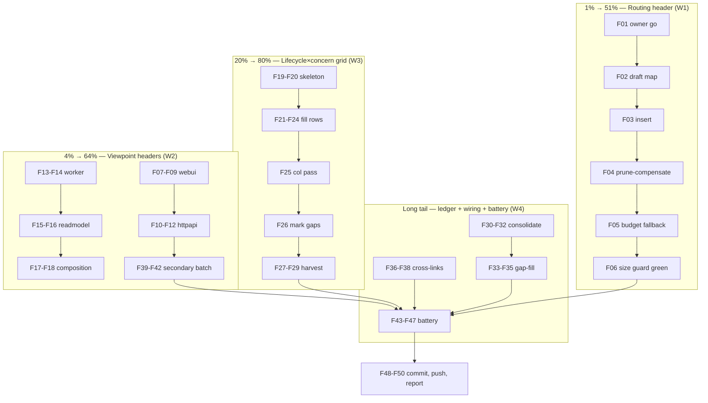

# SUPERB — NAF Surface Clarity Plan

- **Date:** 2026-10-23 14-51 (clock-first: `date` run before filename composition)
- **Status:** PLANNED — not executed. Execution starts with task F01 (harvest decision is owner-gated).
- **Source:** Session analysis of NATO Architecture Framework v4.1 (official spec PDF verified; lessons cross-checked against this repo). Four VERIFIED gaps, not vibes.
- **Scope guard:** Documentation and package-doc work ONLY. Zero behavior changes. Zero CLI flag changes. Zero touching of the owner-blocked dispatch-redesign scope (TODO_LIST "Redesign dispatch prompting + batch granularity").

## Why (context for a future session that wasn't there)

NAF v4.1's material improvements, mapped to verified gaps in this repo:

| NAF v4.1 practice | Verified gap here (evidence) | Workstream |
| --- | --- | --- |
| Purpose & Scope added to EVERY viewpoint (their headline v4.1 change) | `internal/webui`, `internal/httpapi`, `internal/worker` have NO package doc; `internal/readmodel`, `internal/composition` docs describe mechanism, not consumer/concern | W2 viewpoint headers |
| Grid: subjects × aspects; empty cells expose what you forgot | `docs/architecture-understanding/` has module-structure D2 diagrams (structure, one axis) — no lifecycle × concern matrix | W3 grid |
| Explicit subset-of-standard compliance; divergences designed, not accidental | Known go-cqrs-lite divergences scattered across dated memos (`docs/memos/2026-10-10_readmodel-open-seams.md`, `docs/memos/2026-10-09_upstream-seam.md`, `internal/composition/single_opener.md` LANDED) — no living ledger | W4 divergence ledger |
| Tailoring rule: the framework tells you what to SKIP | AGENTS.md is a 21 kB wall every dispatched agent pays in full; no "you need only §X" routing map | W1 routing header |

## Step-0 errata (corrections made while planning — do not re-plan these)

1. **Originally proposed "library-deep-dive on go-cqrs-lite from scratch."** WRONG: Step 0 found the divergences are already discovered and memo'd (single-opener seam LANDED in f6492a00; readmodel-open seams DECIDED 2026-10-10; upstream seam ask DRAFTED). Correct task: consolidate into one living ledger + a bounded gap-fill pass. Re-doing the deep-dive would be verschlimmbessern.
2. **AGENTS.md size guard discovered late**: `agentsDocMaxBytes = 21_100` (cmd/tq/facts_json_test.go:82), AGENTS.md = 21,030 B → **70 B headroom**. Any routing header REQUIRES a paired prune (preferred) or a justified budget bump (fallback). Unbudgeted insertions turn the guard red.
3. **Overlap checks**: TODO_LIST already carries "Fold the internal/composition facade ruling into ADR-0016" — this plan REFERENCES that row (cross-link task), never duplicates it. The dispatch-prompting redesign (owner-blocked) is out of scope; W1 is a readership map only.

## Pareto breakdown

- **1% → 51%:** AGENTS.md routing header (W1). One ~0.5 kB edit; every dispatched agent session in every repo project benefits immediately; misread-convention failures drop across the whole fleet.
- **4% → 64%:** + viewpoint headers (Consumer / Concern / Non-goals) on the five core surfaces (W2). First thing a dispatched agent reads when it lands in a package.
- **20% → 80%:** + lifecycle × concern grid v1 (W3) with every cell citing its owning package and existing gate; empty cells become concrete backlog rows instead of unknowns.
- **Other 80% of effort → last 20% of result:** divergence-ledger consolidation + bounded gap-fill (W4), cross-link wiring, guard consideration, full verification battery, harvest + closeout. Slow, careful, evidence-anchored work that keeps the first three honest.

## Medium plan — 15 tasks, 30–100 min each (sorted by tier → impact)

| ID | Task | Workstream | Est | Impact | Effort | Depends |
| --- | --- | --- | --- | --- | --- | --- |
| M01 | AGENTS.md routing header + size-guard compensation (compact ≤0.6 kB "who reads what" map: review agent → §Conventions/claims; closeout → §payload contracts; verifier → §gates; prune-compensate or bump `agentsDocMaxBytes` with dated justification) | W1 | 60m | ★★★★★ | S | — |
| M02 | Viewpoint header `internal/webui` (Consumer: human operator via `tq serve`; Concern: live task state; Non-goals: persistence) — cite ADR-0003 + ADOPTION.md | W2 | 45m | ★★★★★ | S | — |
| M03 | Viewpoint header `internal/httpapi` (+httpauth/lockout mention; Consumer: machine clients; Concern: machine API; cite SECURITY.md) | W2 | 45m | ★★★★ | S | — |
| M04 | Viewpoint header `internal/worker` (Consumer: pool runtime; Concern: claim→heartbeat→execute loop) | W2 | 30m | ★★★★ | S | — |
| M05 | Reframe `internal/readmodel` package doc: keep mechanism, ADD Consumer/Concern/Non-goals block on top | W2 | 30m | ★★★★ | S | — |
| M06 | Reframe `internal/composition` package doc likewise; cross-ref the existing ADR-0016-addendum TODO row (do NOT fold it here — that row owns the fold) | W2 | 30m | ★★★ | S | — |
| M07 | Grid skeleton: `docs/architecture-understanding/2026-10-23_lifecycle-concern-grid.md` — 7 lifecycle rows (enqueue → claim/lease → execute → verdict/record → closeout → review/sweep → reap/DLQ) × 5 concern columns (correctness, observability, recovery, security, cost) | W3 | 45m | ★★★★★ | M | — |
| M08 | Fill grid cells: each cell cites owning package + the existing gate/test that pins it (verify-window battery scripts, conform suites, module gates) — split by lifecycle row | W3 | 100m | ★★★★ | M | M07 |
| M09 | Harvest empty/weak cells → TODO_LIST rows (machine format, one per line, evidence-bearing) | W3 | 30m | ★★★★ | S | M08 |
| M10 | Divergence ledger `docs/platform-divergence-ledger.md`: consolidate the three memo sources into ONE living table (divergence / status / memo cite / revisit-when) | W4 | 60m | ★★★ | M | — |
| M11 | Bounded gap-fill: one pass over companion/readmodel surfaces vs platform docs for UNMEMO'D divergences; append findings to ledger | W4 | 90m | ★★★ | M | M10 |
| M12 | Cross-link wiring: DOMAIN_LANGUAGE ↔ grid ↔ package docs ↔ ledger; run `scripts/check-doc-refs.sh` | W3/W4 | 30m | ★★★ | S | M07–M11 |
| M13 | Secondary headers batch: `executor`, `journal`, `queue`, `harvest` (same Consumer/Concern/Non-goals shape) | W2 | 90m | ★★ | M | M02–M06 |
| M14 | Verification battery: root build+vet+`test -race -count=1` rc-to-file; every touched nested module `GOWORK=off` gate; `scripts/test-cmd-tq.sh` (size guard rides here); `scripts/check-doc-refs.sh` | ALL | 60m | ★★★★ | M | all |
| M15 | Harvest + closeout: TODO_LIST append (owner-gated), detailed commit(s), push, dated status report per a)–g) skeleton | ALL | 30m | ★★★ | S | M14 |

## Fine plan — 50 tasks, ≤12 min each (sorted by tier → impact; deps in brackets)

| ID | Task | Est | Tier | Dep |
| --- | --- | --- | --- | --- |
| F01 | Owner decision: approve execution + TODO_LIST harvest strategy (single section batch vs staged) | 6m | 1% | — |
| F02 | Draft routing map content offline (≤0.6 kB): role → section pointers | 12m | 1% | F01 |
| F03 | Insert routing map into AGENTS.md top, after status block | 6m | 1% | F02 |
| F04 | Prune-compensate ≥500 B from AGENTS.md (stale known-issues prose) — count bytes before/after | 12m | 1% | F03 |
| F05 | Fallback if prune impossible: bump `agentsDocMaxBytes` by exact delta + dated justification comment in facts_json_test.go | 12m | 1% | F04 |
| F06 | Run `TestAgentsDocSizeGuard` green + root build | 12m | 1% | F05 |
| F07 | webui: extract consumer/concern facts from ADR-0003 + ADOPTION.md | 10m | 4% | F01 |
| F08 | webui: write package doc block (doc.go or serve.go top) | 12m | 4% | F07 |
| F09 | webui: module build+vet green | 8m | 4% | F08 |
| F10 | httpapi: extract facts from SECURITY.md + ADR list | 10m | 4% | F01 |
| F11 | httpapi: write package doc block (incl. httpauth/lockout scope note) | 12m | 4% | F10 |
| F12 | httpapi: module build+vet green | 8m | 4% | F11 |
| F13 | worker: write package doc block | 10m | 4% | F01 |
| F14 | worker: module build+vet green | 8m | 4% | F13 |
| F15 | readmodel: draft Consumer/Concern/Non-goals block atop existing doc | 12m | 4% | F01 |
| F16 | readmodel: module build+vet green | 8m | 4% | F15 |
| F17 | composition: draft block; add cross-ref line to ADR-0016-addendum TODO row | 12m | 4% | F01 |
| F18 | composition: module build+vet green | 8m | 4% | F17 |
| F19 | Grid: define exact row/column vocabulary (pull from DOMAIN_LANGUAGE.md terms) | 12m | 20% | F01 |
| F20 | Grid: create md file with empty 7×5 table + header/legend | 10m | 20% | F19 |
| F21 | Grid: fill enqueue + claim/lease rows (package + gate per cell) | 12m | 20% | F20 |
| F22 | Grid: fill execute + verdict/record rows | 12m | 20% | F20 |
| F23 | Grid: fill closeout + review/sweep rows | 12m | 20% | F20 |
| F24 | Grid: fill reap/DLQ row | 12m | 20% | F20 |
| F25 | Grid: cost + security column cross-pass (often-forgotten cells) | 12m | 20% | F21–F24 |
| F26 | Grid: mark empty/weak cells explicitly (unknown ≠ absent) | 8m | 20% | F25 |
| F27 | Convert marked cells → TODO_LIST candidate rows (draft offline) | 12m | 20% | F26 |
| F28 | Append candidate rows to TODO_LIST (one per line, evidence-bearing) — after owner go | 10m | 20% | F27, F01 |
| F29 | Run `scripts/check-todo-list.sh` green | 8m | 20% | F28 |
| F30 | Ledger: re-read the three divergence memos, extract rows | 12m | tail | F01 |
| F31 | Ledger: create `docs/platform-divergence-ledger.md` with table + revisit-when column | 12m | tail | F30 |
| F32 | Ledger: spot-verify 2–3 rows against code (cite file:line) | 12m | tail | F31 |
| F33 | Gap-fill: list companion/readmodel seams vs platform feature list | 12m | tail | F31 |
| F34 | Gap-fill: check upstream docs for unmemo'd platform features we duplicate | 12m | tail | F33 |
| F35 | Gap-fill: append findings to ledger with status | 12m | tail | F34 |
| F36 | Cross-link: DOMAIN_LANGUAGE add grid + ledger pointers | 10m | tail | F28, F31 |
| F37 | Cross-link: package docs add grid pointer line | 8m | tail | F36 |
| F38 | Run `scripts/check-doc-refs.sh` green | 8m | tail | F36 |
| F39 | executor: write viewpoint header + gate | 12m | tail | F08 |
| F40 | journal: write viewpoint header + gate | 12m | tail | F08 |
| F41 | queue: write viewpoint header + gate | 12m | tail | F08 |
| F42 | harvest: write viewpoint header + gate | 12m | tail | F08 |
| F43 | Battery: root `go build ./...` + `go vet ./...` rc to file | 12m | tail | all |
| F44 | Battery: root `go test ./... -race -count=1` rc to file | 12m | tail | F43 |
| F45 | Battery: every touched nested module `GOWORK=off` build+vet+test | 12m | tail | F43 |
| F46 | Battery: `scripts/test-cmd-tq.sh` (size guard rides here) | 12m | tail | F44 |
| F47 | Battery: `scripts/check-doc-refs.sh` + `check-status-index.sh` | 8m | tail | F44 |
| F48 | git: status/diff review — exactly-mine files only | 8m | tail | F46 |
| F49 | git: detailed commit(s) with Task footer via `scripts/commit-task.sh` if task-backed | 12m | tail | F48 |
| F50 | git: push + verify remote green + dated status report | 12m | tail | F49 |

## Execution graph

## Guardrails (do not verschlimmbessern)

1. **Byte budget is law**: AGENTS.md edits are always net-neutral or justified (F04 before F05; F05 records the dated reason in the test file, following its documented history pattern).
2. **Doc-only**: any task that wants to touch non-comment Go code, flags, or schemas is out of scope — file it as a TODO row instead.
3. **Daemon discipline**: write → stage → commit immediately; never leave new/modified files unattended >60 s; tree CLEAN between steps.
4. **No duplication**: ADR-0016-addendum row, dispatch-redesign row, and the owner-blocked consumer/postgres rows keep their owners. This plan cross-references, never absorbs.
5. **Every claim carries a citation** (gate run or SHA; file:line for filter-scope claims) — including grid cells and ledger rows.
6. **Known-flaky rides the retry**: if `TestExactlyOnceUnderConcurrency`/`TestSelfManagingLoop` drop at a clean parent, re-run before attributing (scripts/lib/verify-retry.sh KNOWN_FLAKY).

## Verification (how we know this plan worked, when executed)

- `TestAgentsDocSizeGuard` green at the new size (F06, F46).
- `go doc ./internal/<pkg>` prints Consumer/Concern/Non-goals for all 5+4 packages.
- Grid has zero silently-empty cells — every empty is either filled or an explicit TODO row.
- Ledger rows each cite memo + code; `check-doc-refs.sh` green across new docs.
- Root + all touched module gates rc=0 to files; battery count via `grep -c '^ok:'` on captured output.
