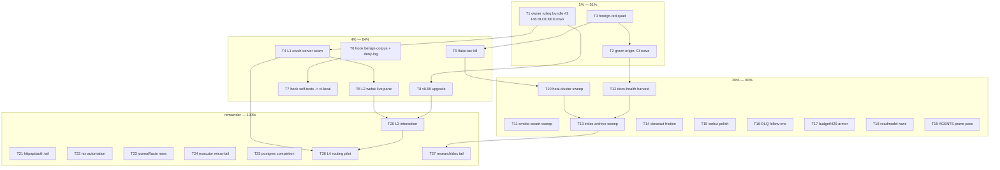

# SUPERB Pareto Execution Plan — ALL 659 open TODOs (2026-10-30 13:53)

> Point-in-time plan over `TODO_LIST.md` at HEAD `6e6167ae` (659 open rows,
> 146 BLOCKED-on-owner; prior ALL-TODOS plan 2026-10-05 covered 304 — the
> backlog more than doubled, mostly closeout-appended rows). Method:
> pareto-planning skill — 1%→51%, 4%→64%, 20%→80%, remainder→100%.
> Table A = 27 strategic tasks (30–100 min each, impact-sorted). Table B =
> fine breakdown (≤12 min each) of the FIRST EXECUTION WAVE (T1–T13); T14+
> are pool-dispatch batches whose fine breakdown lives in their dispatch
> briefs (fleet batch-granularity convention — duplicating 659 rows here
> would create a second source of truth). The **Coverage map** accounts for
> every open row so nothing is unowned. `TODO_LIST.md` stays the living
> source; this plan is a snapshot (docs-health HARVEST pulls items back).
>
> NOT a rewrite of anything: no code, no TODO_LIST edits — plan only.
> Verschlimmbessern guard: every task below must leave the repo verifiably
> no worse than found; anything uncertain escalates instead of improvising.

Fresh evidence this plan rides on (all verified 2026-10-30):
- Master **CI red ≥ 4 consecutive runs** since 2026-10-28 (runs 40618199506,
  40626592985, 40993905287, 40999208406; newest in flight) — vendorHash
  drift + consumer-job red named by the twentyfifth-dispatch report.
- Local foreign-red quad: `check-doc-refs` (AGENTS cites missing
  `scripts/check-erraudit.sh`), `check-dead-sha-refs` (sibling 08-06 report
  cites orphaned `aeff1489`), `TestShowJSONCarriesFailureEvidence`
  order-flake (proven pre-existing at `105c1cb6`), `check-script-syntax`
  (proxy-wait SC2120, flag-count SC1007).
- This session (report `docs/status/2026-10-30_13-48_…`): Crush hook fleet
  live (2 guards, 41+9 self-tests, 2 fleet FPs fixed), client/server
  mechanics proven on crush v0.98.2 (planning doc
  `2026-10-30_04-43_crush-client-server-relations.md`, L0–L4 ladder), 3
  owner questions open (ladder GO, hook gates, v0.99 ownership).

## Step 1 — The Pareto breakdown

### The 1% that delivers 51%

Two moves, ~4 hours total, and half the fleet's friction dies:

1. **Owner ruling bundle #2** — 146 of 659 rows (22% of the backlog!) are
   BLOCKED on the owner. One bundled ruling session (Table B §O) converts a
   fifth of the queue into executable work — same shape as ruling bundle #1
   (2026-10-05), which was that plan's #1 too. Nothing else is close.
2. **Green the origin** — master CI red since 10-28 plus the four local
   foreign reds. Every dispatched verification round-trip pays this tax in
   paid re-runs and false attributions; a red origin trains the fleet to
   distrust green. One wave restores the signal for everyone.

### The 4% that delivers 64%

Add the structural capability moves (T4–T9): client/server **L1 executor
seam** + **L2 webui live pane** (mechanics proven this session; gives the
operator live per-task telemetry — the "what is it DOING" pane), hook-fleet
hardening (benign-corpus battery + ci-local wiring + deny-log telemetry —
protects every dispatch at zero marginal cost), flake-tax kill
(KNOWN_FLAKY pair + TestShowJSON root-cause instead of retry-masking), and
the **v0.99 host upgrade** (unlocks PostToolUse/SessionStart/PreCompact
hooks + notes/piped-permissions the L3/L4 rungs want).

### The 20% that delivers 80%

Add the substantive clusters (T10–T19): heal-cluster sweep (51 rows —
daemon-sweep hygiene is attribution integrity), smoke vacuous-assert sweep
(the vacuous-200 class), docs-health HARVEST + index archive cadence (31
rows + bloat warnings), closeout-ceremony friction (40-row cluster),
webui polish (40), DLQ evidence follow-ons (23), budget/429 armor (32),
readmodel/projection (21), AGENTS budget discipline (160 B headroom).

### The remainder (20% of work → 100%)

T20–T27: client/server L3/L4 continuation, httpapi/auth tail (16),
nix/vendorHash automation (17), journal/facts deep rows (25), postgres
completion (7), executor micro-tail (14), research/doc rows, and the long
micro-tail dispatched in 6–8-row batches.

## Step 2 — Table A: Comprehensive plan (30–100 min tasks, impact-sorted)

| # | Task (30–100 min) | Tier | Rows absorbed | Impact | Effort |
| --- | --- | --- | --- | --- | --- |
| T1 | **Owner ruling bundle #2** — one sheet, one session: client/server ladder GO (L1 now vs post-v0.99) · hook self-tests as ci-local hard gate? · v0.99 upgrade ownership · queue-liveness/attempt-accounting (1355-kin) · re-dispatch dedup authority · size-budget policy (24,400 headroom discipline) · carried BLOCKED rulings from bundle #1 remains | 1% | ~146 BLOCKED | ★★★★★ | 90m owner |
| T2 | **Green the origin: CI wave** — vendorHash bump + verify loop (`nix build .#checks…vendor-hash`, copy got→flake), consumer-job red diagnosis (examples/embed facade on-ramp), re-run until 2 consecutive greens | 1% | CI + 2 rows | ★★★★★ | 100m |
| T3 | **Foreign-red quad heal** — create-or-decite `scripts/check-erraudit.sh` (AGENTS); re-anchor orphaned `aeff1489` cite; TestShowJSON root-cause (leaked stdout writer → isolation pin); SC2120 netns args + SC1007 space-after-= | 1% | 4 reds | ★★★★★ | 100m |
| T4 | **L1 executor seam** — `--crush-server <socket>` pool flag: agentEnv `CRUSH_CLIENT_SERVER=1` + `-H`, `crush server` as runactor, absent-flag = today's path; E-gap proofs ride the pilot (verdict/question env, 429 evidence) | 4% | L1 row + 3 E-gaps | ★★★★★ | 90m |
| T5 | **L2 webui live agent pane** — SSE race-attach per active workspace → ADR-0003 hub; tool-call stream + token counters; one-output-source eval vs tailer | 4% | L2 row + eval | ★★★★☆ | 100m |
| T6 | **Hook benign-corpus battery + deny-log** — replay fleet command history as silent-expectation fixtures per DENY rule; hooks append denied cmds to scratch log; weekly FP triage ritual | 4% | fleet FP class | ★★★★☆ | 60m |
| T7 | **Hook self-tests → ci-local HARD gates** — pinned summaries + env-hook negative batteries (same contract as check-script-syntax); flaky-battery soak rule first | 4% | 1 row | ★★★★☆ | 45m |
| T8 | **v0.99 host upgrade** — crush-config repo bump (5-endpoint diff verified harmless; 13 hook events gained); post-upgrade hook-fleet + routed-run regression pass | 4% | 1 row | ★★★★☆ | 60m |
| T9 | **Flake-tax kill** — TestShowJSON isolation fix (T3 leg), TestExactlyOnce/TestSelfManaging root-cause or formal KNOWN_FLAKY graduation with pins; verify-retry signatures updated once, not re-derived per window | 4% | KNOWN_FLAKY + rows | ★★★★☆ | 90m |
| T10 | **Heal-cluster sweep** — 51 heal/daemon-sweep rows → 5–6 dispatched batches (heal rails, fork-records, attribution guards, span-terminator docs); batch briefs carry the ≤12m breakdowns | 20% | ~51 | ★★★★☆ | 100m/batch |
| T11 | **Smoke vacuous-assert sweep** — status-code-only JSON asserts → pinned body shapes (vacuous-200 class), batched by suite | 20% | ~12 hot of 45 | ★★★★☆ | 100m/batch |
| T12 | **docs-health HARVEST** — pull the 13-53 report §f (28 items) into TODO_LIST with routing rigor; L1/L2 already rows | 20% | 28 items | ★★★☆☆ | 45m |
| T13 | **Index archive sweep + digest row** — fold resolved reports to `archived/`, land the monthly `digest 2026-10` row, kill the bloat warning | 20% | ~31 docs rows | ★★★☆☆ | 60m |
| T14 | **Closeout-ceremony friction batch** — tick-claims gate, tick-audit rails, closeoutPending residue rows (top of the 40-row cluster) | 20% | ~10 | ★★★☆☆ | 100m |
| T15 | **webui polish cluster #1** — ADOPTION guard note, live-contract drift rows, detail-trail evidence= rows | 20% | ~10 of 40 | ★★★☆☆ | 100m |
| T16 | **DLQ evidence follow-ons** — evidence-stage aliases (kill the 3rd knowledge copy), autopsy parity, dead-agent mint rows | 20% | ~12 of 23 | ★★★☆☆ | 100m |
| T17 | **Budget/429 armor completion** — env-streak refinements, provider requeue evidence rows, cap-unit ruling rides T1 | 20% | ~14 of 32 | ★★★☆☆ | 100m |
| T18 | **Readmodel/projection rows** — fold-lock contention class, ConvergeProjectionHome residue, snapshot rename-transient pins | 20% | ~12 of 21 | ★★★☆☆ | 100m |
| T19 | **AGENTS prune pass** — fact-preserving compression to ≥200 B under budget (24,238/24,400 now); candidates: superseded incident walkthroughs now hook-owned | 20% | guard health | ★★★☆☆ | 30m |
| T20 | **Client/server L3** — browser-answerable questions (attach→current-session ordering), structured closeout from messages API, dashboard cancel | rem. | 3 | ★★★☆☆ | 100m |
| T21 | **httpapi/auth tail** — lockout surfacing, `--help` mentions, nosniff/CSP completions | rem. | ~10 of 16 | ★★★☆☆ | 100m |
| T22 | **nix/vendorHash automation** — drift detector + got→flake copy helper; drop-day watch (formatterWithGo/goTarball) | rem. | ~10 of 17 | ★★☆☆☆ | 100m |
| T23 | **journal/facts deep rows** — cqrs adapter constraints, watermark edge classes, fact-shape pins | rem. | ~15 of 25 | ★★☆☆☆ | 100m |
| T24 | **executor micro-tail** — verdict-channel edge rows, excerpt/decodePayload refinements | rem. | ~10 of 14 | ★★☆☆☆ | 100m |
| T25 | **postgres completion** — conform gaps, OpenWithPool docs rows | rem. | ~7 | ★★☆☆☆ | 100m |
| T26 | **L4 routing pilot + memory measurement** — one repo, one wave, shared-server RSS tracked; go/no-go evidence for fleet-wide | rem. | L4 | ★★☆☆☆ | 100m |
| T27 | **Research/doc long tail** — webui-live-contract updates, DOMAIN_LANGUAGE drift, drafts triage — 6–8-row dispatched batches | rem. | remainder | ★★☆☆☆ | 100m/batch |

## Step 3 — Table B: Fine breakdown (≤12 min each, execution-sorted, wave T1–T13)

Batch = dispatchable unit (fits `--batch-items` default 3); items within are
≤12-min steps. Sort = execution order (deps before dependents), impact
within.

### §O Ruling sheet (T1 — owner session, agent-prepared ≤30m of prep items)

| # | Fine task (≤12m) | For |
| --- | --- | --- |
| O1 | Render the 146 BLOCKED rows into a grouped ruling sheet (group/counts/one-line stakes each) | T1 prep |
| O2 | Attach the 3 session questions (ladder GO, hook gates, v0.99 ownership) as sheet §1–3 | T1 prep |
| O3 | List carried bundle-#1 rulings still unresolved (grep OWNER-RULINGS refs) | T1 prep |
| O4 | Record rulings back: BLOCKED rows → unblocked rows or deleted (owner words verbatim) | T1 close |

### §C Green-the-origin (T2+T3)

| # | Fine task (≤12m) | For |
| --- | --- | --- |
| C1 | `nix build .#checks.x86_64-linux.vendor-hash`, copy `got:` → flake.nix | T2 |
| C2 | Push-trigger CI, capture failing job log for the consumer-job red | T2 |
| C3 | Reproduce consumer red locally (`check-cleanroom-install`/examples on-ramp) | T2 |
| C4 | Fix consumer red (facade on-ramp or job spec), re-run | T2 |
| C5 | Two-consecutive-green verification run + report note | T2 |
| C6 | Decide create-vs-decite for `check-erraudit.sh`; apply (AGENTS erraudit bullet) | T3 |
| C7 | Re-anchor the orphaned `aeff1489` cite (find reachable SHA or strike) | T3 |
| C8 | Bisect TestShowJSON pollution source (which test leaks the stdout writer) | T3 |
| C9 | Land isolation fix or order-pin for the leaking test | T3 |
| C10 | proxy-wait SC2120: pass explicit args or `function netns_marker_gate()` local pin | T3 |
| C11 | flag-count SC1007: `var=''` fix + battery re-run | T3 |
| C12 | Full `check-script-syntax` + doc-refs + dead-sha triple-green proof | T3 |

### §L Client/server ladder start (T4+T5 — after T1 GO)

| # | Fine task (≤12m) | For |
| --- | --- | --- |
| L1.1 | Executor: add `CrushServerSocket` pool flag + config plumbing (flag → executor field) | T4 |
| L1.2 | agentEnv: append `CRUSH_CLIENT_SERVER=1` when set; args: append `-H <sock>` | T4 |
| L1.3 | runactor: `crush server --host unix://<data-dir>/crush-pool.sock` actor + LIFO shutdown | T4 |
| L1.4 | Absent-flag path identity test (env diff = empty, args diff = empty) | T4 |
| L1.5 | E-gap: routed verdict write to `$TQ_RESULT_FILE` end-to-end scratch test | T4 |
| L1.6 | E-gap: routed `$TQ_QUESTION_FILE` + AnswerPoller round-trip scratch test | T4 |
| L1.7 | E-gap: 429 requeue evidence from a routed run (RequeueEvidence.provider) | T4 |
| L1.8 | Smoke: `scripts/smoke/crush-server-route.sh` (health + routed run + hooks deny) | T4 |
| L2.1 | webui: SSE attach client (UUID client-id, race-attach poll, reconnect/backoff) | T5 |
| L2.2 | webui: workspace-event → hub adapter (tool_call/tool_result/session tokens) | T5 |
| L2.3 | webui: live agent pane (templ table + SSE push, ADOPTION guard check) | T5 |
| L2.4 | webui: stuck-turn detector (no events > N min → pool-health feed) | T5 |
| L2.5 | Output-source eval memo: SSE pane vs tailer — one source of truth ruling | T5 |

### §H Hook-fleet hardening (T6+T7)

| # | Fine task (≤12m) | For |
| --- | --- | --- |
| H1 | Harvest fleet benign corpus: `grep -h '' shell-output`/history → fixture file (git add/grep/cat/tee/pipes over smoke paths, ERE mentions, `2>&1` shapes) | T6 |
| H2 | tq-bash-guard: benign-corpus silent-expectation runner (all fixtures → rc0/no stdout) | T6 |
| H3 | tq-edit-advice: benign corpus for file-path notes (non-matching paths silent) | T6 |
| H4 | Deny-log side-channel: hooks append `ts|rule|cmd` to `$TQ_HOOK_DENY_LOG` scratch file | T6 |
| H5 | Weekly FP-triage ritual row + check (log non-empty → review) | T6 |
| H6 | ci-local: wire both `--self-test` invocations with pinned summary grep | T7 |
| H7 | Negative-path env hook for each battery (TQ_SYNTAX_FILES pattern) — force one FAIL, assert message | T7 |
| H8 | Soak rule: 7 days green before HARD-gate flip (advisory mode first) | T7 |

### §F Flake tax + upgrade (T8+T9)

| # | Fine task (≤12m) | For |
| --- | --- | --- |
| F1 | crush-config repo: bump crush to v0.99.0 (input/lock), build | T8 |
| F2 | Post-upgrade regression: hook fleet e2e (deny+advise+registration) on v0.99 | T8 |
| F3 | Post-upgrade: routed-run + SSE capture repeat (E1–E5 class proofs) | T8 |
| F4 | Catwalk v3 config-migration check (providers parse, models resolve) | T8 |
| F5 | KNOWN_FLAKY audit: TestExactlyOnce load-flake root-cause or pin with jitter bounds | T9 |
| F6 | Same for TestSelfManagingLoop | T9 |
| F7 | verify-retry: retire stale signatures, add TestShowJSON shape if it flake-residues | T9 |

### §D Dispatch batches (T10–T13 briefs — each item a ≤12m step in its brief)

| # | Fine task (≤12m) | For |
| --- | --- | --- |
| D1 | Compose heal-cluster batch briefs (5 batches × ~10 rows, anchors verbatim) | T10 |
| D2 | Compose smoke-assert batch briefs (3 batches by suite family) | T11 |
| D3 | docs-health HARVEST run over the 13-53 §f (route: TODO rows vs ROADMAP vs drop) | T12 |
| D4 | Archive sweep: resolved-report fold + backticked archived rows | T13 |
| D5 | Digest row `digest 2026-10` land + live-count recheck | T13 |

Coverage note: T14–T27 rows are absorbed by their Table A cluster entries
(row counts in the table); their fine breakdowns happen in dispatch briefs
at execution time (the pool's own ≤12m convention), not duplicated here.

## Step 4 — Execution graph (mermaid)

Read: the 1% row (T1–T3) runs first and unblocks or de-taxes everything;
the 4% row builds the new capability spine (T4→T5→T20→T26 ladder, T6→T7
hook spine, T8 upgrade, T9 flake kill); the 20% row is batch sweeps that
ride a green origin; the remainder is long-tail completion.

## Step 5 — Coverage map (every open row owned)

| TODO_LIST band (lines) | Cluster | Owner task |
| --- | --- | --- |
| 1–120 (16-42 closeout appends + siblings) | journal-drift/redaction/self-test pins | T10/T14 + done-in-place sweep (docs-health) |
| 121–410 (mid-Oct closeout waves) | executor/webui/secrets/closeout ceremony | T14/T15/T24 |
| 411–700 (late-Oct waves A) | heal/daemon/attribution + docs rows | T10/T12/T13 |
| 701–1050 (late-Oct waves B) | smoke/check-gate/self-test rows | T11/T7 |
| 1051–1300 (current week waves) | budget/429, readmodel, DLQ, httpapi, postgres | T16/T17/T18/T21/T25 |
| 1301–1361 (today: heal rails, span-terminator, webui smoke pin, client/server L1/L2) | fresh session rows | T4/T5/T10 |
| BLOCKED rows (146, distributed) | owner rulings | T1 |

Errata/verification pass: spot-checks done at planning time — master CI run
list (4 reds listed), blocked count 146, foreign-red quad reproduced or
cited from reports; no rows verified DONE-but-unchecked in this pass (the
docs-health HARVEST in T12 owns the deep sweep — a full 659-row
CHANGELOG-grep verify would itself be a 100m task and is folded into T12).

— planned 2026-10-30 13:53 at HEAD `6e6167ae`; reporter session:
`docs/status/2026-10-30_13-48_crush-hooks-fleet-and-client-server-relations.md`.
