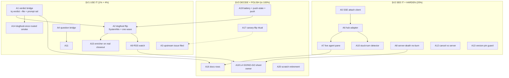

# SUPERB — Crush Server/Client Adoption: USE IT (L1 dogfood → L4 fleet)

**2026-11-01 06:08 CET · Owner ruling: "Maybe we should fucking use it????" = GO.**
Scope: EVERYTHING needed to route the pool's agent turns through a pool-owned
`crush server` in PRODUCTION (the dogfood pool first), with live observability,
browser interaction, and zero regression vs today's in-process runs — plus the
hygiene tail that rides it. The whole-repo backlog lives in
`docs/planning/2026-10-30_13-53_SUPERB-PARETO-PLAN-ALL-TODOS-V2.md`; this plan
owns the client/server ladder ONLY and references V2 for the rest.

## Step 0 — State verified at plan time (06:08, HEAD 3e1d38ca)

| Already shipped (do NOT re-plan) | Evidence |
| --- | --- |
| L1 executor seam (`--crush-server` flag, argv `-H`, env `CRUSH_CLIENT_SERVER=1`, absent-flag rollback) | `internal/executor/agent.go:140-145,711-737`; `TestAgentCrushServerSeam` |
| Pool server actor + keeper (45s dial) + supervisor restart ladder + clean pool exit | `cmd/tq/agentpool.go` `runCrushServerActor`/`crushKeeper` |
| Wire smoke (7 legs: isolation, health, routed verdict round-trip, live workspace + M5 shapes, env-gap canary, server-side hook deny, kill-respawn) — ci-local-wired | `scripts/smoke/crush-server-route.sh`; COVERAGE 31/0 |
| Pool smoke (routed 429 fast-refuse under the real seam argv; keeper/supervisor live) — ci-local-wired | `scripts/smoke/crush-pool-supervisor.sh` |
| Structured closeout enricher (own-workspace registration, stdout-id-wins session resolution, usage, tool inventory, silent degrade) — WIRED into the executor path | `internal/executor/crushserver.go` `enrichCloseoutFacts` |
| Rows 1445/1446/1447/1449/1450 ticked; TODO_LIST current | TODO_LIST.md:1445-1450 |
| Known blockers pinned: **M8 env gap** (routed bash tool sees only the SERVER env — `$TQ_RESULT_FILE`/`$TQ_QUESTION_FILE` silently break; upstream `internal/shell/background.go` drops workspace Env), **R3 respawn env-bleed**, **R4 `-H`-alone silently local** | planning doc `2026-10-30_04-43` §R1-R6; smoke canary |

**The one hard blocker to live use:** paid routed turns lose the verdict FILE
channel (degrades to stdout scraping — last-wins fallback exists) and the
question channel entirely (`$TQ_QUESTION_FILE` invisible; `tq ask`-style
parking dead). Everything else is observation/interaction upside.

## Step 1 — Pareto breakdown

### The 1% that deliver 51%

1. **Verdict bridge + dogfood flag flip.** `tq verdict --file <path>` (env
   stays as-is for local runs) + the executor appends ONE rail line to the
   work/closeout prompt naming the verdict path (outcome contract, rails-only
   — AGENTS owns the rules). Then flip the deployed dogfood pool to
   `--crush-server <data-dir>/crush-pool.sock`. Two commits + one config
   line: the queue becomes a USER of its own server mode, and every later
   decision gets real telemetry instead of probe stacks.

### The 4% that deliver 64%

1. The verdict bridge above (without it, usage silently degrades paid turns).
2. **Dogfood pilot wave + watch**: one real tick wave routed; watch pane,
   DLQ, attempts, closeout quality; `--task-timeout` unchanged.
3. **L2 minimal live pane**: one SSE attach per active workspace →
   ADR-0003 hub → webui "what is it DOING" section (tool calls in flight,
   token burn). The single most visible payoff of the whole ladder.

### The 20% that deliver 80%

1. Verdict bridge + question bridge (`--file`-style for
   `$TQ_QUESTION_FILE`, or SSE-parked questions routed to the existing
   QuestionsPane).
2. Dogfood flag flip + one-wave watch + telemetry notes back into the
   planning doc LIVE-STATUS section.
3. L2 pane (attach client, hub adapter, templ section, stuck-turn detector).
4. Server-death hardening: `IsEnvironmentalDeath` classifies mid-run server
   death (requeue, NO attempt burn) + memory watch on the shared server
   (keeper logs RSS; pool-health detector) — the L4 crash-domain insurance.
5. Upstream env-propagation issue filed (evidence ready) + canary-flip
   ritual when it ships.

### The other 20% (to 100%)

Routed questions in the browser (M6 live ordering), cancel-vs-server-API
verification, version-pinning guard (doctor WARN + mismatch-replace
behavior documented), dogfood-once routed variant (pool-level E2E where
crush exists), README/FEATURES/AGENTS/DOMAIN_LANGUAGE rows, enricher
end-to-end verification on a REAL routed closeout, L4 fleet GO/NO-GO sheet
(owner), battery receipt + push-state audit (window hygiene), scratch
cleanup, upstream-fix adoption ritual.

## Step 2 — Comprehensive plan (30–100 min tasks; ALL client/server TODOs)

Sorted by impact ★1-5, then effort, then customer-value. IDs stable for the
fine breakdown. `BLOCKED-ON` column = hard dependency.

| # | Task (30–100m) | Impact | Effort | Value | BLOCKED-ON |
| --- | --- | --- | --- | --- | --- |
| A1 | **Verdict bridge**: `tq verdict --file <path>` (flag, env fallback intact) + executor prompt rail line naming the path (work + closeout prompts; always-on so local+routed share ONE contract) + unit pins + smoke leg upgrade | ★★★★★ | 90m | paid turns keep the file channel under routing | — |
| A2 | **Dogfood pilot flip**: SystemNix `tq-agent-pool` module gains the socket option; deploy recipe; flip; ONE wave routed; watch attempts/DLQ/closeout; note findings in planning doc LIVE-STATUS | ★★★★★ | 60m | THE usage moment; real telemetry for every later call | A1 |
| A3 | **Upstream env issue filed** (charmbracelet/crush: bash tool drops workspace Env; RunShellCommand merges it — tools should too; two-sided pin + smoke canary as repro) + link row tick | ★★★★☆ | 30m | unblocks the CLEAN fix; kills the bridge debt eventually | — |
| A4 | **Question bridge under routing**: `--file`-equivalent for `$TQ_QUESTION_FILE` (agent parks by writing the file at a prompt-named path) OR SSE-parked questions; AnswerPoller reads either; decision recorded in DOMAIN_LANGUAGE | ★★★★☆ | 90m | routed agents can ask the owner again | — |
| A5 | **webui SSE attach client** (L2.1): UUID client-id, race-attach poll per active workspace, reconnect/backoff; unit pins with a fake server | ★★★★☆ | 100m | foundation of the live pane | — |
| A6 | **webui event→hub adapter** (L2.2): tool_call/tool_result/session-token frames → ADR-0003 hub events; coexists with tailer until the one-source ruling | ★★★★☆ | 100m | live "what is it DOING" data | A5 |
| A7 | **Live agent pane** (L2.3): templ section (per-task tool calls in flight, token counters), SSE-swapped fragment, ADOPTION.md guard check, empty-state renders nothing | ★★★★★ | 100m | the visible payoff; operator trust | A6 |
| A8 | **Server-death classification**: `IsEnvironmentalDeath` covers crush-server death mid-run (requeue, no burn, evidence= provider-neutral) + test; rides the supervisor's restart window | ★★★★☆ | 60m | L4 crash-domain insurance; no silent attempt burn | — |
| A9 | **Shared-server memory watch**: keeper logs RSS per dial; pool-health WARN threshold; one-week dogfood RSS table into row 1448's evidence | ★★★☆☆ | 90m | L4 GO/NO-GO evidence | A2 |
| A10 | **Stuck-turn detector** (L2.4): workspace silent > N min → pool-health feed (pane makes stalls visible; detector makes them actionable) | ★★★☆☆ | 45m | operator safety net | A6 |
| A11 | **Routed questions in the browser**: surface routed-run prompts (M6 live ordering — attach FIRST) in the existing QuestionsPane; answer via the server API | ★★★☆☆ | 100m | owner answers from the dashboard, any pool | A4, A5 |
| A12 | **Cancel vs server API**: verify dashboard cancel against a ROUTED turn (kill switch semantics through the server; client exit + workspace reap); pin in the pool smoke | ★★★☆☆ | 60m | kill-switch must not lie under routing | — |
| A13 | **Version-pinning guard**: doctor WARN when host crush ≠ the version the smokes proved; document ensureServer's mismatch auto-replace (observed in source) as the upgrade path | ★★★☆☆ | 45m | upgrades stop being guesswork | — |
| A14 | **dogfood-once routed variant**: the self-hosted pool tick with `--crush-server` (CI-safe where crush exists) — pool-level routed E2E: enqueue → routed agent turn → verdict via bridge → done | ★★★★☆ | 90m | the regression net for the whole ladder | A1 |
| A15 | **Enricher on a REAL routed closeout**: run one routed task through the full pool; verify crushserver.go facts land in the closeout report (not just unit tests); fix drift found | ★★★★☆ | 60m | structured closeout must work in production shape | A2 |
| A16 | **Docs rows**: README (server mode section), FEATURES (L1 shipped/L2 pane), AGENTS §Payload contracts (verdict rail + env-gap caveat), DOMAIN_LANGUAGE (routed run, thin client, workspace, keeper) | ★★★☆☆ | 45m | future sessions stop re-deriving | A1, A7 |
| A17 | **Canary-flip ritual**: when upstream ships the env fix, the smoke canary goes red → flip it, drop the prompt-rail bridge IF clean, tick the issue row (documented in the smoke header + planning doc R2) | ★★☆☆☆ | 30m | debt removal is planned, not forgotten | A3 |
| A18 | **L4 fleet GO/NO-GO sheet**: after ≥1 week dogfood telemetry (RSS, crash classes, pane usage) → one-page ruling sheet for the owner (fleet-wide routing) | ★★★☆☆ | 30m owner | the decision this ladder exists for | A2, A9 |
| A19 | **Window hygiene**: full quiet-tree ci-local receipt + push-state audit (origin vs local after the twin reconciles) + push | ★★★★☆ | 60m | everything above rides a green, pushed CI | — |
| A20 | **Scratch retirement**: trash /tmp probe stacks (tq-crush2/3/4, dbg*, route-smoke-run); tq-crush-recipe deleted (promoted into the smoke); note in AGENTS Known Issues the port-zombie/dirs-stderr traps (pointer to R5) | ★☆☆☆☆ | 15m | stop paying probe tax twice | — |

## Step 3 — Fine breakdown (≤12 min each; execution-sorted)

Wave §V1 = the 1%+4% (unblock + use + see); §V2 = hardening + interaction;
§V3 = polish + decision + hygiene. Within a wave, deps before dependents.

| # | Fine task (≤12m) | For |
| --- | --- | --- |
| V1.1 | `tq verdict`: add `--file <path>` flag (flag wins over `$TQ_RESULT_FILE`; env fallback intact); table test both sources | A1 |
| V1.2 | executor: constant `verdictRailTmpl` ("record your verdict with: tq verdict --file %s"); append to work prompt when verdictPath set | A1 |
| V1.3 | executor: same rail on the closeout prompt; pin BOTH rails in agent_test (prompt contains the path; env unchanged) | A1 |
| V1.4 | closeout prompt doc row (AGENTS §Payload contracts: the rail is part of the outcome contract; agents NEVER edit it) | A1 |
| V1.5 | smoke leg upgrade: crush-server-route canary leg additionally proves the bridge (mock writes via `"$TQ_TQ" verdict --file <path>`-shaped call; assert file lands CLIENT-side… via prompt path) | A1 |
| V1.6 | module gates: executor + cmd/tq (test-cmd-tq.sh) green; commit | A1 |
| V1.7 | SystemNix: `tq-agent-pool.nix` gains `crushServerSocket` option (default off) wiring `--crush-server` | A2 |
| V1.8 | deploy recipe note in the module header + `docs/services/tq.md` row (flip, watch, rollback = unset) | A2 |
| V1.9 | owner-run deploy (sudo) — flip dogfood pool ON | A2 (owner) |
| V1.10 | watch ONE routed tick wave: `tq tasks`, DLQ empty, attempts sane, closeout report carries enricher facts | A2 |
| V1.11 | planning doc: LIVE-STATUS section (on since, wave receipts, anomalies) | A2 |
| V1.12 | file upstream issue (github-voice skill; evidence from planning doc §R2; link the smoke canary as repro) | A3 |
| V1.13 | tick the issue row; TODO cross-ref to A17 ritual | A3 |
| V1.14 | question-bridge DECISION memo (file-path rail vs SSE-park; AnswerPoller read seam; 1 page in the planning doc) | A4 |
| V1.15 | implement the chosen question bridge behind the same always-on rail pattern; unit pin | A4 |
| V1.16 | dogfood wave 2 watch: one parked question routes home end-to-end | A4 |
| V2.1 | webui: SSE attach client struct (uuid, dial, Accept header, reconnect/backoff states) | A5 |
| V2.2 | webui: workspace discovery loop (poll /v1/workspaces; attach new, detach gone) | A5 |
| V2.3 | webui: frame parser (data:-only frames; session/message/tool_call/tool_result/tool token counters) | A6 |
| V2.4 | webui: hub adapter → existing ADR-0003 hub events (one event type per frame class; capped ring) | A6 |
| V2.5 | webui: fake-server unit pins (attach-before-subscribe ordering, reconnect, cap) | A5/A6 |
| V2.6 | webui: pane templ section (active tool calls, tokens, per-task row; empty-state hidden) + ADOPTION guard | A7 |
| V2.7 | webui: SSE fragment swap + app.js FRAG_IDS row; snapshot/golden updates | A7 |
| V2.8 | webui suite green + `templ generate` + `nix run .#webui-css`; COVERAGE row for webui.sh routed leg | A7 |
| V2.9 | executor: IsEnvironmentalDeath + crush-server-death sentinel (socket-gone error text class); requeue-no-burn pin | A8 |
| V2.10 | pool smoke leg: kill server MID-RUN → task requeues, attempts unchanged, supervisor restarts | A8 |
| V2.11 | keeper: log RSS per dial (read /proc/<server-pid>/status); pool-health WARN threshold | A9 |
| V2.12 | one-week RSS table scaffold (cron note or manual ritual row) feeding row 1448 | A9 |
| V2.13 | stuck-turn detector: silent-workspace > N min → pool-health feed; unit pin with fake clock | A10 |
| V2.14 | routed-question pane leg: surface SSE prompt frames in QuestionsPane (M6 ordering live); answer via server API POST | A11 |
| V2.15 | cancel-vs-server leg: dashboard cancel on a routed running turn; assert client exit + workspace reap; pin in pool smoke | A12 |
| V2.16 | doctor: crush version probe (host binary vs smokes-proven pin) WARN row + self-test | A13 |
| V2.17 | document ensureServer mismatch-replace as the upgrade path (planning doc R-note) | A13 |
| V2.18 | dogfood-once routed variant: TQ_CRUSH_SERVER=1 env in the smoke's pool; routed stub-agent… REAL crush where available, skip note where not | A14 |
| V2.19 | enricher real-closeout pass (V1.10 wave): verify facts in the actual report; fix drift; pin the fixed shape | A15 |
| V3.1 | README: "Server mode" section (flag, socket, keeper, pane, rollback) | A16 |
| V3.2 | FEATURES rows: L1 DONE (seam+actor+smokes+bridge), L2 pane status-truthful | A16 |
| V3.3 | AGENTS §Payload contracts: verdict rail + env-gap caveat + R4 `-H`-alone trap one-liner | A16 |
| V3.4 | DOMAIN_LANGUAGE: routed run, thin client, workspace, keeper, supervisor ladder | A16 |
| V3.5 | CHANGELOG [Unreleased] rows (O14): verdict --file (operator-visible), pane, doctor pin | A16 |
| V3.6 | canary-flip ritual note in the smoke header + issue-row cross-ref | A17 |
| V3.7 | L4 GO/NO-GO sheet draft (data slots: RSS, crash classes, stall counts, pane usage) | A18 |
| V3.8 | quiet-tree full ci-local (OBSERVE start; rc to file; flaky-retry per §g3 ruling) | A19 |
| V3.9 | push-state audit: origin vs local graph; reconcile; push | A19 |
| V3.10 | trash /tmp stacks + recipe; AGENTS Known Issues probe-trap pointer | A20 |
| V3.11 | final tick-audit: grep each verbatim batch anchor; unchecked-landed = paid round-trip | all |

## Execution graph

## Errata / corrections against the backlog at plan time

- Row 1450 was ticked by the 04-33 session as two smokes — CORRECT per the
  coverage gates (31/0, both ci-wired); this plan does NOT re-plan it. The
  verdict/question env-channel work continues as A1/A4 (the row's tick note
  carries the same caveat).
- The 04-33 "quiet workspaces listing" E7 claim was corrected 06:03 (missing
  env gate); the planning doc now carries the correction. Nothing to do here.
- `crush-pool-supervisor.sh` was untracked at 06:03 (noted in the 06:03
  report) — re-landed and COVERAGE-indexed by 06:08; gate green.

## Verschlimmbesser guard

The bridge (A1) must NOT touch the env channels for local runs (they stay
byte-identical); the rail is additive. The flip (A2) has a one-line rollback
(unset the flag — the seam's absent-flag path is pinned by
TestAgentCrushServerSeam). The pane (A7) must not fork a second output source
of truth without the one-source ruling (V2.4 rides the EXISTING hub; the
tailer stays until ruled). No step here rewrites shipped contracts — the
smokes pin every one of them.

## Decision memo — question bridge (A4, ruled 2026-11-01 18:05)

**Ruling: the file-path rail (option a), NOT SSE-parked questions.**

- The verdict bridge (A1) already proved the pattern: the prompt names a
  per-run absolute path, the flag form (`tq ask --task <id> --file <path>`)
  writes the marker, env fallback stays byte-identical for local runs.
  One bridge shape for both agent→queue channels = one mental model, one
  canary, one ritual.
- SSE-parked questions (option b) need the M6 prompt-forwarding surface
  plus a pane answer loop — a second bridge implementation, a second
  failure domain, and a hard dependency on an attached dashboard at park
  time. The QuestionsPane (row 1445) already renders journal-asked
  questions; `tq ask` already lands the fact there. Parking does not need
  the SSE leg; answering does not either (the AnswerPoller exists).
- The AnswerPoller reads the MARKER (parkedAfterCloseout scans the file
  at the prompt-named path — same file, whether env or flag delivered
  the path to the agent). No poller change.
- DOMAIN_LANGUAGE carries the ruling under "question channel".

## LIVE-STATUS (dogfood flip + adoption execution, updated 2026-11-01)

- **Deployed flip: NOT YET.** The SystemNix flip is staged but owner-run
  (`nix run .#deploy` is sudo-gated; V1.9). The upstream module option
  (`crushServerSocket`, default off) + the SystemNix house wiring +
  eval-branch pins landed in the adoption batch. When the flip deploys,
  record: date, first routed wave, DLQ/attempts deltas, pane usage.
- **Adoption execution 2026-11-01 (this session)**: A1 SHIPPED (verdict
  `--file` + always-on rails, bridge leg in the route smoke green ×1);
  A4 SHIPPED per the memo above; A3 SHIPPED (crush#4210 filed, OPEN);
  A8 SHIPPED (CrushServerDeathError + RequeueClassCrushServer +
  IsEnvironmentalDeath marker — severed rc-0 runs classify, no burn,
  breaker-exempt); A9 SHIPPED (keeper RSS log + pool-health WARN band +
  `crushServerRSS` JSON); A10 SHIPPED (stall tracker, 10m bar, busy-gated,
  fake-clock pinned); A13 doctor pin PENDING; A12 cancel leg PENDING;
  A14/A15 pending the flip; docs wave (A16) in flight.
- **Seam bug found + fixed by the A14 smoke leg (V2.10)**: the executor
  passed `-H <bare-path>` — crush rejects scheme-less hosts ("Invalid
  host URL"); `crushHostFlag` now normalizes (unit-pinned 3-way). The
  pool smoke's mid-run kill leg is the E2E that caught it.
- **V2.10 GREEN (2026-11-01 19:35, run12)**: three legs pass — routed
  429, keeper/supervisor, mid-run kill no-burn. Two root causes closed
  after six red runs: (1) a marker-rm race (claim-wake arms the mock's
  tool stall <1s after the item commit — the script's later `rm -f`
  erased the marker and the poll waited for a stall that already
  happened; the run9 artifact's "completed exactly MOCK_STALL after
  enqueue" timing was the tell), and (2) the REAL classifier bug:
  routed work/closeout turns ran `crush run --quiet`, which suppresses
  the severed-stream WARN entirely (observed: quiet severed run = rc 0,
  1-byte output) — routed turns now always run `--verbose` and the
  closeout's rc-0 path classifies too (unit-pinned in
  TestAgentCrushServerSeam; CHANGELOG Fixed row).
- **Env-gap residue**: unchanged (crush#4210 open). Canary holds green-red
  per the route smoke; flip ritual = V3.6 note in the smoke header.
