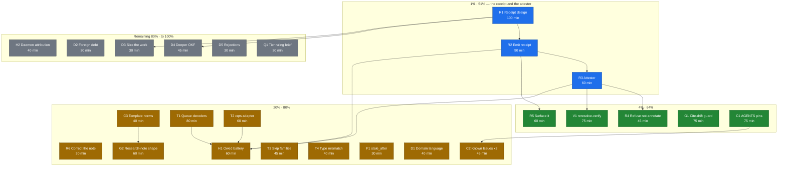

# SUPERB plan: verify receipts, the attester, and the guards this session proved we need

**Created:** 2026-11-01 20:17 (CET). **Author:** undispatched agent session.
**Predecessor:** `docs/research/2026-11-01_okf-lessons.md` (the OKF analysis) and
`docs/status/2026-11-01_20-09_okf-lessons-forward-compat-pins.md` (what that
session did and got wrong).
**Scope of this plan:** every actionable item from that session's `§f` list
(50 items), consolidated into 24 tasks of 30–100 min, then into 102 micro-tasks
of ≤ 12 min. Nothing from that list is dropped; §6 records what was
deliberately excluded and why.

> **Hard rule for whoever executes this: do not build a second artifact.**
> See §2. The plan was rewritten mid-flight after discovering that tq already
> ships both halves of the evidence shape. Extending them is ~1/3 the cost of
> minting a parallel "receipt" format, and a parallel format would be a
> verschlimmbesserung of the exact kind this repo keeps paying for.

---

## 1. Why this plan exists (the problem in one page)

go-taskqueue's economics are: **paid agent sessions produce claims, and a
human then re-verifies those claims by hand.** The OKF analysis found that this
is not a tooling gap but a *contract* gap — tq asks the right trust questions
and answers them in prose (AGENTS.md rules) instead of in types (declared,
optional, additive fields that a deterministic program can check).

The single most expensive instance: **gate evidence**.

- AGENTS.md §Conventions says a report's "N ok / M fail" count is
  `grep -c '^ok:'` over a **captured gate-output file — never counted in
  context**.
- That rule exists because two windows miscounted (02-11 and 04-55: "17 ok"
  vs actual 16) and a corrected receipt had to be re-issued.
- It is a *manually enforced* rule, which means every closeout spends paid
  session time producing evidence instead of work, and the rule can still be
  violated silently.

OKF's answer is a **receipt** (a declared field set a run must return) plus an
**attester** (deterministic, no-LLM code that grades a receipt and makes the
consumer *refuse* a value on a false verdict). The plan below builds exactly
that, and the guards that keep the rest of the repo's evidence honest.

## 2. The ground-truth correction that reshaped this plan

Before planning, the executor's evidence surfaces were re-read. tq is **not**
starting from zero:

| Surface | File | What it already carries |
| --- | --- | --- |
| Success path | `internal/executor/result.go:65` (`AgentResult`) | `VerifyTail`, `Commits`, `FilesChanged`, `CommitSHA`, `ToolCalls`, session usage |
| Failure path | `internal/executor/result.go:109` (`FailureEvidence`) | `Stage`, `ExitCode`, `Tail`, `VerifyStage`, `Class`, `FilesChanged` |
| Sidecar | `internal/executor/evidence.go` / `writeVerifyEvidence` | full (unbounded) verify output on a path, referenced from the fact |
| Filtering | `executor.MatchesEvidenceStageSet` | `--evidence-stage` matching over Stage/VerifyStage/Class + gate aliases |

So the real gap is **four fields on the success path plus one pure function**:

1. `verify_command` — the command that actually ran (today `AgentResult` keeps
   only its *tail*, not the command, so "did the gate that ran equal the gate we
   declared" is unanswerable after the fact).
2. `verify_rc` — the exit code (the failure path records it; success does not).
3. `verify_head` — the HEAD sha the gate ran at.
4. `verify_counts` — the per-gate `ok/fail` counts the closeouts currently
   hand-grep, emitted by the gate runner instead of re-derived by a reader.
5. **The attester** — a deterministic comparison of (receipt, the payload's
   declared verify, the claimed HEAD) that *refuses* rather than annotates.

Consequence for execution: **R1–R5 extend `AgentResult` and reuse
`writeVerifyEvidence`.** No new format, no new module, no second writer.

## 3. Customer definition (so "customer value" is not hand-waving)

This is an internal developer tool; there is no external customer.

- **Primary customer: the operator (Lars).** Pays per session. Values: fewer
  burned sessions, reports that cannot lie, no re-dispatches for a single
  flipped character.
- **Secondary customer: the dispatched agent.** Consumes reports and evidence.
  Values: a row-level signal it can filter on before spending tokens reading a
  body.
- **Tertiary customer: the reviewer sweeper / DLQ autopsy.** Values: a
  mechanical false-verdict signal instead of a prose judgement.

"Customer value" in the tables below means *value to the operator*, 1–5.

## 4. Pareto breakdown

### The 1% that delivers 51% — `R1 + R2 + R3`

**Extend `AgentResult` with the four verify-receipt fields, and make the
attester a pure function over them.**

Why this is the 1%:

- It is the **only** change that touches every report the repo will ever write,
  forever. Every closeout, every review, every status sweep quotes gate
  evidence.
- It collapses a *manual* rule into a *mechanical* one: the hand-grep becomes
  an emitted number, and "the gate I claim ran" becomes a comparison instead of
  a trust statement.
- It is **smaller than it looks** because §2 is true: 4 fields, 1 sidecar reuse,
  1 pure function. The naive version (new format + storage layer + renderer)
  would be 3× the work for the same outcome.
- It unblocks the best part of `V1`: once the receipt records the executed
  command, `--reresolve-verify` stops being invisible.

Deliberately **not** in the 1%: the trust tier (`Q1`), because it has no
consumer yet — building it now would be OKF's own "premature generalization"
anti-pattern.

### The 4% that delivers 64% — the 1% plus `R5`, `V1`, `G1`, `C1`

- **`R5` surface the receipt.** An artifact nobody renders is worth nothing.
  Row-level (`tq dlq` column, `tq show` section, `--evidence-stage` term) is the
  tier-2 customer's filter.
- **`V1` `--reresolve-verify`.** A documented trust hole: the gate can come from
  an agent-editable `.tq-verify`. The attester (R3) is what makes the hole
  observable; V1 decides whether to retire or narrow the flag. Cheap fix to a
  real integrity break.
- **`G1` cite-drift guard.** This repo's highest-frequency documentation defect
  is citation rot (it already has `check-dead-sha-refs.sh` for SHAs). Line-level
  cite drift is the same class and was committed **four times in one document**
  by the very session that wrote the analysis. A mechanical re-read guard
  prevents the recurrence class, not just the instance.
- **`C1` the additive-growth pin in AGENTS.md.** This is the contract R1's four
  new fields ride on: a new detail field is optional, has a documented absence
  meaning, and gets a legacy fallback read. Without it, the receipt fields are
  just new fields that a future cleanup may make required.

### The 20% that delivers 80% — the 4% plus `R4`, `R6`, `G2`, `C2`, `C3`, `T1`–`T4`, `F1`, `H1`, `D1`

Grouped by what they protect:

- **Honesty of the artifact** — `R4` refuse-not-annotate (OKF's §10.5 rule: a
  false verdict means refuse, not decorate), `R6` correct the note (the gap is
  success-side receipt + attester, not "no receipt at all" — the current wording
  overstates).
- **Honesty of the docs** — `G2` research-note shape gate, `C2`/`C3` the three
  Known-Issues rules and the template norms, all of which exist because this
  session wrote a false verification sentence.
- **Coverage of the tolerance contract** — `T1`–`T4`: the same forward-compat
  pin applied to the remaining decode surfaces, so lesson 1/2 stop being
  one-off tests and become a contract with a suite.
- **Proof the concept works on our own docs** — `F1` `stale_after` on the OKF
  note: the cheapest possible demonstration that absolute freshness beats a
  relative TTL, applied to the note about absolute freshness.
- **The owed battery** — `H1`: this session shipped two test files into two
  modules and never ran `ci-local.sh`. That debt is real and named.
- **Vocabulary** — `D1`: five named concepts (provenance / trust / freshness /
  lifecycle / attestation) in `docs/DOMAIN_LANGUAGE.md`, because the live
  confusion (`generated` vs `verified` = attempt outcome vs review approval) is
  caused by the concepts being unnamed.

### The remaining 80% to reach 100% — everything else

`H2`, `D2`–`D5`, `Q1`, plus the explicit non-goals in §6. These are real but
low-leverage: routing foreign debt, recording rejections so they stop being
re-litigated, a one-page ruling brief, and a sizing measurement. None of them
change behaviour on their own.

---

## 5. Task table A — 24 tasks, 30–100 min each (all TODOs covered)

Sorted by leverage (Impact × Customer value ÷ Effort), highest first.
Effort: 1 = trivial … 5 = heavy. Impact/Value: 1–5.

| # | Task | Why it matters | Imp | Eff | Val | Lev | Deps |
| --- | --- | --- | --- | --- | --- | --- | --- |
| R1 | **Receipt design**: extend `AgentResult` with `verify_command`, `verify_rc`, `verify_head`, `verify_counts`; reuse the `writeVerifyEvidence` sidecar; write the storage rationale (why the fact detail and not a new file) | This is the design that decides whether R2 is 90 min or 400 | 5 | 3 | 5 | 8.3 | — |
| R2 | **Emit the receipt** from `runVerify` on success *and* failure; keep one shape across both paths | The actual artifact; without it everything else is theory | 5 | 3 | 5 | 8.3 | R1 |
| R3 | **Attester**: pure function over (receipt, declared verify, claimed HEAD) returning a verdict; three comparisons | Converts a trust statement into a check; also makes V1 observable | 5 | 2 | 5 | 12.5 | R2 |
| R5 | **Surface it**: `tq show` section, `tq dlq` column, `--evidence-stage` receipt term | An unrendered artifact is worth nothing to the tier-2/3 consumers | 4 | 2 | 4 | 8.0 | R2 |
| V1 | **`--reresolve-verify`**: audit `tq doctor --hygiene` coverage, write the retire-vs-narrow design note | Closes a documented trust hole where the gate is agent-editable | 5 | 2 | 4 | 10.0 | R3 |
| G1 | **Cite-drift guard**: extract every `file:NNN` cite from a doc and re-read the line, FAIL on token mismatch; `--self-test`; wire into ci-local | Prevents the exact defect this session committed 4×; sibling to `check-dead-sha-refs.sh` | 4 | 3 | 4 | 5.3 | — |
| C1 | **Two AGENTS.md pins** (additive-growth contract; signals-not-scores) + the required compress pass against the size budget | The contract the new receipt fields ride on; the anti-promotion rule for AI scores | 4 | 3 | 4 | 5.3 | R1 |
| C2 | **Known Issues x3**: `download`-before-`fetch`; tolerate-unknown ≠ tolerate-newer; no absolute verification phrases | Three rules whose absence cost this session real damage | 3 | 2 | 4 | 6.0 | — |
| C3 | **Research-note template norms**: record the acquisition passes; cite-then-verify | Fixes the template so the next note cannot repeat the failure | 3 | 2 | 4 | 6.0 | — |
| G2 | **`check-research-note-shape.sh`**: every `docs/research/*.md` has a citations table + a Verification trail; `--self-test`; ci-local | Makes the template norms enforceable instead of advisory | 3 | 2 | 3 | 4.5 | C3 |
| R4 | **Refuse-not-annotate** wiring: a failed attestation refuses the value and lands a named refusal class in the evidence surface | OKF §10.5: a false verdict must not merely decorate | 4 | 2 | 3 | 6.0 | R3 |
| R6 | **Correct the research note**: the gap is success-side receipt + attester, not "no receipt artifact" | The note currently overstates; a wrong note is worse than none | 3 | 1 | 4 | 12.0 | — |
| T1 | **Queue detail decoders**: forward-compat pins for `ParseReprioritizeEvidence` + siblings | Turns the tolerance lesson from one test into a contract | 3 | 3 | 3 | 3.0 | — |
| T2 | **journal/cqrs adapter**: fact-decode tolerance pin | Same class, different decode surface | 3 | 2 | 3 | 4.5 | — |
| T3 | **`eventFor` known-skip families** pin + **webui degrade** pin | Closes the overclaim in lesson 1: "nothing tests it" was written wider than the evidence | 3 | 2 | 3 | 4.5 | — |
| T4 | **Payload type-mismatch** case + a canary comment about a future strict-by-default Go | Distinguishes tolerance on *members* from strictness on *types* | 2 | 1 | 3 | 6.0 | — |
| H1 | **The owed battery**: `ci-local.sh`, `root-gate.sh`, `check-mirror-clones.sh`, `check-dead-exports.sh --self-test`, windows cross-compile, rc to files | The one gate that sees cross-module interactions two targeted runs cannot | 4 | 2 | 4 | 8.0 | R2, R3, T1, T2 |
| H2 | **Daemon attribution**: grandfather this session's 7 sweeps in `scripts/daemon-sweep-baseline.txt` with a dated reason; route the 34 foreign ones | 41 unattributed sweeps are red at HEAD; laundering foreign debt is not ours to do | 3 | 2 | 3 | 4.5 | — |
| D1 | **DOMAIN_LANGUAGE.md**: the five OKF words mapped to tq terms | Unnamed concepts are the ones that get conflated (`generated` vs `verified`) | 3 | 2 | 3 | 4.5 | — |
| F1 | **`stale_after` on the OKF note** + the convention in the template | The concept applied to the note about the concept; costs nothing | 2 | 1 | 3 | 6.0 | — |
| D3 | **Size the receipt work**: count live reports carrying a hand-grepped "N ok / M fail" | Gives R1–R5 a measured justification instead of an argued one | 2 | 1 | 3 | 6.0 | — |
| D4 | **Deeper OKF**: SPEC §10.4 `receipt` declaration syntax + read `attesters/sql_equality.py`; write adopt/reject | Only worth it once R1 lands; could change the receipt's field set | 2 | 2 | 2 | 2.0 | R1 |
| D5 | **Record two rejections** (TODO-row `status` analogue; provenance-on-closeout-claim experiment) | Stops the same two ideas being re-proposed | 2 | 1 | 2 | 4.0 | — |
| D2 | **Route foreign debt**: the 4 dead-SHA cites + the 10 phrase-drift WARNs recorded on the fleet board, not fixed blind | Foreign reports are not ours to edit; the count is the useful output | 1 | 1 | 2 | 2.0 | — |
| Q1 | **Trust-tier ruling brief** (one page: advisory tier vs no tier; cost = a fact type + retention) | Unblocks the `— BLOCKED:` row without us deciding the owner's product call | 3 | 1 | 3 | 9.0 | — |

Total effort: **1315 minutes ≈ 21.9 h** across 24 tasks (≈ 3 focused days, or one
long wave of dispatched batches).

## 6. Deliberate non-goals (the verschlimmbesserung guard)

Recorded so a future agent does not "helpfully" add them:

1. **No new evidence format.** Extend `AgentResult`/`FailureEvidence`. A parallel
   "receipt" type would be a second source of truth for the same facts.
2. **No second writer.** The receipt lands in the existing completion detail via
   the existing path; the SQLite single-writer invariant is untouched.
3. **No required field.** All four receipt fields are optional with documented
   absence meanings (a legacy task has no receipt — that is *unverified*, not
   invalid). This is `C1`'s contract.
4. **No trust tier implementation.** `Q1` is a ruling brief only. No fact type,
   no tier computation, until a consumer exists.
5. **No OKF bundle ingestion in `tq harvest`.** The backlog has one
   machine-consumed shape with strong invariants; a second source format doubles
   the gate surface for zero current consumers.
6. **No re-planning of the pre-existing 619-row `TODO_LIST.md` backlog.** It has
   its own harvest/dispatch mechanism and its own gate. This plan covers the 50
   items derived from the OKF session, which is what "ALL TODOS" means here.
7. **No mass grandfathering.** `H2` grandfathers only this session's SHAs; the
   34 foreign sweeps get routed to their owners.
8. **No `--reresolve-verify` deletion without the audit.** `V1` decides, with
   evidence, between retire and narrow.

## 7. Task table B — 102 micro-tasks, ≤ 12 min each (covers every task above)

| # | Micro-task (≤12 min) | Parent |
| --- | --- | --- |
| R1.1 | Re-read `runVerify` end-to-end and list every value it already holds at the tail cut | R1 |
| R1.2 | Re-read `AgentResult` + `FailureEvidence` + `writeVerifyEvidence` and write the field-by-field delta | R1 |
| R1.3 | Draft the four field names + JSON tags + absence meanings (one line each) | R1 |
| R1.4 | Draft `verify_counts` shape (gate name, ok, fail, total) and reject alternatives in one line each | R1 |
| R1.5 | Decide fact-detail vs sidecar, write the 5-line rationale (OKF says attestation is not stored — address it) | R1 |
| R1.6 | Write the design section into the note/ADR stub and stop (no code yet) | R1 |
| R2.1 | Add the four fields + `VerifyCounts` type to `result.go` | R2 |
| R2.2 | Add a round-trip JSON test for the new fields (tolerance preserved: unknown keys still ignored) | R2 |
| R2.3 | Capture `verify_command` and `verify_rc` at the `runVerify` success return | R2 |
| R2.4 | Capture `verify_head` (rev-parse at gate time) — verify it matches the claimed HEAD source | R2 |
| R2.5 | Emit `verify_counts` by parsing the gate output's `ok:`/`FAIL` lines once, at the source | R2 |
| R2.6 | Mirror the same fields onto the failure path so both shapes agree | R2 |
| R2.7 | Assert the sidecar path reuse: no new file, no new rotation rule | R2 |
| R2.8 | `internal/executor` `GOWORK=off go test ./... -count=1` rc to a file | R2 |
| R3.1 | Write the attester signature as a pure function (receipt, declared verify, claimed HEAD) → verdict | R3 |
| R3.2 | Comparison 1: receipt HEAD == claimed HEAD (normalise abbreviated shas) | R3 |
| R3.3 | Comparison 2: executed command == declared verify (whitespace-normalised, no rewriting) | R3 |
| R3.4 | Comparison 3: `verify_counts` sum == recorded total | R3 |
| R3.5 | Table test: three green cases + three red cases, one per comparison | R3 |
| R3.6 | Add the "not vacuous" counterfactual: a deliberately rewritten command must FAIL | R3 |
| R3.7 | `internal/executor` gate rc to a file | R3 |
| R4.1 | Find where `FailureEvidence`/`AgentResult` are consumed and pick the refusal insertion point | R4 |
| R4.2 | Add a named refusal class (attestation-mismatch) to the evidence vocabulary | R4 |
| R4.3 | Pin that a false verdict refuses the value and names the failed comparison | R4 |
| R4.4 | Confirm no existing consumer silently treats a refused value as a pass | R4 |
| R5.1 | Add the `tq show` receipt section (fields + verdict), beside `failure` | R5 |
| R5.2 | Add the `tq dlq` receipt column (`none`/`ok`/`mismatch`) | R5 |
| R5.3 | Add the `--evidence-stage` receipt term and one alias | R5 |
| R5.4 | `cmd/tq` tests for the three surfaces, then `./scripts/test-cmd-tq.sh` rc to a file | R5 |
| V1.1 | Trace `--reresolve-verify` from flag to `verifyFor` and list every path it changes | V1 |
| V1.2 | Read `doctor --hygiene`'s stale-pin audit and state exactly which staleness case it covers | V1 |
| V1.3 | Grep reports/CHANGELOG for a live beneficiary of the flag; record the evidence either way | V1 |
| V1.4 | Write the retire-vs-narrow note: two options, cost, risk, recommendation | V1 |
| V1.5 | Add the narrowing design if it loses: re-resolve only paths the run did not modify | V1 |
| V1.6 | File the ruling as a `— BLOCKED:` TODO row pointing at the note | V1 |
| G1.1 | Write the cite extractor (`file.go:NNN`, `file.md:NNN`) and print matches for this repo's docs | G1 |
| G1.2 | Implement the re-read + token comparison, including a tolerant-match window | G1 |
| G1.3 | Define the report line + the summary shape the fleet convention requires | G1 |
| G1.4 | Build the negative fixture tree and `--self-test` (one drifted cite must FAIL) | G1 |
| G1.5 | Run it over `docs/research/**` and record the current hit count as the baseline | G1 |
| G1.6 | Wire into `ci-local.sh` next to `check-dead-sha-refs.sh`; rc to a file | G1 |
| G2.1 | Enumerate the required sections from the template (citations table, lesson table, Verification trail) | G2 |
| G2.2 | Implement presence checks + `FAIL` lines naming the missing section | G2 |
| G2.3 | `--self-test` with a fixture missing each section in turn | G2 |
| G2.4 | Run over `docs/research/**`; grandfathered set for notes predating the template, if any | G2 |
| G2.5 | Wire into `ci-local.sh`; rc to a file | G2 |
| C1.1 | Measure the AGENTS.md budget and current headroom (`check-agents-size.sh`) | C1 |
| C1.2 | Pick two compress candidates (dated asides that aged out) and draft the cuts | C1 |
| C1.3 | Write the additive-growth pin (optional, documented absence, legacy fallback, never required) | C1 |
| C1.4 | Write the signals-not-scores pin beside the ADR-0015 ladder | C1 |
| C1.5 | `check-agents-size.sh` + `TestAgentsDocSizeGuard` rc to a file | C1 |
| C2.1 | Add the `fetch`-empty → `download` fallback observation to §Known Issues | C2 |
| C2.2 | Add "tolerate unknown members ≠ tolerate newer contract versions" where payload contracts live | C2 |
| C2.3 | Add "no absolute verification phrases; write the pass history" to §Conventions | C2 |
| C2.4 | `check-agents-size.sh` rc to a file (three edits, one budget) | C2 |
| C3.1 | Add the acquisition-pass line to `docs/references/research-note-template.md` | C3 |
| C3.2 | Add the cite-then-verify rule + the sweep command that enforces it | C3 |
| C3.3 | Re-read the rendered template for whitespace/heading damage | C3 |
| R6.1 | Edit lesson 10 to state the narrower gap (success-side fields + attester) | R6 |
| R6.2 | Add the `AgentResult`/`FailureEvidence` citation rows to the note's citation table | R6 |
| R6.3 | Re-read the edited rows for table integrity | R6 |
| T1.1 | List every detail decoder in `internal/queue` that hand-decodes fact detail | T1 |
| T1.2 | Table test: marshal the real queue type, decode, pin key parity (the `detailkeys_test` pattern) | T1 |
| T1.3 | Add unknown-key cases for each decoder | T1 |
| T1.4 | Add the corruption boundary case (truncated detail still errors where it must) | T1 |
| T1.5 | `internal/queue` gate rc to a file | T1 |
| T2.1 | Locate the cqrs adapter's fact-decode path and its error posture | T2 |
| T2.2 | Pin that an unknown `FactType` is skipped, not rejected | T2 |
| T2.3 | Pin that unknown detail keys are ignored | T2 |
| T2.4 | `internal/journal/cqrs` gate rc to a file | T2 |
| T3.1 | Enumerate `eventFor`'s known skip families from the doc comment | T3 |
| T3.2 | Pin each family as `(nil, false, nil)` in a table | T3 |
| T3.3 | Pin `payloadKind` degrade-to-raw for an unknown payload type (settles the lesson-1 overclaim) | T3 |
| T3.4 | Both module gates rc to files | T3 |
| T4.1 | Add a type-mismatch payload case (string where int expected) and pin the permanent error | T4 |
| T4.2 | Add the canary comment: a strict-by-default Go would fail the counterfactual test | T4 |
| H1.1 | `./scripts/ci-local.sh` with rc to a file (accept the 45 s ×3 transient retry) | H1 |
| H1.2 | `./scripts/root-gate.sh` rc to a file | H1 |
| H1.3 | `check-mirror-clones.sh` rc to a file (two new test files are new surface) | H1 |
| H1.4 | `check-dead-exports.sh --self-test` rc to a file | H1 |
| H1.5 | `./scripts/test-cmd-tq.sh` (windows cross-compile leg) rc to a file | H1 |
| H1.6 | Record every rc + the gate-receipt counts in the closeout report | H1 |
| H2.1 | `audit-daemon-attribution.sh` to list the 41 sweeps and separate mine from foreign | H2 |
| H2.2 | Append this session's 7 SHAs to `scripts/daemon-sweep-baseline.txt` with a dated reason comment | H2 |
| H2.3 | Re-run `check-daemon-attribution.sh`; record the remaining foreign count | H2 |
| H2.4 | Add a TODO row routing the foreign 34 to their owning windows | H2 |
| D1.1 | Draft the five terms with the tq-specific mapping and one live confusion each | D1 |
| D1.2 | Place them in `docs/DOMAIN_LANGUAGE.md` in the existing style | D1 |
| D1.3 | Re-read for duplicate-term collisions with existing entries | D1 |
| F1.1 | Add `stale_after: 2027-05-01` (absolute, justified) to the OKF note | F1 |
| F1.2 | Add the convention line to the research-note template | F1 |
| D3.1 | Grep live reports for hand-grepped `^ok:` receipts and count them | D3 |
| D3.2 | Record the count in the receipt design note as its justification | D3 |
| D4.1 | Read SPEC §10.4's `receipt` declaration syntax and quote it | D4 |
| D4.2 | Read `attesters/sql_equality.py`; note anything more prescriptive than the prose | D4 |
| D4.3 | Write adopt/reject for each delta against R1's field set | D4 |
| D5.1 | Write the TODO-row `status` analogue rejection (why backlog deletion is deliberate) | D5 |
| D5.2 | Write the provenance-on-closeout-claim experiment rejection (deferred, needs a consumer) | D5 |
| D2.1 | Run `check-dead-sha-refs.sh` and record the 4 foreign cites with their owners | D2 |
| D2.2 | Record the 10 phrase-drift WARNs as a fleet-board number | D2 |
| Q1.1 | Write the one-page brief: two options, cost, what a consumer would need to exist | Q1 |
| Q1.2 | Attach it to the `— BLOCKED:` row so the ruling arrives pre-briefed | Q1 |

**102 micro-tasks, no micro-task over 12 minutes, every parent task covered.**

## 8. Execution graph

Legend: blue = the 1%; green = the 4%; amber = the 20%; grey = the tail.
Arrows are hard dependencies only; most tasks are otherwise parallelisable and
safe to dispatch as separate batches.

## 9. Risks and their mitigations

| Risk | Why it is real | Mitigation |
| --- | --- | --- |
| The receipt becomes a second truth | tq already has `AgentResult` + `FailureEvidence` + a sidecar | §2/§6.1: extend, never add a parallel shape; R1 gates R2 |
| A required field breaks legacy tasks | legacy tasks have no receipt at all | C1's contract: absent = unverified, never invalid; R2.2 pins it |
| The attester becomes a heuristic | "compare the command" invites normalisation creep | R3.3: whitespace-normalise only; R3.6's counterfactual must stay red |
| Cite-drift guard floods on historical docs | the repo has thousands of cites | G1.5 measures the baseline first; historical dirs excluded like `check-dead-sha-refs.sh` does |
| Grandfathering washes foreign debt | 41 sweeps, 7 mine | H2.2 appends only mine, with a dated reason; H2.4 routes the rest |
| AGENTS.md grows past budget while adding pins | hard size cap | C1.1/C1.2 compress first, then C1.5 verifies |
| The plan itself becomes stale | 24 tasks, 3 days | every task is independently shippable; nothing depends on the whole |

## 10. Questions the owner must answer (blocking only where marked)

1. **Receipt scope** — operator-visible v0.5 feature (CHANGELOG `Added`, docs,
   version bump) or repo-internal evidence format promoted later? Blocks R5's
   polish level, not R1–R3.
2. **`--reresolve-verify`** — retire once pin staleness is first-class, or keep
   it and narrow it? Blocks V1's outcome, not V1's analysis.
3. **Trust tier** — advisory tier, or explicitly no tier? Blocks Q1 → nothing
   else. R1–R5 ship without it.
