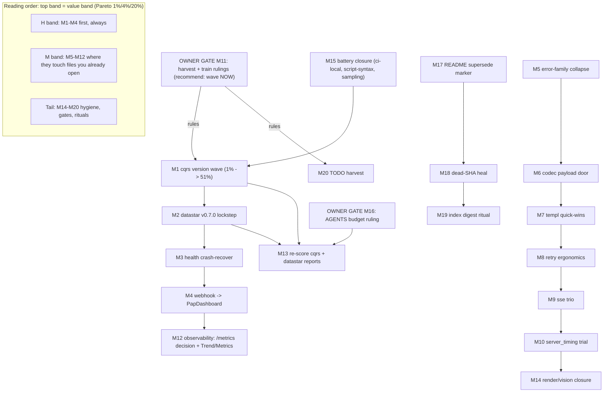

# Library Fleet Review — Pareto Execution Plan (2026-11-09_03-30)

Source of truth: `docs/status/2026-11-09_00-50_libs-fleet-review-self-audit.md` §f 1-34 + §g 1-3,
grounded in the 22 reports at `docs/review/libs/` (each claim carries its citation there — this
plan cites report §-numbers, not code, except where a task names its target file).
Customer = the operator (Lars) + the agent fleet riding the queue; customer-value = uptime,
security, currency, and less code to trust.

**Staleness check (plan step 0, verified 2026-11-09 by TODO_LIST grep):** f19 is the
ssetest `Require*`-assertion half only — the EventID-branded migration half is already
DONE (TODO_LIST row 1067, landed 38e2c7cf); the plan keeps only the assertion half.
`--dep-sweep` vehicle is live (TODO row 155's retirement is time-gated and orthogonal).
go-datastar split (root v0.6.3 / cmd-tq v0.6.2 / static v0.6.1) re-verified against
go.mod files this session. All other f-items spot-checked open via the reports' own
verify blocks (subagent-executed 2026-11-08; lead sampled go-sse + go-retry).

## 1. Pareto breakdown

### The 1% that delivers 51%
**M1 — one cqrs-lite version wave** (`--dep-sweep` onto metaengine v4.23.0,
sqliteengine v4.8.0, system v4.18.0, id v4.7.5). One ~90-minute task out of ~55 fine
tasks (≈2%) buys: the AggregateFn SQL-injection hardening class (system v4.18.0 —
engine family tq SHIPS), 4-module currency, and closure of the review's single
biggest flag. Everything else in this plan is decoration next to a shipped
security-class fix being unpinned.

### The 4% that delivers 64%
M1 + **M2 go-datastar v0.7.0 lockstep + ScriptHandler** (9/9 adopted libs on latest,
ETag+versioned SDK serving replaces hand-rolled) + **M3 health crash-recover**
(a pusher-goroutine panic currently KILLS `tq serve` — the highest-truth
reliability finding in the fleet). Three tasks ≈ 5% of the plan ≈ two-thirds of the
real-world value: security + currency + uptime.

### The 20% that delivers 80%
The above plus: M4 webhook→PapDashboard (incidents become alerts), M5 error-family
PermanentError collapse (deletes a parallel hand-rolled taxonomy), M6 codec
decodePayload door (one JSON door for every payload), M7 templ quick-wins
(MetaRefresh + StickyHeader + the undocumented Pagination guard row), M8 retry
ergonomics, M9 sse health surface. Seven M-tasks ≈ 20% of tasks, ≈ 80% of value.

### The other 80% of tasks (the last 20% of result)
M10-M20: the server_timing trial, observability extras and their decision gates,
re-audit refresh, render/vision closure, battery hygiene (ci-local, script-syntax,
verify sampling), memory rulings, docs-health residue (dead SHAs, README supersede
marker), the index-bloat digest ritual, and the two owner decision gates that
convert this plan into dispatched work. Honest label: necessary, not glorious.

## 2. Comprehensive plan — medium granularity (30-100 min each, 20 tasks)

Sorted by importance → impact → effort → customer-value (security/stability first,
currency second, leverage third, hygiene last; within a band, lower effort first).

| # | Task | Covers §f | Imp | Eff | Value for the customer |
|---|------|-----------|-----|-----|------------------------|
| M1 | cqrs-lite version wave: verify upstream tags pushed → depsweep metaengine v4.23.0 + sqliteengine v4.8.0 + system v4.18.0 + id v4.7.5 → tidy+vendor → vendorHash → parity → module loop → root+cmd gates | f1-f4, f31 | **H** | 90m | Security-class hardening on the shipped engine family; 4-module currency |
| M2 | go-datastar v0.7.0 lockstep (root+cmd/tq+static, kill the 0.6.2/0.6.3 split) + replace hand-rolled serveDatastarSDK with ScriptHandler (ETag + client v1.0.4) | f5, f6 | H | 60m | Currency 9/9; correct cacheable SDK serving |
| M3 | webui health hardening: recover() around evaluate (pusher panic crashes tq serve today) + populate StatusSince/TotalLatencyMs in finishEval | f11, f12 | H | 45m | `tq serve` stops dying on one bad probe; dashboard rows stop rendering empty |
| M4 | health-dashboard WithWebhook → existing PapDashboard channel (store down, wedged fold, fold-follower demotion) | f13 | H | 60m | Queue health lands in the alert surface the operator already watches |
| M5 | error-family: give PermanentError a family; collapse Permanent onto WrapOnce (retire the parallel taxonomy at internal/executor/executor.go:45-63) | f8 | M+ | 45m | One error taxonomy to reason about; dead-letter family matching everywhere |
| M6 | codec: route decodePayload[T] through codec.JSONCodec{}.Decode (zero behavior change; DecodeEnvelopeOrLegacy noted as the future versioning lever) | f7 | M | 40m | One JSON door for every executor payload = one place to harden |
| M7 | templ quick-wins bundle: layout.MetaRefresh swap + Table.StickyHeader + document adopted navigation.Pagination in ADOPTION.md (guard regex) | f15-f17 | M | 30m | Dashboard polish + guard-truth (+~11 leverage points on the next audit) |
| M8 | retry ergonomics: execWithTransientRetry → DoWithValue + OnExhausted/ErrExhausted labeling for 3x-exhausted store-busy writes | f9, f10 | M | 30m | Exhausted retries stop being silent before the reclaim backstop |
| M9 | sse trio: Broadcaster.Health() on /health + adopt ssetest Require* assertions + tidy v0.6.2 residue across 11 nested go.mods | f18-f20 | M | 30m | Subscriber/buffer visibility; stronger SSE tests; pin hygiene |
| M10 | server_timing TRIAL: mount behind RequestLog flag on tq serve; instrument handleFacts + stats read; keep-or-remove verdict | f21 | M | 45m | The one WORTH A TRIAL from the fleet review; cheapest observability win |
| M11 | OWNER GATE (30m meeting): harvest ruling (mint f-items as tq tasks or not) + upgrade-train ruling (confirms/refutes M1-M2 timing) + record verdicts | f24, g1, g2 | H | 30m | Converts this plan into dispatched (paid) or self-serve work |
| M12 | cqrs observability decision + optional token-gated /metrics (otel/prometheus) + WithTrend/WithMetrics after webhook | f14, f22, f23 | M | 40m | Right-sized observability, not gold-plating |
| M13 | Post-wave refresh: re-score go-cqrs-lite.md + go-datastar.md after M1/M2 land (delta rows, index.html update) | f30 | M | 30m | Keeps the review series truthful; feeds the next 80/20 |
| M14 | Render-gate closure: vision pass on index.png (or scripted pixel-diff harness) — structural checks proved well-formedness, not appearance | f25 | L+ | 30m | The index.html render proof becomes a real proof |
| M15 | Window battery closure: full ci-local once + check-script-syntax + re-run 3 random report verify blocks (lead-side sampling debt) | f26-f28 | M | 45m | The session's own hygiene debt paid |
| M16 | OWNER GATE: agentsDocMaxBytes conscious reset ruling; if yes, restore full fleet-verdict line to AGENTS.md within new budget | f29, g3 | L | 30m | Memory richness vs. size guard, owner's conscious call |
| M17 | research README: mark the 2026-10-05 cqrs row SUPERSEDED inline (today only the new row says it) | f32 | L | 15m | Discovery truth for future sessions |
| M18 | docs-health residue: heal dead SHAs 64b22f25/573acfee in tasks/2026-11-08_18-16 closeout (fork records or baselines) | f33 | L | 30m | Dead-cite gate green for the whole corpus |
| M19 | INDEX BLOAT digest ritual: ANNOTATE+ARCHIVE sweep of docs/status/README.md (421 live rows > 400) + land the digest row | f34 | M | 90m | The ratified monthly ritual, overdue by 21 rows |
| M20 | TODO_LIST harvest of the minted subset once M11 rules YES (docs-health HARVEST shape; dedup against rows 155/380/1067 neighborhoods) | f24 | H | 30m | The living execution surface gets the plan's actionable half |

## 3. Fine-grained breakdown — max 12 min per task (55 tasks)

Same sort. Gate-runs that exceed 12m sit inside their parent M-window as a "run + read
rc" step; the 12m cap applies to preparation, never to waiting on a build.

| # | Task (each ≤12m) | Parent | Imp | Min |
|---|------------------|--------|-----|-----|
| F1 | Verify go-cqrs-lite tags pushed: `git -C ../go-cqrs-lite ls-remote --tags origin \| grep -E 'system/v4.18.0\|metaengine/v4.23.0\|sqliteengine/v4.8.0\|id/v4.7.5'` | M1 | H | 6 |
| F2 | If any tag unpushed → add local replaces to root + facades + cmd/tq/go.work + examples/embed (AGENTS graph-loader rule); else noop | M1 | H | 12 |
| F3 | Run the depsweep bump for the 4 modules (go get pins across root graph) | M1 | H | 10 |
| F4 | Per-consumer tidy sweep + `go mod vendor` (root) | M1 | H | 12 |
| F5 | `nix build .#checks.x86_64-linux.vendor-hash`, copy `got:` into flake.nix | M1 | H | 10 |
| F6 | `./scripts/check-facade-parity.sh` BEFORE staging | M1 | M | 8 |
| F7 | 20-module loop build+vet+test (AGENTS per-module gate, GOWORK=off) | M1 | H | 12* |
| F8 | Root build+vet+test -race + `./scripts/test-cmd-tq.sh` | M1 | H | 12* |
| F9 | ci-local.sh full pass; read rc file (not PIPESTATUS) | M1 | H | 12* |
| F10 | CHANGELOG `[Unreleased]` rows for the wave (operator-visible: security hardening note) | M1 | M | 10 |
| F11 | datastar bumps: root go.mod v0.7.0 + static v0.7.0; cmd/tq go.mod v0.7.0; tidy+vendor | M2 | H | 12 |
| F12 | Replace serveDatastarSDK with ScriptHandler in internal/webui/health.go (+ versioned script tag) | M2 | H | 12 |
| F13 | webui tests: SDK-header expectations updated; `go test ./internal/webui/ -run TestHealth` | M2 | H | 10 |
| F14 | Conform + facade-parity + root vet for the datastar graph; commit | M2 | H | 12 |
| F15 | Add recover() in the probe pusher path around evaluate; log at error with check name | M3 | H | 10 |
| F16 | Populate StatusSince + TotalLatencyMs in finishEval | M3 | M | 10 |
| F17 | Test: probe-panic → serve stays alive (t.Run with panicking check); metadata fields pinned | M3 | H | 12 |
| F18 | WithWebhook wiring in internal/webui/health.go → papdashboard notify seam (bridge exists) | M4 | H | 12 |
| F19 | Transition payloads: store down / wedged fold / fold-follower demotion → alert.triggered shapes | M4 | H | 12 |
| F20 | Test webhook fire on health transition (fake URL capture); gate behind existing alert-url flag | M4 | M | 12 |
| F21 | go-error-family checkout: confirm PermanentError-family API shape (read tag v0.12.0) | M5 | M | 6 |
| F22 | Mint family for PermanentError; route executor.go:45-63 hand-rolled taxonomy onto WrapOnce | M5 | M | 12 |
| F23 | Sweep call sites (internal/executor, readmodel DLQ gate); tests stay green | M5 | M | 12 |
| F24 | decodePayload: route through codec.JSONCodec{}.Decode; keep unknown-key/V-refusal semantics pinned by payload_test.go | M6 | M | 12 |
| F25 | Test: payload_test.go contract unchanged (both halves: unknown keys ignored, greater V refused) | M6 | M | 10 |
| F26 | templ: swap refreshMeta → layout.MetaRefresh (render.go) | M7 | M | 8 |
| F27 | templ: Table.StickyHeader:true on the ledger table (components.go) | M7 | M | 5 |
| F28 | templ: `templ generate` + `nix run .#webui-css` + commit generated files | M7 | M | 12 |
| F29 | ADOPTION.md: add navigation.Pagination row; verify adoption_test guard regex sees it | M7 | M | 10 |
| F30 | execWithTransientRetry → DoWithValue (agent.go) | M8 | M | 10 |
| F31 | persistOutcome: OnExhausted/ErrExhausted label for 3x store-busy exhaustion; test the label | M8 | M | 12 |
| F32 | hub.go: expose Broadcaster.Health() through the /health JSON (webui handlers) | M9 | M | 12 |
| F33 | webui SSE tests: migrate plain assertions → ssetest.Require* where they exist | M9 | M | 12 |
| F34 | Tidy sse v0.6.2 residue: for each of 11 nested go.mods bump to v0.7.0 (go mod tidy -go? no: go get + tidy) | M9 | L | 12 |
| F35 | Read httputil/server_timing checkout API (middleware + When predicate) before wiring | M10 | M | 6 |
| F36 | Mount ServerTimingMiddlewareWhen(r → cfg.RequestLog) in webui Handler() chain | M10 | M | 10 |
| F37 | Instrument handleFacts + stats read with MeasureServerTiming (stop BEFORE write) | M10 | M | 12 |
| F38 | Manual trial verdict note appended to docs/review/libs/httputil-server-timing.md (keep or remove) | M10 | L | 10 |
| F39 | Draft the two rulings (harvest scope; train timing) with recommendation paragraphs for owner | M11 | H | 12 |
| F40 | /metrics decision memo: who polls it, what it answers; if yes → token-gated mount sketch | M12 | M | 12 |
| F41 | WithTrend + WithMetrics option flips after webhook (if M4 landed) | M12 | L | 8 |
| F42 | Re-score cqrs-lite + datastar reports: delta sections + index.html row updates | M13 | M | 12 |
| F43 | Vision pass on index.png via a vision-capable session; or script pixel-diff (baseline vs re-render) | M14 | L | 12 |
| F44 | Run check-script-syntax.sh; record rc | M15 | M | 6 |
| F45 | Re-run 3 random report verify blocks; note deltas in the report files' Reviewed lines | M15 | M | 12 |
| F46 | Full ci-local run; tee log; `grep -c '^ok:'` the log file (receipts rule) | M15 | M | 12* |
| F47 | AGENTS budget memo: current bytes, proposed reset value, what the restored line buys | M16 | L | 8 |
| F48 | If reset approved: restore full fleet-verdict line; re-run TestAgentsDocSizeGuard | M16 | L | 6 |
| F49 | research README: inline ~~SUPERSEDED~~ strike + pointer on the 2026-10-05 cqrs row | M17 | L | 5 |
| F50 | Dead-SHA heal: re-resolve 64b22f25/573acfee → fork records (old→new) or baselines in the 18-16 closeout | M18 | L | 12 |
| F51 | Digest ritual prep: candidate list of fully-resolved reports (check-archive-eligibility shape) | M19 | M | 12 |
| F52 | Digest ritual pass 1: ANNOTATE banners on the candidates | M19 | M | 12* |
| F53 | Digest ritual pass 2: archive moves + digest row + index repoint | M19 | M | 12* |
| F54 | HARVEST: mint the ruled-YES subset into TODO_LIST.md (machine shape, dedup vs rows 155/380/1067) | M20 | H | 12 |
| F55 | Post-harvest: check-docs-gates freshness + check-todo-list green | M20 | H | 8 |

`*` = capped prep; the gate/build itself runs longer inside the parent window.

## 4. Execution graph



## 5. Decision gates (the three §g questions, with my recommendations)

1. **Harvest ruling (M11/M20):** recommend YES for M1-M4 (they are bounded, evidence-backed,
   and gate everything else); report-only for the tail. Minting the tail risks paying for
   hygiene at leverage prices.
2. **Train timing (M11):** recommend NOW for M1 regardless of the v0.4.3 train —
   a shipped-security-fix-unpinned outweighs release-train tidiness. M2 may ride the train.
3. **AGENTS budget (M16):** recommend a modest conscious reset (+400B) so the fleet-verdict
   line fits; the guard exists to force the decision, not to forbid the bytes.

## 6. How to verify this plan is still current

```bash
cd /home/lars/projects/go-taskqueue
grep -c '^- \[ \]' TODO_LIST.md                      # backlog shape before/after M20
git -C ../go-cqrs-lite tag -l 'system/v4.*' | sort -V | tail -1   # wave target still latest?
grep -n 'go-datastar' go.mod cmd/tq/go.mod           # split healed after M2?
./scripts/check-docs-gates.sh                        # freshness after any harvest
```

— Plan written 2026-11-09_03-30; execution NOT started (plan-only session; no code touched).
