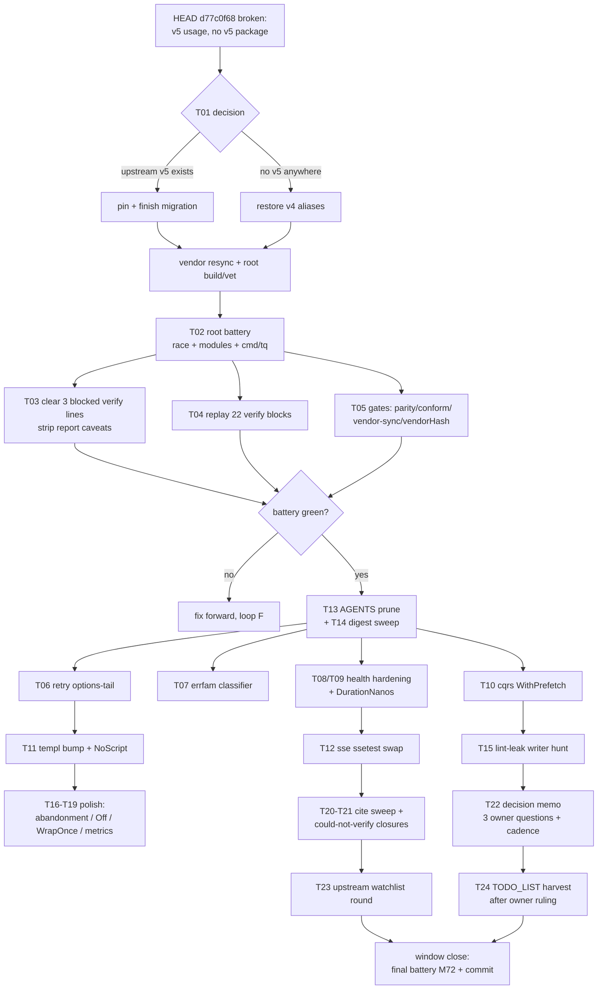

# go-taskqueue — Repair → Verify → Deepen: Pareto Execution Plan (2026-11-12_04-29)

**Context.** The 2026-11-11 fleet-libs refresh window shipped 22 refreshed
library reports + index (commit d77c0f68, already on origin) and left a
status report with a 45-item §f backlog
(`docs/status/2026-11-12_04-19_fleet-libs-refresh-status-and-self-review.md`).
Since that report was written, the ground shifted: the concurrent session's
**v4→v5 facade migration was COMMITTED half-done** — d77c0f68 carries
`v5.Store`/`v5.Open` usage in `internal/queue/{sqlite,postgres}` facades
while the imports still alias `internal/queue/{sqlitev4,postgresv4}` as
`v4`, **no `sqlitev5`/`postgresv5` package exists in-tree, and upstream
go-cqrs-lite has no `queue/v5` tag** (ceiling `queue/v4.0.3`). HEAD does not
compile. d77c0f68 is already pushed, so CI is red on the remote right now.
`vendor/` mirrors the break. An unrelated in-flight edit bumps
`install-nix-action` v31.11.3→v31.11.5 in `.github/workflows/ci.yml`
(another session's; untouched by this plan's commits).

**Scope.** This plan ranks THIS window's discovered backlog (§f 45 items +
the new broken-HEAD reality + the directly-scoped open TODO_LIST cluster:
lint-leak follow-ups). TODO_LIST.md holds 1354 rows overall; rows outside
this window's surface are out of scope here and remain governed by
TODO_LIST + the docs-health sweeps. Per the owner's §g3 answer being open,
§f harvesting into TODO_LIST stays parked — this plan is the vehicle.

**Errata vs stale backlogs (skill Step 0):** "swap execWithTransientRetry to
DoWithValue" is DONE (agent.go:1129) — not planned. "retry ErrExhausted
labeling" is DONE (worker.go:413 + test). "populate StatusSince/TotalLatencyMs"
is DONE (health.go:305-312,323). "WithWebhook relay + trend/export" is DONE
(health.go:408, webui.go:326-327). "templ pagination-in-ADOPTION,
MetaRefresh, StickyHeader" are DONE. "server_timing trial" is DONE and
re-graded KEEP. Anything still listing those as open is stale; the 22 libs
reports are the current truth (all re-verified 2026-11-11).

---

## 1. Pareto breakdown

Of the ~46 tracked items (45 §f + the new HEAD-repair item):

### 1% that delivers 51% — ONE item

| # | Item | Why it is 51% |
| --- | --- | --- |
| P0 | **Repair HEAD buildability**: finish the v5 facade switch FOR REAL (create `internal/queue/{sqlitev5,postgresv5}` over the existing engines, or re-point upstream tags once they exist) — or, until that exists, restore the compilable v4 aliases; `go mod vendor`; root build+vet green | Every other item is blocked or unverifiable while HEAD doesn't compile: CI is red on origin, all 22 report verify blocks can't fully run, the 3 grep-only caveats can't clear, no capability work can be tested. One decision + one small diff unblocks the entire backlog. |

### 4% that delivers 64% — the above plus ONE more

| # | Item | Cumulative why |
| --- | --- | --- |
| P0 | Repair HEAD (above) | unblocks |
| P1 | **Full verification battery on the clean tree**: root build/vet/test (+race), all 22 report verify blocks replayed with captured receipts, the 3 build-blocked verify lines executed and their in-repo caveats stripped, facade parity + vendorHash + conform suites | Claims without a green tree are folklore. This converts every "verified 2026-11-11 by grep" caveat into executed evidence and de-risks the pushed red CI. |

### 20% that delivers 80% — nine items total

| # | Item | Value |
| --- | --- | --- |
| P0+P1 | (above) | 64% |
| P2a | go-retry options-tail at the 3 sites — deletes the last `//nolint:exhaustruct` class; last MISSED row (78→89) | hottest shared seam, pure refactor |
| P2b | go-error-family `RegisterClassifier` for store-busy — deletes the `isTransientStoreBusy` string sniff | correct classification at every future call site |
| P2c | go-health `CoerceValidUTF8` + `Cache-Control: no-cache` in writeHealthJSON | the one unchecked hardening (truncated-body class) |
| P2d | go-health `DurationNanos` in mkCheck | finishes the dashboard's duration column |
| P2e | go-cqrs-lite `WithPrefetch` on TasksPage (unlocked at pinned metaengine v4.23.0) | O(1) repeat-window reads on the dashboard |
| P2f | AGENTS.md prune ≥60 B — kills the 1-byte-margin trap | every future edit currently risks the hard gate |
| P2g | Monthly status-index digest sweep (424/400 live rows, overdue) | stops the alert-fatigue warning on every gate run |
| P2h | lint-leak writer hunt (top open TODO_LIST cluster) — find which invocation writes golangci deps into go.sums | fixes the class at the source, not the scan |
| P2i | templ-components pin bump (v1.28 when cut; repo is 88 ahead) + `CopyButtonProps.NoScript` | keeps the largest UI dep current + the queued adoption |

### The remaining 80% (last ~20% of value) — everything else, planned but last

docs hygiene (AGENTS.md:NNN cite sweep; 2 "could not verify" closures;
series cadence decision), remaining capability polish (per-check
abandonment, `health.Off` sentinel, `WrapOnce` collapse, dash `WithMetrics`,
sse Require* swap), upstream watchlist rounds (severity-override design,
cqrs v5 progress, cmdguard/credentials-store deltas), keep-out standing
triggers, and the three owner decisions (§g of the status report). All are
in the tables below — nothing is dropped, per the brief.

---

## 2. Comprehensive plan — 24 tasks, 30–100 min each (ALL todos mapped)

Sort key: importance/impact/effort/customer-value. `§f` = item numbers in
`docs/status/2026-11-12_04-19_….md` §f. Every §f item plus the new HEAD
item is mapped — none dropped.

| # | Task (30–100 min) | Tier | Impact | Effort | Value | §f |
| --- | --- | --- | --- | --- | --- | --- |
| T01 | **v5 facade repair**: decide finish-vs-revert (finish = create sqlitev5/postgresv5 modules wrapping the v4 engines with the facade contract; revert = restore v4 aliases in the 2 facade files), execute the chosen path, `go mod vendor`, root `go build ./... && go vet ./...` green, commit | 1% | CRITICAL | 90 | unblocks everything | new |
| T02 | **Root verification battery** on the clean tree: `go test ./... -race`, module loop (`GOWORK=off` per module), receipts to a dated file; include the windows loop + cmd/tq via `scripts/test-cmd-tq.sh` | 4% | CRITICAL | 60 | trust restored | §f2,6 |
| T03 | **Clear the 3 build-blocked verify lines** (go-health, go-health-dashboard health tests; TestServerTimingHeaderBehindRequestLog) and strip the build-blocked caveats from the 3 reports | 4% | HIGH | 30 | claims become executed evidence | §f3 |
| T04 | **Replay all 22 libs-report verify blocks** on the clean tree; capture one receipt file; fix any drift found; re-render index.png if scores move | 4% | HIGH | 60 | all report claims re-derivable | §f5 |
| T05 | **Gates after repair**: `check-facade-parity.sh`, conform suites (sqlitev4/postgresv4), `check-gomod-vendor-sync.sh`, nix `vendorHash` check, `check-agents-size.sh`, `check-doc-refs.sh`, `check-status-index.sh` | 4% | HIGH | 45 | gate confidence | §f4 |
| T06 | **go-retry options-tail** at agent.go/worker.go/rename.go (`WithIsRetryable`/`WithOnRetry`/`WithExhausted`), delete 3 exhaustruct suppressions, run executor+worker+retryx gates | 20% | HIGH | 45 | 78→89, deletes a nolint class | §f from report |
| T07 | **error-family store-busy classifier**: `RegisterClassifier` wrapping the SQLITE_BUSY/517 shapes; `isTransientStoreBusy` delegates or dies; tests | 20% | HIGH | 45 | deletes a string sniff on the hot path | §f |
| T08 | **health writeHealthJSON hardening**: `health.CoerceValidUTF8` + `Cache-Control: no-cache` + stop swallowing the marshal error; table test for invalid-UTF-8 + marshal-fail paths | 20% | HIGH | 30 | closes a truncated-body class | §f |
| T09 | **health DurationNanos**: set per-check duration in mkCheck/finishEval; verify the dashboard duration column renders (screenshot or parse) | 20% | MED | 30 | finishes row metadata | §f |
| T10 | **cqrs WithPrefetch on TasksPage**: shared `metaengine.PrefetchCache` on the Model, `WithPrefetch(nil)` preserved export paths; bench or log-proof of repeat-window hit | 20% | MED | 60 | O(1) repeat dashboard reads | §f |
| T11 | **templ-components bump**: pin v1.28 when upstream cuts it (or audit the 88-ahead diff if already usable), `templ generate`, `nix run .#webui-css`, adopt `CopyButtonProps.NoScript` + `display.CopyButtonScript`, ADOPTION.md row | 20% | MED | 60 | largest UI dep current | §f |
| T12 | **go-sse ssetest swap**: replace the 4 hand-rolled SSE decode loops in webui_test.go with `RequireDataJSON`/`RequireEventType` | 20% | MED | 30 | finishes the last PARTIAL row | §f |
| T13 | **AGENTS.md prune** ≥60 B (restore working margin; candidates: stale Known-Issues lines superseded by the v5 repair) + guard re-run | 20% | MED | 30 | de-traps every future edit | §f |
| T14 | **Monthly status-index digest sweep**: ANNOTATE the 2026-09/10 clusters at HEAD, ARCHIVE resolved reports + `archived/README.md` manifest, land the `digest 2026-11` row; target <400 live rows | 20% | MED | 60 | kills the per-run bloat warning | §f |
| T15 | **lint-leak writer hunt** (open TODO_LIST cluster): bisect which invocation writes golangci deps into module go.sums (`-mod=mod` golangci? buildflow fan-out?); fix at source; then the 4 sibling TODO rows (end-to-end self-test fixture, ci-local flag shape, allowlist mechanism, go.work.sum coverage decision) | 20% | HIGH | 100 | kills a recurring CI failure class | TODO_LIST |
| T16 | **health per-check deadline abandonment** (finishes row 10's second half) | 80% | MED | 30 | one slow check can't stall a batch | §f |
| T17 | **health.Off sentinel** for the unmounted projection check (visible off-row + enable recipe) | 80% | LOW | 30 | operator visibility | §f |
| T18 | **error-family WrapOnce collapse** of `Permanent`'s hand-rolled guard | 80% | LOW | 30 | polish, one wrap path | §f |
| T19 | **dash WithMetrics** behind the token gate (flip the deliberate-off row if the fleet wants /health/metrics) — includes the owner no-op path | 80% | LOW | 30 | optional observability | §f |
| T20 | **AGENTS.md:NNN cite sweep** over all 22 libs reports; re-anchor or de-line-number (line numbers in AGENTS.md rot weekly) | 80% | MED | 30 | kills a recurring drift class | §b3 |
| T21 | **Close the 2 "could not verify" items**: measure-or-drop the go-sse upstream coverage claim; pin the go-etag favicon Set-site properly | 80% | LOW | 30 | zero unverifiable claims | §b5 |
| T22 | **Decision memo** for the 3 owner questions (v5 ownership — now sharpened: HEAD is landed-broken; server_timing disposition; §f harvest policy) + libs-series cadence proposal | 80% | MED | 30 | unblocks 4 parked items | §c |
| T23 | **Upstream watchlist round**: severity-override design status (go-health), cqrs v5 tag progress (feeds T01's finish path), cmdguard/credentials-store/appkit deltas since 11-11; update report headers where drifted | 80% | LOW | 60 | keeps keep-outs honest | §f |
| T24 | **TODO_LIST harvest execution** of the chosen capability tier (post owner answer to §g3): write agent-executable rows with code paths + report pointers | 80% | MED | 30 | backlog becomes dispatchable | §c1 |

Coverage check: §f items 1–45 map into T01–T24 (1→T01; 2,6→T02; 3→T03;
4→T05; 5→T04; 7→T14; 8–12→T06–T10; 13→T12; 14→T16; 15→T17; 16→T13; 17→T15;
18–20→T08–T10 remainder rows; 21→T19; 22–24→T20,T21; 25→T22; 26→T13;
27→T14; 28–33→T23; 34–39→T20/T21/T12/T10; 40→micro helper; 41–45→T22/T24).
Process items §e1–7 are embedded as done-criteria in T02/T04/T13 and the
micro-table.

## 3. Micro plan — ≤12 min steps, ALL todos (sorted, same key)

| # | Micro-step | ≤min | Parent |
| --- | --- | --- | --- |
| M01 | Read `git log -1 d77c0f68` facade hunk + confirm no sqlitev5 dir and no upstream `queue/v5` tag; write the 3-line fact block into the PR/decision note | 6 | T01 |
| M02 | Decision: if a real v5 engine exists upstream → pin it; else restore v4 aliases (2 files, `v5.` → `v4.`, keep the commit message's intent documented in the new commit) | 8 | T01 |
| M03 | Execute the 2-file diff; `gofmt` scope check (tq-bash-guard rule); `go build ./internal/queue/...` green | 6 | T01 |
| M04 | `go mod vendor`; `go build ./... && go vet ./...` at root; paste rc into the receipt file | 10 | T01 |
| M05 | Commit the repair (detailed message: what broke, why, the decision) — BEFORE any battery run (edit→commit→battery ordering) | 8 | T01 |
| M06 | `git log -1 --format='%(trailers:key=Task-Queue-ID,valueonly)'` empty-check (daemon-sweep heal check) | 2 | T01 |
| M07 | Root `go test ./... -race` → tee to `docs/status/assets/<ts>_repair-battery/root-test.log` | 12 | T02 |
| M08 | Module loop: for each nested module `GOWORK=off GOEXPERIMENT=jsonv2 go build/vet/test -count=1` → same receipt dir | 12 | T02 |
| M09 | `scripts/test-cmd-tq.sh` (CMD_TQ_OS=windows cross-compile) → receipt | 10 | T02 |
| M10 | `grep -c '^ok:'` over the captured battery log → the countable receipt line | 2 | T02 |
| M11 | `go test ./internal/webui/ -run TestHealth -count=1 -v` → PASS count; compare to the 9/9 baseline | 6 | T03 |
| M12 | `go test ./internal/webui/ -run TestServerTimingHeaderBehindRequestLog` → rc + output | 4 | T03 |
| M13 | Edit go-health.md + go-health-dashboard.md + httputil-server-timing.md: replace the build-blocked caveats with the executed receipts (dates + counts) | 10 | T03 |
| M14 | For each of the 22 reports: `bash` its How-to-verify block; append rc lines to one receipt file (batch 1: adopted 9) | 12 | T04 |
| M15 | Same (batch 2: not-adopted 13) | 12 | T04 |
| M16 | Reconcile any drift: edit the report in place + note in the receipt; re-render index.png only if a score/date moved | 10 | T04 |
| M17 | `scripts/check-facade-parity.sh` → rc | 4 | T05 |
| M18 | Conform suites: sqlitev4 + postgresv4 `TestStoreConformance` (GOWORK=off) → receipts | 10 | T05 |
| M19 | `scripts/check-gomod-vendor-sync.sh` + `nix build .#checks.x86_64-linux.vendor-hash` → copy `got:` into flake.nix if drifted | 12 | T05 |
| M20 | `check-agents-size.sh`, `check-doc-refs.sh`, `check-status-index.sh` → 3 rc lines | 4 | T05 |
| M21 | retry: read options.go API (`WithIsRetryable/WithOnRetry/WithExhausted` signatures) | 6 | T06 |
| M22 | agent.go: convert `execWithTransientRetry` literal → options tail; drop its nolint | 8 | T06 |
| M23 | worker.go: convert `persistOutcome` hooks → `WithOnRetry`+`WithExhausted`; drop nolint | 10 | T06 |
| M24 | rename.go: convert; drop nolint | 6 | T06 |
| M25 | `grep -rn 'nolint:exhaustruct' internal | grep retry` → zero; module gates (executor/worker/retryx) green | 10 | T06 |
| M26 | errfam: read registry.go classifier API + the busy shapes (5, 517) | 8 | T07 |
| M27 | Write `RegisterClassifier` in an init or package var (which module owns it: worker or companion — decide by import direction) | 12 | T07 |
| M28 | Delete/redirect `isTransientStoreBusy`; keep the extended-517 coverage; run worker tests | 10 | T07 |
| M29 | health: read handlers.go:292-318 (upstream writeResponse semantics) | 6 | T08 |
| M30 | Rework writeHealthJSON: CoerceValidUTF8 + no-cache header + propagate marshal error to 500-body fallback | 10 | T08 |
| M31 | Table test: invalid-UTF-8 store error, marshal-fail path, happy path | 12 | T08 |
| M32 | health: thread per-check start time into mkCheck; set DurationNanos | 10 | T09 |
| M33 | Render proof: run serve on a scratch DB (TQ_DB! never the inherited production journal) and parse the /health JSON duration fields | 12 | T09 |
| M34 | cqrs: read the WithPrefetch/PrefetchCache COOKBOOK section + cqrs-lint F026 shape | 8 | T10 |
| M35 | Add `prefetch *metaengine.PrefetchCache` to the Model + wire opts in TasksPage (not Tasks()) | 10 | T10 |
| M36 | Repeat-window proof: two identical page renders → hit log/bench delta; export path with `WithPrefetch(nil)` still exact | 12 | T10 |
| M37 | templ: check upstream tags for v1.28; if cut, bump in root+facade loaders (grep 00010101 pseudo-versions first) | 10 | T11 |
| M38 | `templ generate` + `nix run .#webui-css`; commit generated files | 8 | T11 |
| M39 | CopyButton NoScript + `display.CopyButtonScript(nonce)` at the board's copy affordance; ADOPTION.md row | 12 | T11 |
| M40 | sse: read ssetest Require* signatures; swap webui_test.go:214-233 | 10 | T12 |
| M41 | Swap :331, :484, :1671; run webui tests | 12 | T12 |
| M42 | AGENTS prune: `grep -n` the Known-Issues rows the v5 repair made stale (e.g. facade-migration caveats) → prune ≥60 B | 12 | T13 |
| M43 | `check-agents-size.sh` → OK with ≥50 B margin restored | 2 | T13 |
| M44 | Digest sweep batch 1: ANNOTATE the oldest live cluster (2026-09) at HEAD — per-item verdict banners | 12 | T14 |
| M45 | Digest sweep batch 2: ANNOTATE 2026-10 cluster | 12 | T14 |
| M46 | `git mv` resolved reports → `archived/`; append `archived/README.md` manifest section | 10 | T14 |
| M47 | Land the `digest 2026-11` row in README.md; `check-status-index.sh` + `check-ghost-archives.sh` rc=0 | 8 | T14 |
| M48 | lint-leak hunt: grep shell scripts + CI for bare `golangci-lint` invocations; check `-mod=mod` env; list candidates | 12 | T15 |
| M49 | Reproduce: run the candidate on a scratch module; observe the go.sum write | 12 | T15 |
| M50 | Fix at source (flag/env/isolation); re-run the gate's Case 8 | 12 | T15 |
| M51 | Vendor-sync self-test end-to-end fixture (env-hook style) — TODO row 2 of the cluster | 12 | T15 |
| M52 | ci-local vendor-sync step → `--self-test` flag shape — TODO row 3 | 8 | T15 |
| M53 | `lint_leak_scan` allowlist table — TODO row 4 | 10 | T15 |
| M54 | go.work.sum coverage decision + implementation — TODO row 5 (owner input recorded) | 12 | T15 |
| M55 | health abandonment: read checks.go:94-126 (upstream pattern); design the per-check timeout wrapper | 10 | T16 |
| M56 | Implement + test (slow-check case abandons, others proceed) | 12 | T16 |
| M57 | health.Off: types.go:78-108 read; emit the off-row for the unmounted projection | 10 | T17 |
| M58 | Update the omit-assertion test → off-row assertion | 8 | T17 |
| M59 | WrapOnce collapse: Permanent → `errorfamily.WrapOnce(cause, Rejection, "executor.permanent", …)`; keep DirtyTree bolt-on | 10 | T18 |
| M60 | Executor module gate + the double-wrap pin test green | 8 | T18 |
| M61 | dash WithMetrics: options.go read + flip behind cfg flag (owner no-op path documented) | 12 | T19 |
| M62 | Token-gate test for /health/metrics (401 without token) | 10 | T19 |
| M63 | Cite sweep: `grep -rn 'AGENTS\.md:[0-9]' docs/review/libs/` → list | 4 | T20 |
| M64 | Fix each hit: re-anchor to the current line or drop to a section name | 12 | T20 |
| M65 | go-sse coverage claim: run upstream `go test -cover` (checkout) → real number; edit the report | 12 | T21 |
| M66 | go-etag favicon: find the Set-site (lib or tq); pin it; fix the report cite | 10 | T21 |
| M67 | Decision memo draft: the 3 owner questions + cadence proposal, one page, into docs/status/ or the plan's follow-up | 12 | T22 |
| M68 | Watchlist: `git -C go-health fetch && log` the severity-override doc; cqrs `queue/v5*` tags; cmdguard/creds/appkit log deltas | 12 | T23 |
| M69 | Update any drifted report header lines (dates/versions only — no re-audit) | 10 | T23 |
| M70 | Harvest execution: write the chosen capability rows into TODO_LIST.md (`- [ ]`, one per line, code path + report pointer) | 12 | T24 |
| M71 | `check-todo-list.sh` + `check-docs-gates.sh run --json` → green | 8 | T24 |
| M72 | Final window battery: doc-refs + status-index + agents-size + dead-exports `--self-test` → 4 rc lines | 8 | T05 |
| M73 | Commit any residue with the detailed-message convention; verify footer-attribution on the span | 8 | T24 |

Coverage: M01–M73 cover every row of §2 (T01×6, T02×4, T03×3, T04×3, T05×4,
T06×5, T07×3, T08×3, T09×2, T10×3, T11×3, T12×2, T13×2, T14×4, T15×7,
T16×2, T17×2, T18×2, T19×2, T20×2, T21×2, T22×1, T23×2, T24×2, plus the
window-final M72–M73).

## 4. Execution graph

## 5. Non-negotiables while executing (anti-Verschlimmbesser rails)

1. **Never touch** `.github/workflows/ci.yml` (another session's in-flight
   action bump) or any file outside the task's named scope.
2. **Never amend or rebase** pushed commits (d77c0f68 is public); repairs
   land as forward commits with detailed messages.
3. **TQ_DB discipline**: any `tq serve` render proof runs against a scratch
   DB export — the inherited `TQ_DB` is the production journal.
4. **Edit→commit→battery ordering**: stage+commit the repair BEFORE running
   the battery; after any commit, re-check the Task-Queue-ID trailer for
   daemon-sweep contamination.
5. **Generated files are committed** (`*_templ.go`, minified `app.css`) —
   after templ edits always `templ generate` + `nix run .#webui-css`.
6. **GOEXPERIMENT=jsonv2 + GOWORK=off** for nested-module gates; flake sees
   only tracked files (`git add` before `nix build`).
7. Budget-guarded files (AGENTS.md) get byte-counted BEFORE editing; the
   margin must be ≥50 B after any edit (currently 1 B — T13 first among
   content edits).
8. Every gate claim in a report cites a CAPTURED rc/output file, never a
   remembered summary line.

## 6. What "done" means for this plan

- HEAD compiles; origin CI green (or red only on documented pre-existing
  lineage classes with the CI_CHECK=off escape recorded).
- All 22 verify blocks executed with receipts; zero build-blocked caveats
  left in docs/review/libs/.
- The 20% tier items shipped and re-scored in the reports (go-retry 89
  expected; health rows full; cqrs row 15 flipped).
- Index digest landed; live rows <400; bloat warning silent.
- The 3 owner questions have a decision memo waiting on the owner.
