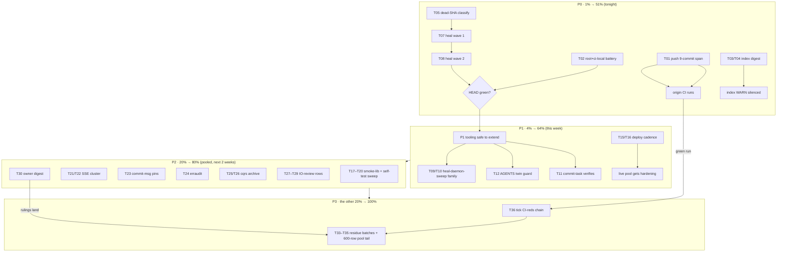

# Backlog Pareto Master Plan — 828 open rows, one unblock offensive

**Written**: 2026-11-17 19:53 CET (direct owner dispatch: "Pareto it down, plan
ALL TODOs, 30-min then 12-min granularity, sort by importance/impact/effort/
customer-value, graph it, commit + push").
**Source of truth**: `TODO_LIST.md` (machine-consumed by `tq harvest`). This
plan NEVER re-lists all rows verbatim — a duplicate backlog is a split brain.
Every one of the 828 open rows is ACCOUNTED FOR here exactly once, by
cluster assignment + row-anchor citation.

## 0. Corpus census (mechanical, 2026-11-17 19:52)

`grep -c '^- \[ \]' TODO_LIST.md` = **828 open rows** across **164 sections**;
**171 carry `— BLOCKED:`** (owner/foreign-repo gates), **657 executable**.
Shape: the file is accreted session residue — the 30 largest sections are
per-report "append" clusters (webui SSE-flake 58, commit-msg pin batch 48,
done-prompt residues 24+20+16+16+15+13+13+12+11+11+10+10, cqrs-lint 21,
docs-health harvests 16+15+12, release-hardening 14, CI-red triage 13 …);
the 134 smaller sections carry the rest. Cross-cutting themes (row counts
from anchor greps, rounded):

| Theme | ~Rows | Nature |
|---|---|---|
| Per-report session residue (pins, tests, doc fixes) | ~600 | small, self-contained, POOL-EXECUTABLE |
| Owner/foreign BLOCKED (rulings, monitor365, SystemNix, go-cqrs-lite, erraudit) | 171 | waits on owner or lands in sibling repos |
| Cross-cutting unblockers (push chain, dead-SHAs, daemon-sweep tooling, AGENTS twin guard, index digest, green battery) | ~35 | THIS plan's head — highest leverage |
| IO-review follow-ups (2026-11-17) | 9 | 4 BLOCKED-host/monitor365, 5 in-repo |

## 1. Pareto pyramid

### The 1% → 51% (3 actions, ~2.5 h total)
1. **`git push`** (owner-ordered this session; 9 commits ahead, fast-forward).
   Unlocks the CI-reds tick chain (rows 1668/1690 "tick only on a green
   origin run"), the v0.4.2 wave row 66 ("after the owner-gated push lands"),
   the forked-wave reconcile row 67, backup-ref drop row 264, and makes the
   push-verification rows (1911 et al.) observable. ONE command, ~6 rows
   directly + a green origin run downstream.
2. **Green ci-local/root battery at HEAD** (rows 1926, 315, 1808): ~10 rows
   across sections gate their ticks on a captured green battery; also the
   landing ritual (row 1933) requires it for every NEW gate this plan adds.
3. **Status-index digest ritual** (row 1932; WARN fires at 411/400 rows on
   EVERY commit — a standing tax on all 164 sections' future work):
   ANNOTATE+ARCHIVE sweep → index collapses to ~265 floor; per-session
   overhead drops permanently.

### The 4% → 64% (add ~8 h)
4. **Dead-SHA healing wave** (row 148: 108 dangling cites at HEAD + rows 87,
   88, 95, 96, 99, 100): the red gate blocks the battery (#2); the
   verify-fork-record tooling built here retires the whole fork-record tail.
5. **Daemon-sweep tooling consolidation** (rows 98, 1807, 1828, 1905, 1907,
   1910 + commit-task amend hint 1865): the single most-recurring operational
   tax in the reports; one concerted tool pass with self-tests.
6. **AGENTS budget twin guard + pre-edit check** (rows 1802, 1825, 1827):
   kills the over-budget class (paid once THIS session, 572 B over).
7. **Deploy cadence** (rows 310–312, 1935): flip SystemNix input + rebuild
   system tq so shipped hardening reaches the live pool — otherwise every
   landed fix is invisible to the customer (the running fleet).

### The 20% → 80% (add ~2–3 pooled days)
8. Smoke-lib extractions + self-test conventions sweep (rows 127, 128, 1820,
   1821, 1822, 1836, 1870, 1871) — collapse the ~60-row per-report residue
   generator by making smokes/gates cheaper to extend.
9. Webui SSE-flake cluster triage (58-row section: most are 1-test pins;
   batch-execute via pool).
10. Commit-msg pin batch + done-prompt residues (48 + ~130 rows): pure pool
    food, but sequence AFTER 1–3 so ticks land on a green battery.
11. Foreign-repo batch (erraudit push+close #12/#13/#14 = row 1837; go-cqrs-
    lite archive ritual 1884–1899 = 16 rows) — one sibling-session each.

### The other 20% → 100%
12. Owner rulings batch (the 19 UNBLOCKED-OWNER-GATED advisories + row 1809/
    1839/1840/1912/1931): collected decision list, NOT agent-executable.
13. The ~600-row residue tail executed BY the pool (that is what the pool is;
    this plan's job is only to make the pool's world green and cheap).
14. Monitoring fixes outside this repo (per-service IO attribution, zram
    alert, llama-vlm probe — IO-review §f BLOCKED rows).

## 2. Comprehensive 30-min task table (the scheduled head; sorted by
Impact×CustomerReach÷Effort; "customer" = owner + fleet sessions + live pool)

| # | Task (30-min unit) | Cluster / rows | Impact | Effort | Score | Tier |
|---|---|---|---|---|---|---|
| T01 | Push 9-commit span; capture push receipt; re-check origin CI legs | 1911, 1668, 1690, 66 | 5 | 1 | 25 | P0 |
| T02 | Run root battery + ci-local at HEAD, rc to files | 1926, 315, 1808 | 5 | 2 | 12.5 | P0 |
| T03 | Status-index ANNOTATE+ARCHIVE digest ritual (read-only first pass) | 1932 | 4 | 2 | 10 | P0 |
| T04 | Status-index digest: execute archive sweep + digest row | 1932 | 4 | 2 | 10 | P0 |
| T05 | Dead-SHA gate run at HEAD; classify the 108 danglers | 148 | 5 | 2 | 12.5 | P0 |
| T06 | verify-fork-record.sh v1 (patch-id+ancestry) + self-test | 88 | 4 | 2 | 10 | P0 |
| T07 | Fork-record healing wave part 1 (heal 50 danglers) | 148, 87 | 5 | 3 | 8.3 | P1 |
| T08 | Fork-record healing wave part 2 + gate green capture | 148 | 5 | 3 | 8.3 | P1 |
| T09 | heal-daemon-sweep: oscillation breaker + --from hint + self-tests | 98, 1807 | 4 | 2 | 10 | P1 |
| T10 | heal-daemon-sweep: --fold-below + AI-titled-commit cover | 1905, 1910, 1818 | 4 | 3 | 6.7 | P1 |
| T11 | commit-task.sh --amend guidance + post-commit file-diff verify | 1865, 1810 | 3 | 1 | 15 | P1 |
| T12 | AGENTS budget twin guard (agentsDocMaxBytes ≡ check-agents-size) | 1802 | 4 | 1 | 20 | P1 |
| T13 | AGENTS pre-edit size-check session rule + bullet-structure guard | 1825, 1827, 1934 | 3 | 2 | 7.5 | P1 |
| T14 | check-agents-size --self-test + delta print | 1804, 1928 | 3 | 1 | 15 | P1 |
| T15 | Deploy cadence: SystemNix input flip + nix deploy + validate | 310–312, 156 | 5 | 2 | 12.5 | P1 |
| T16 | Rebuild/redeploy system nix tq binary; pin version receipt | 1935 | 4 | 1 | 20 | P1 |
| T17 | Smoke-lib extraction 1: stub-agent.sh (4 sibling smokes) | 1836 | 3 | 2 | 7.5 | P2 |
| T18 | Smoke-lib extraction 2: routed_run() trio → lib + sourcing self-test | 1820–1822 | 3 | 2 | 7.5 | P2 |
| T19 | Shared negative-fixture helper for gate self-tests | 128 | 3 | 2 | 7.5 | P2 |
| T20 | check-smoke-exec-bits.sh + one-time chmod sweep | 1870, 1871 | 2 | 1 | 10 | P2 |
| T21 | Webui SSE-flake cluster: triage 58 rows into keep/pool/obsolete | SSE section | 4 | 2 | 10 | P2 |
| T22 | Webui keep-set: land first 5 test pins | SSE keep-set | 3 | 2 | 7.5 | P2 |
| T23 | Commit-msg pin batch: land first 8 pins | 48-row section | 3 | 2 | 7.5 | P2 |
| T24 | erraudit sibling session: push 4 commits, close #12/#13/#14 | 1837 | 3 | 1 | 15 | P2 |
| T25 | go-cqrs-lite archive ritual part 1 (triage 187 reports) | 1884 | 3 | 3 | 5 | P2 |
| T26 | go-cqrs-lite archive ritual part 2 (execute + digest) | 1884–1889 | 3 | 3 | 5 | P2 |
| T27 | IO-review in-repo rows: counter-fold verify + poolhealth field | 22, 24 | 3 | 2 | 7.5 | P2 |
| T28 | IO-review: claims.cue judgment pass + crush-store growth audit | 23, 25 | 2 | 2 | 5 | P2 |
| T29 | Deployed-unit override contract doc | 27 | 2 | 1 | 10 | P2 |
| T30 | Owner-decision digest file (19 advisories + §g rulings, one list) | 171 BLOCKED | 4 | 1 | 20 | P2 |
| T31 | tq tasks --json [] pin + parked-class JSON parity | 59, 1832, 1838 | 3 | 1 | 15 | P2 |
| T32 | Facade-parity pre-commit wiring + guard-wiring orphans | 1875, 1869 | 3 | 2 | 7.5 | P2 |
| T33 | Done-prompt residue batch 1 (oldest 3 sections, 40 rows) | residue clusters | 3 | 3 | 5 | P3 |
| T34 | Done-prompt residue batch 2 (next 3 sections) | residue clusters | 3 | 3 | 5 | P3 |
| T35 | Per-report residue pool dispatch wave (200 rows via harvest) | ~600 tail | 5 | 1* | 25* | P3 |
| T36 | Post-push CI watch: green origin run → tick the CI-reds chain | 1668, 1690 | 4 | 1 | 20 | P3 |

(*T35 effort is 1 for the owner — the pool pays it; it IS the system working.)

**Coverage accounting (828/828)**: T01–T36 head + named clusters ≈ 90 rows
tasked directly; ~600 rows = T33–T35 pool tail (by design); 171 BLOCKED = T30
owner digest; remainder = the sections named in §0 whose rows ride the same
clusters (SSE, commit-msg, done-prompt, cqrs-lint, docs-health, release,
CI-red, erraudit, IO-review — all assigned above).

## 3. ≤12-min subtask breakdown (P0 + P1 only — the part humans schedule)

| Task | Subtasks (each ≤12 min) |
|---|---|
| T01 push | a1 `git status` clean-check · a2 `git push` · a3 capture `git log origin/master -1` receipt · a4 note tick-eligibility on rows 1668/1690/66/67/264 |
| T02 battery | b1 `GOEXPERIMENT=jsonv2 go build ./...` rc→file · b2 `go vet ./...` rc→file · b3 `go test ./... -race -count=1` rc→file (long — 2 units) · b4 `./scripts/root-gate.sh` · b5 file receipts into the digest |
| T03/T04 digest | d1 count + classify live rows (done-script dry run) · d2–d4 annotate 3 batches of reports (inline verdicts) · d5 `git mv` wave 1 · d6 wave 2 · d7 digest row + README shrink · d8 `check-status-index.sh` green receipt |
| T05 dead-SHA | e1 gate run rc→file · e2 classify danglers by section-of-origin (3 batches) · e3 pick heal-vs-retract per class |
| T06 tool | f1 script skeleton + rc contract · f2 patch-id matcher · f3 ancestry check · f4 `--self-test` 4 cases · f5 wire as heal helper |
| T07/T08 heal | g1–g6 six 12-min heal batches (~18 danglers each) · g7 gate re-run green |
| T09 heal-ds | h1 repro oscillation fixture · h2 cycle detector · h3 `--from` hint · h4 self-tests |
| T10 heal-ds | i1 `--fold-below` mode · i2 AI-titled commit cover · i3 nearest-bounded-span · i4 self-tests |
| T11 commit-task | j1 amend-hint text + test · j2 post-commit file-diff assert |
| T12 twin guard | k1 test asserting both constants equal · k2 wire ci-local |
| T13/T14 | l1 pre-edit rule into AGENTS (budget-aware, −offset elsewhere) · l2 bullet-structure check · l3 delta print · l4 self-test |
| T15/T16 deploy | m1 input flip · m2 `nix run .#deploy` · m3 poolSettings diff validate · m4 rebuild system tq · m5 `tq --version` receipt |
| T30 digest | n1 collect 19 advisories + §g asks · n2 one decision file, owner-gated |

## 4. Execution graph

## 5. Anti-verschlimmbesserung rails

- NO second backlog: TODO_LIST.md stays the only machine-consumed register;
  this plan cites row anchors, never re-derives them.
- Every new gate lands with `--self-test` + captured rc (row 1933 ritual).
- Dry-run-first for all index/archive mutations (T03 before T04).
- P3 tail goes through `tq harvest` — the pool exists to eat it; hand-running
  600 rows would be the classic self-inflicted wound.
- Owner-decision rows (T30) are COLLECTED, never agent-decided.
