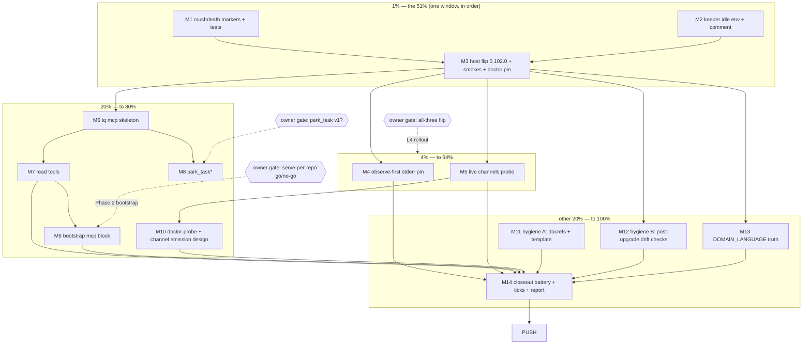

# SUPERB — crush v0.102.0 upgrade + channels unlock (pareto execution plan)

**Date**: 2026-11-23 00:57 CET. **Trigger**: owner directive (pareto 1/4/20
breakdown → 30–100 min comprehensive plan → ≤12 min fine plan → execution
graph → commit+push).
**Scope**: the crush arc — everything between "pool on v0.101.0 today" and
"pool safely on v0.102.0 with the `tq mcp`/channels build path unblocked".
This is the crush-arc successor slice of
`docs/planning/2026-11-17_19-53_backlog-pareto-master-plan.md` (which owns
the whole backlog); NOT a re-plan of its 600 rows — re-planning those here
would fork the standing artifact.
**Inputs, verified at HEAD 2026-11-23 ~00:5x**: research note
`docs/research/2026-11-23_00-32_crush-v0.102.0-channels-and-server-hardening.md`
(17 tag-verified citations); dependency map + TODO rows minted this window;
still-open receipts: `grep -c 'lost connection to the crush'
internal/executor/crushdeath.go` → 0, `doctorCrushProvenVersion = "0.99.0"`
(doctor.go:125), no `CRUSH_SERVER_IDLE_TIMEOUT` in cmd/tq/agentpool.go,
status report `docs/status/2026-11-23_00-38_crush-v0102-channels-research-window.md`.
**Errata (skill step 0)**: none — every in-scope task verified still-open at
HEAD this window; no already-shipped work re-dispatched.

## 0. The goal, in one line each

1. **No-burn stays true on 0.102.0**: pool-infrastructure deaths must keep
   requeueing without attempt burn (crushdeath markers + idle keeper fix).
2. **The flip**: host binary 0.101.0 → 0.102.0, smokes green, doctor pin
   honest.
3. **Channels velocity**: host-verified capability probe → `tq mcp` Phase 1
   (read tools for every session) → Phase 2 bootstrap design fed by official
   `mcp add --channel`/`--channel-reply` flags.

## 1. Pareto pyramid

### The 1% that deliver 51% (do first, as ONE window)

| # | Task | Why it is the 51% |
| - | ---- | ----------------- |
| P1 | `crushServerDeathMarkers` += `lost connection to the crush server`, `agent run was cancelled on the server` + both-sided tests | The ONLY correctness break in 0.102.0: without it every server death burns attempts (paid round-trips + DLQ autopsies + env-streak risk). Marker miss = silent misclassification. |
| P2 | Keeper: `CRUSH_SERVER_IDLE_TIMEOUT=<long>` in `runCrushServerActor` env + fix the false `crushKeeperInterval` comment | Server churn (60 s idle exit → ladder restart at 1m after 3 tries) parks claims and distorts restart counts; one env var kills the whole class. |
| P3 | Host bump 0.101.0→0.102.0 (SystemNix) + re-run `crush-server-route.sh` + `crush-pool-supervisor.sh` + bump `doctorCrushProvenVersion`→0.102.0 in the SAME change | The unlock act; nothing below this tier pays off until it lands. Pin-bump-in-same-change is the doctor comment contract. |

### The 4% that deliver 64% (add)

| # | Task | Why |
| - | ---- | ---- |
| P4 | Observe-first stderr pin: run a routed run against the real 0.102.0 binary, capture the fail-on-drop error lines verbatim, pin them in `crushdeath_test.go` fixtures | Turns source-derived strings into observed strings (the repo's observe-first pin rule); guards against fang error-handler prefixes. |
| P5 | Live channels-capability probe (scratch stdio MCP server declaring `claude/channel`; confirm gate opens + push renders) | Converts "tag-verified" into "host-verified" — the LAST technical unknown before Phase 2; feeds the owner ruling. |

### The 20% that deliver 80% (add)

| # | Task | Why |
| - | ---- | ---- |
| P6 | `tq mcp` Phase 1 build: hand-rolled JSON-RPC 2.0 stdio server, ≤6 tools (`task_list`, `task_show`, `queue_stats`, `dlq_list`, `park_task`*) | Kills the argv-quoting class + ambient-TQ_DB hazard class for EVERY dispatched and interactive session, starting day one. *park_task per owner ruling. |
| P7 | Bootstrap mcp-block emission (explicit `--db` flag, managed block) + doctor wiring (channels-capability probe, mcp-present check) | Makes the MCP server configuration, not inherited env; doctor-observable. |

### The other 20% (to reach 100%)

| # | Task | Why |
| - | ---- | ---- |
| P8 | Session-hygiene batch: re-run `check-doc-refs.sh` (heal or hand off the foreign vendor-window cite), template upstream-cite example row (`docs/references/research-note-template.md`), `is_busy`-wideness + env-gap canary re-check post-upgrade | Small honesty debts this research window created or noticed; cheap now, annoying later. |
| P9 | DOMAIN_LANGUAGE `Routed run`/`Keeper` rows: server-side-cancel semantics + idle-knob once P3 lands | Vocabulary stays true to shipped behavior. |
| P10 | Status-index digest ritual (411/400 rows) — STANDING row, owned by the docs-health sweep; referenced, NOT re-planned here | Prevents this plan from forking that work. |

### Owner-gated (listed, never self-scheduled)

- Serve-per-repo pilot go/no-go (channels Phase 2's ruling) — question 3 of
  the 00-38 report.
- All-three production flip (`--crush-server` rollout, row 1604 BLOCKED).
- `park_task` in `tq mcp` v1 or wait (plan doc open gate 2).

## 2. Comprehensive plan — 30–100 min tasks (14 tasks, sorted by importance/impact/effort/customer-value)

Customer = pool operator + every dispatched agent session. Value axes:
**Correctness** (no-burn, no-lie) > **Cost** (paid attempts, churn) >
**Velocity** (channels/mcp) > **Hygiene**.

| ID | Task | Tier | Est (min) | Impact | Depends | Customer value |
| -- | ---- | ---- | --------- | ------ | ------- | -------------- |
| M1 | Extend `crushServerDeathMarkers` (crushdeath.go) with the two v0.102.0 strings + both-sided tests in crushdeath_test.go (positive on errText AND output, negative on benign routed completions) | 1% | 45 | CRITICAL | — | Server deaths stay no-burn; zero misclassified infra deaths post-upgrade |
| M2 | Keeper hardening: `CRUSH_SERVER_IDLE_TIMEOUT=43200` in runCrushServerActor spawn env; rewrite the crushKeeperInterval comment (GET holds nothing; it is a health probe); re-run `scripts/smoke/crush-pool-supervisor.sh` | 1% | 30 | HIGH | — | No idle-exit churn between dispatch bursts; honest keeper docs |
| M3 | Host flip: bump crush 0.101.0→0.102.0 in SystemNix (outside this repo), re-run `crush-server-route.sh` + `crush-pool-supervisor.sh`, bump `doctorCrushProvenVersion`→"0.102.0" (same change, per doctor.go comment contract) | 1% | 100 | CRITICAL | M1, M2 | The unlock; every downstream payoff gated on it |
| M4 | Observe-first pin: force one fail-on-drop against the real 0.102.0 binary (scratch socket, kill server mid-run), capture stderr verbatim, pin as crushdeath_test fixtures | 4% | 30 | HIGH | M3 | Marker strings proven on the shipped binary, not inferred |
| M5 | Live channels-capability probe: scratch stdio MCP server (Go or python) declaring `capabilities.experimental["claude/channel"]`, one push, confirm render; record verdict in the plan doc + TODO row tick | 4% | 45 | HIGH | M3 | Last technical unknown for Phase 2 closed on-host |
| M6 | `tq mcp` skeleton: `internal/mcpserver` (or cmd wiring) — JSON-RPC 2.0 over stdio: initialize (capabilities echo), tools/list, tools/call, notifications/initialized; table tests with a pty-less pipe harness | 20% | 100 | HIGH | M3 (nice M5) | The transport every tool rides |
| M7 | `tq mcp` read tools: task_list, task_show, queue_stats, dlq_list against `internal/queue` (read-only surfaces; compact JSON shapes pinned) | 20% | 100 | HIGH | M6 | Agents stop burning shell-`tq` round-trips for reads |
| M8 | `tq mcp` park_task (write tool, `tq park` parity: explicit task_id+duration+reason, running refused) — IF owner rules it into v1 | 20% | 45 | MED | M6, owner gate | Mid-task parking without shell quoting |
| M9 | Bootstrap emission: managed `.crushrc` mcp block with the server (explicit `--db <journal>`), guarded by a flag; doctor mcp-present WARN; parity with ADR-0016 facade rules if exported | 20% | 45 | MED | M7 | Configuration over inherited env (ambient-TQ_DB class dies) |
| M10 | Doctor channels-capability probe (`crush --channels`-equivalent detection or probe server) + `channel_enabled`/`channel_reply` emission design note (use `mcp add --channel`/`--channel-reply` surfaces) | 20% | 30 | MED | M5 | Phase 2 bootstrap becomes one bootstrap call |
| M11 | Hygiene batch A: re-run check-doc-refs; if the vendor-window cite is still broken, mint the one-row fix or hand-off note; add the upstream-cite example row to research-note-template.md | 20% | 30 | LOW-MED | — | Gates stay honest; next research note skips the red-gate rework |
| M12 | Hygiene batch B: post-upgrade re-checks — env-gap canary legs in route smoke, `is_busy` wideness vs close-out fact asserts; annotate findings in the 00-38 report's open items | 20% | 30 | LOW-MED | M3 | No silent drift in the smokes' pinned shapes |
| M13 | DOMAIN_LANGUAGE updates: Routed run (server-side cancel of interrupted runs), Keeper (idle knob), Ask/verdict rows if mcp tools change the rails | 20% | 30 | MED | M3, M8/M9 if landed | The glossary keeps telling the truth |
| M14 | Closeout: re-run ci-local battery on the final tree, tick the four TODO rows with tick-commit citations, report | 20% | 30 | MED | all | Land the window honestly |

## 3. Fine plan — ≤12 min tasks (58 tasks; ALL in-scope todos; sorted by tier → dependency)

| ID | Task (≤12 min) | Parent | Est | Order rationale |
| -- | -------------- | ------ | --- | --------------- |
| F01 | Read crushdeath.go + test; list current marker table + both existing test shapes | M1 | 6 | Baseline before edit |
| F02 | Add the two marker constants to `crushServerDeathMarkers` with source-comment (commit 2a8be165, note lesson 3) | M1 | 6 | The core edit |
| F03 | Positive test: severed-stream output containing `lost connection to the crush server…` → detected | M1 | 8 | Both-sided pin |
| F04 | Positive test: errText `agent run was cancelled on the server…` → detected | M1 | 8 | Both-sided pin |
| F05 | Negative test: benign routed completion text (session id line + no marker) → NOT detected | M1 | 8 | No over-match |
| F06 | Run `go test ./... -count=1` in internal/executor (GOWORK=off) | M1 | 10 | Module gate |
| F07 | Locate runCrushServerActor spawn env construction in agentpool.go | M2 | 4 | Read-before-edit |
| F08 | Add `CRUSH_SERVER_IDLE_TIMEOUT=43200` to the server cmd env | M2 | 6 | The core edit |
| F09 | Rewrite crushKeeperInterval comment: GET holds nothing; probe-only; supervisor is the bound | M2 | 8 | Truth repair |
| F10 | Add/extend the keeper test or smoke assert for env presence (if a seam exists; else note) | M2 | 10 | Pin |
| F11 | Bump crush in SystemNix config (outside repo; record the PR/commit hash) | M3 | 10 | Host act |
| F12 | `crush --version` on host → v0.102.0 receipt | M3 | 2 | Verify |
| F13 | Run scripts/smoke/crush-server-route.sh (TQ_DB=scratch), capture output file | M3 | 12 | Smoke 1 |
| F14 | Triage route-smoke legs vs 0.102.0 expectations (fail-on-drop, viewer self-report) | M3 | 12 | Observe-first |
| F15 | Run scripts/smoke/crush-pool-supervisor.sh, capture output | M3 | 12 | Smoke 2 |
| F16 | Bump doctorCrushProvenVersion → "0.102.0" in doctor.go | M3 | 4 | Pin contract |
| F17 | `tq doctor` run → no proven-version WARN receipt | M3 | 6 | Verify |
| F18 | Scratch: start `crush server` + routed run; kill -9 server mid-run; capture combined stderr to a file | M4 | 10 | Repro |
| F19 | Diff observed error lines vs the pinned marker strings; amend tests if prefixes differ | M4 | 10 | Observe-first pin |
| F20 | Write the probe server: stdio JSON-RPC initialize echoing `experimental:{"claude/channel":{}}` (python ~30 lines or Go) | M5 | 12 | Probe build |
| F21 | Wire it into a scratch crushrc (`mcp add` + `--channel true`), launch `crush run --verbose -- 'say hi'` | M5 | 10 | Probe run |
| F22 | Emit one `notifications/claude/channel` push; capture whether the turn renders `<channel …>` | M5 | 12 | The verdict |
| F23 | Record verdict (rendered/not, exact wrapper) in TODO row + plan doc errata | M5 | 6 | Receipt |
| F24 | Decide module home for the server (internal/mcpserver) + go.mod wiring via new-module.sh if needed | M6 | 10 | Boundary first |
| F25 | JSON-RPC framing: read loop, dispatch, error responses (-32601 etc.), notification ignore | M6 | 12 | Transport |
| F26 | initialize handler: protocol echo + capabilities | M6 | 8 | Handshake |
| F27 | tools/list handler: static registry shape | M6 | 8 | Handshake |
| F28 | tools/call dispatcher: tool lookup, arg decode, error envelope | M6 | 12 | Handshake |
| F29 | Pipe-harness table test: full init→list→call conversation over stdin/stdout | M6 | 12 | Pin |
| F30 | Store seam: open queue read-only from an explicit --db flag (config.FromFlags parity, one reader) | M6 | 12 | Data plane |
| F31 | task_list tool: status/type/limit filters → compact JSON | M7 | 12 | Read tool |
| F32 | task_list shape pin test (golden JSON) | M7 | 10 | Pin |
| F33 | task_show tool: id → record + retry-trail facts | M7 | 12 | Read tool |
| F34 | task_show shape pin test | M7 | 10 | Pin |
| F35 | queue_stats tool: tq stats surface | M7 | 10 | Read tool |
| F36 | dlq_list tool: dead letters | M7 | 10 | Read tool |
| F37 | park_task tool: `tq park` parity (running refused, explicit reason) — if owner-approved for v1 | M8 | 12 | Write tool |
| F38 | park_task negative test: running task → refused | M8 | 8 | Pin |
| F39 | Bootstrap: managed mcp block emission (command + args with explicit --db), flag-gated | M9 | 12 | Config |
| F40 | Bootstrap golden test: block renders, idempotent re-run | M9 | 10 | Pin |
| F41 | Doctor: WARN when mcp block absent on pool repos | M9 | 10 | Observability |
| F42 | Doctor channels-capability probe design note in plan doc (which signal, which WARN) | M10 | 10 | Design |
| F43 | `channel_enabled`/`channel_reply` emission design: use `mcp add --channel`/`--channel-reply` (official) vs raw keys; record ruling | M10 | 10 | Design |
| F44 | Re-run check-doc-refs.sh; if the vendor-window cite still fails, write the one-row heal or hand-off | M11 | 8 | Foreign edge |
| F45 | Add upstream-cite example row to research-note-template.md | M11 | 8 | Template fix |
| F46 | Route smoke env-gap canary leg re-read vs 0.102.0 (SetCurrentSession interplay) | M12 | 10 | Drift check |
| F47 | is_busy wideness check vs close-out fact asserts in smokes | M12 | 10 | Drift check |
| F48 | DOMAIN_LANGUAGE: Routed run row += interrupted runs cancelled server-side (5s budget) | M13 | 8 | Glossary |
| F49 | DOMAIN_LANGUAGE: Keeper row += idle knob; remove any poll-keeps-alive phrasing | M13 | 8 | Glossary |
| F50 | DOMAIN_LANGUAGE: mcp/verdict rows if F37/F39 changed the rails | M13 | 10 | Glossary |
| F51 | TODO_LIST: tick M1/M2 rows with tick-commit citations (check-tick-claims clean) | M14 | 8 | Closeout |
| F52 | TODO_LIST: tick M3/M4 rows after receipts (F12/F13/F15/F17) | M14 | 8 | Closeout |
| F53 | TODO_LIST: tick M5 row with F22-F23 verdict | M14 | 6 | Closeout |
| F54 | ci-local battery on final tree; capture rc to a file (no PIPESTATUS) | M14 | 12 | Gate |
| F55 | Grep TODO_LIST for the batch anchors (TICK-AUDIT) — all landed rows read `- [x]` | M14 | 6 | Audit |
| F56 | Write window status report (a)-g) skeleton) + index row | M14 | 12 | Report |
| F57 | git log trailer re-read after final commit (daemon-fold heal if empty) | M14 | 4 | Attribution |
| F58 | Push (this plan's git step authorizes the window's push) | M14 | 2 | Ship |

## 4. Execution graph (mermaid)



## 5. Anti-verschlimmbesserung rails

1. **Order is load-bearing**: M1/M2 land BEFORE M3 or the burn-window opens
   the moment the host flips. No reordering for convenience.
2. **Observe-first, assertion-second**: F18/F19/F22 pin only OBSERVED output;
   no marker string ships inferred-from-source only.
3. **No TODO_LIST bloat**: every in-scope task already has its standing row
   (the four upgrade rows + the 2026-09-29 tq-mcp rows); this plan adds ZERO
   new rows — fine tasks are decomposition, not new commitments.
4. **Foreign work stays foreign**: M11 touches the vendor-window cite ONLY if
   it is still failing at execution time; otherwise hand-off note, no fix.
5. **No scope creep into the 11-17 master plan's backlog**; this plan owns
   the crush arc only.
6. **Every gate rc goes to a file** (no PIPESTATUS), commit-before-gate on
   repo-scope gates, clock-first filenames, tick-claims cite tick commits.
7. **`go` directives never lower**; pure-Go deps only (M6 hand-rolled
   JSON-RPC, no new deps — the plan doc's rule holds).
8. **Push only the plan + this window's commits**; never the concurrent
   agent's in-flight files (stage by path, never `git add -A`).

## 6. Design notes (recorded at execution, M9/M10)

**M9 emission form (landed, 2bd5b30c).** The managed `.crushrc` block
gains one rc statement under `tq bootstrap --mcp`:

```
mcp add tq --type stdio --command <abs tq> --args mcp --args --db --args <abs journal>
```

Verified against crush v0.102.0 `internal/shellconfig/mcp.go`: `mcp
add <name> --type stdio --command CMD --args ARG` with repeatable
`--args` (opAppend). Paths are absolute because stdio MCP servers start
with the workspace's cwd (upstream bb9914d9) and agent shells have
`TQ_DB` denylist-stripped — explicit > inherited, per the plan's own
rule. Doctor carries the `mcp:<repo>` WARN when a pool repo's block
lacks the enrollment (warn, never fail — opt-in).

**F42 — doctor channels-capability probe design (design only; build
lands with Phase 2).** Signal: the CHANNEL capability is declared by
the MCP server, not crush — a server's `initialize` result carries
`capabilities.experimental["claude/channel"]` (wire contract, research
note 2026-11-23_00-32 citations 1–6). Probe: doctor spawns the ENROLLED
command from the repo's `mcp add tq` line over stdio, sends
`initialize`, and checks the declared experimental keys against the
installed tq binary's support. WARN shape: `mcp-channels:<repo>` —
warns when the tq mcp server is enrolled but does NOT declare
`claude/channel` (stale tq binary: the pool would drop every push) and
when channels keys exist without the enrollment. Never FAIL: channels
are opt-in (owner serve-per-repo gate, Phase 2).

**F43 — channel_enabled / channel_reply emission ruling.** Phase 2's
bootstrap emission uses the OFFICIAL flags — `mcp add tq --channel
true --channel-reply '<json>'` (v0.102.0 `shellconfig/mcp.go` lines
58–59; research lesson 2: flags and raw keys persist identically, the
flags are self-documenting and survive schema reshapes). Raw
`crush.json` keys remain the documented fallback for pre-flag
enrollments. The flags join the M9 statement only behind the owner
serve-per-repo gate; `tq mcp` gains `notifications/claude/channel`
push + `channel_reply` in the same phase.
